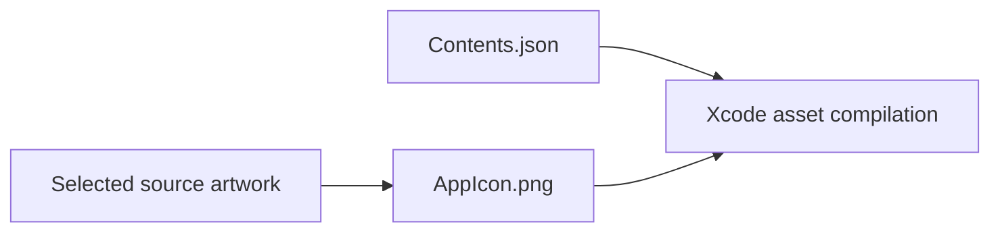

# Universal App Icon

## Summary

One selected 1024×1024 iOS app-icon image.

## Ownership and boundaries

Owns only AppIcon.png and its asset declaration. Icon choice is build-time, without runtime alternate-icon APIs.

## External relationships and data flow

Arrows show build-time asset/metadata movement; runtime acquisition is owned outside this directory.

## Asset declaration

`Contents.json` references `AppIcon.png` with universal idiom, iOS platform and 1024×1024 size. Asset-catalog version is 1. The selected image must remain square and compatible with Xcode app-icon compilation.

AppIcon.png 由选择器从 eyes-wink.png 生成：深色背景、收拢且留有充足左右边距的蓝色睁眼与圆润 `<` 形眨眼。根 README 的 [banner](../../../../output/README.md) 独立使用蓝色眨眼概念稿呈现中央手机，与此构建资源分别维护；更换 AppIcon 不会自动更新 banner。原生桌面效果须构建并安装 App 验收。

Universal icon image and metadata.

## Related design

[Parent design](../README.md)

## 待实现

- Separate dark/tinted appearance entries.
