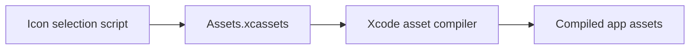

# Application Asset Catalog

## Summary

Xcode asset catalog for the selected app icon.

## Ownership and boundaries

Owns catalog metadata and packaged visual assets, with no runtime logic. Alternate source artwork is preserved in AppIconVariants.

## External relationships and data flow

Arrows show build-time asset/metadata movement; runtime acquisition is owned outside this directory.

## Catalog contract

`Contents.json` uses asset-catalog version 1 and Xcode author metadata. [AppIcon](AppIcon.appiconset/README.md) provides the universal iOS icon. Build-time asset compilation resolves packaging; this directory has no model weights, prompt catalog or dynamic resource loader.

✅ Asset catalog and selected icon.

## Related design

[Parent design](../README.md) · [AppIcon.appiconset](AppIcon.appiconset/README.md)
