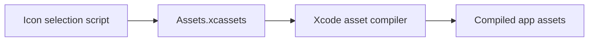

# Application Asset Catalog

## Summary

Xcode asset catalog for the selected app icon.

## Ownership and boundaries

Owns catalog metadata and packaged visual assets, with no runtime logic. Alternate source artwork is preserved in AppIconVariants.

## External relationships and data flow

Arrows show build-time asset/metadata movement; runtime acquisition is owned outside this directory.

## Catalog contract

`Contents.json` uses asset-catalog version 1 and Xcode author metadata. [AppIcon](#app-icon) provides the universal iOS icon. Build-time asset compilation resolves packaging; this directory has no model weights, prompt catalog or dynamic resource loader.

## Related design

[Parent design](../README.md) · [AppIcon.appiconset](#app-icon)

## Universal iOS icon

[`AppIcon.appiconset/`](AppIcon.appiconset/)

[Contents.json](AppIcon.appiconset/Contents.json) declares the universal iOS 1024×1024 [AppIcon.png](AppIcon.appiconset/AppIcon.png). [The icon selection script](../../../scripts/select-app-icon.sh) copies the chosen artwork into the app icon set before asset compilation. The project banner is maintained as a separate asset.
