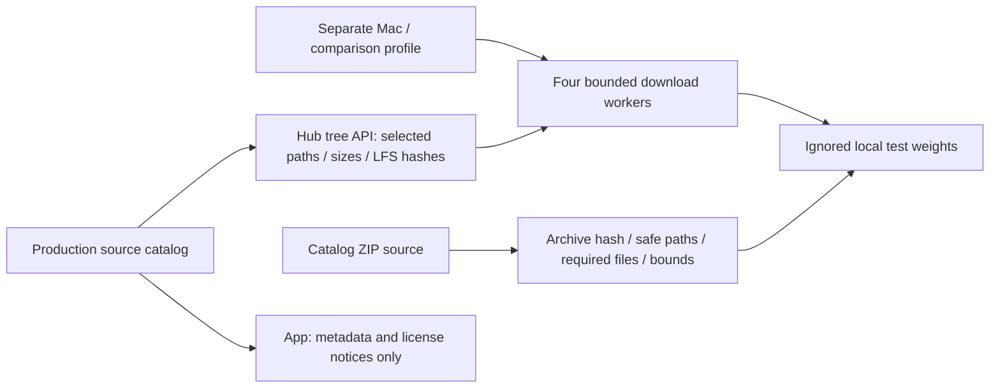

# Local model resources

Purpose: keep the compact production source catalog and the local weights needed by opt-in Mac tests. Design goals: one production declaration per artifact, reproducible test exports and no weights in App resources or Git.

## Configuration ownership

- ✅ `model-catalog.json` schema v2 is the shared production source for App resource acquisition and developer download wrappers. It declares repositories/selection rules or a ZIP source, key required files, license/compatibility and advisory size. Per-file URLs/sizes/hashes are resolved at download time.
- ✅ Only one separate development configuration remains: `qwen3.5-4b.download.json` (opt-in comparison/assessment variant). These do not redefine production resources.
- ✅ Redundant production download JSONs and the inactive Audio8 profile/wrapper are removed. Historical Audio8 validation remains in docs.

| Local directory retained | Mac test use |
| --- | --- |
| Nemotron | Nemotron real streaming/cancellation and Silero comparison |
| Qwen35 | Qwen generation/tokenizer/lifecycle and Agent prompt evaluation |
| Silero | Real VAD streaming/reset tests |
| MossTTSNano | Chinese/English synthesis and lifecycle |
| YOLOPose | Opt-in real pose/lifecycle tests via YOLO_POSE_MODEL_ROOT |

✅ Old unused `Kokoro` CoreAI weights and iPhone-only `Nemotron` h18p weights were removed locally (about 1.6 GiB). Other local model weights are retained for Mac validation. `Qwen35-4B` can be downloaded when requested but is not currently cached. These directories are ignored by Git and are never App build prerequisites.

## Developer acquisition workflow

Use the existing wrappers: `download-qwen35.py` defaults to 2B (`--size 4b` selects its separate test profile); `download-nemotron.py --platform macos` selects the Mac test export (default/ios reads the production catalog). Silero/MOSS/YOLO wrappers read the same production catalog as App. `--endpoint` supports official HF, mirror and custom HTTPS domains; `--force` refreshes reused local files.

✅ Developer downloads use only Python standard library plus existing curl, bounded metadata pages/files, four workers, partial files and atomic replacement. ZIP installation preserves the previous model on failure. Runtime SDK/state/installation belongs to [Management](../../ModelKit/Management/README.md#local-model-resources--current-contract), not these scripts.

❌ Real network/mirror and iPhone acceptance remain pending. Local weights are reproducible test assets; do not commit them, user media, credentials or signing settings.

✅ Unregistered Kokoro comparison provisioning is removed: download JSON, wrapper and local KokoroCoreML weights (about 330 MiB). Its optional adapter/contract tests remain; real-model tests must explicitly supply an external root.

✅ Nemotron macOS and iOS provisioning use one pinned multilingual/2240ms Core ML source (22 files, 664,846,846 bytes). The obsolete nemotron-macos.download.json profile was removed. Existing old-revision installations require explicit deletion and re-download.
