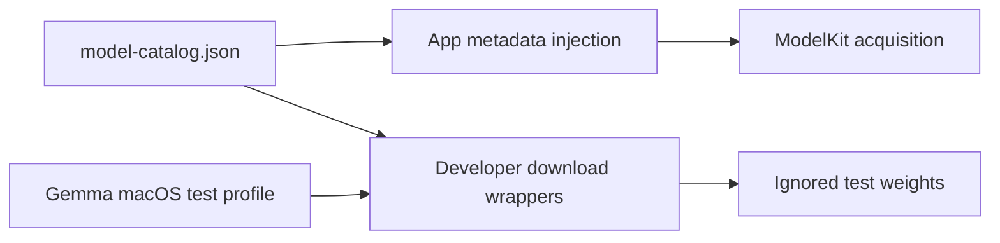

# Model Source Declarations

## Summary

Pinned production catalog and ignored, explicitly provisioned local test artifacts.

## Ownership and boundaries

This directory declares files and compatibility; it performs no inference or active-model selection. Vendor READMEs inside downloaded weights/compiled graphs remain untouched and are covered by this resource boundary.

## External relationships and data flow

Arrows show build-time asset/metadata movement; runtime acquisition is owned outside this directory.

## Catalog and selection

`model-catalog.json` schema v2 defines package IDs, capability, destination directory, compatibility, license, advisory size and source declaration. Hugging Face sources pin repository/revision, path selection and optional prefix stripping; per-file size/LFS hash is resolved at acquisition. ZIP sources supply archive hash and required files. [Management](../../ModelKit/Support/Management/README.md) owns validation, bounded installation, receipts and removal.

| Package / local directory | Use |
| --- | --- |
| `nemotron` / Nemotron | Multilingual 2240 ms streaming ASR, shared pinned iOS/macOS export |
| `silero` / Silero | Optional neural VAD, independent of custom-recognition preference |
| `gemma4-e2b` / Gemma4 | Production h18p CoreAI binding; separate macOS decoder test profile |
| `moss-tts-nano` / MossTTSNano | Optional custom synthesis |
| `yolo26n-pose` / YOLOPose | Explicitly provisioned native pose graph |
| `d3-edge` / D3Edge | Local candidate scoring with pinned CoreAI graph, tokenizer and configuration |
| `d3-lite` / D3Lite | Lite text decision graph, tokenizer and configuration |

Old Qwen receipts are not Gemma installations. Apple ASR/TTS assets are OS-managed. Acquisition does not enable a custom mode. Kokoro adapter tests require an external root; Kokoro has no production catalog binding.

## Developer artifacts

App download wrappers use the production catalog. The uncompiled Mac Gemma decoder profile and its local artifacts belong to [Gemma4Tests](../../../Tests/Gemma4Tests/README.md). `--endpoint` accepts Hugging Face/mirror/custom HTTPS sources; `--force` refreshes reused files. Metadata/file bounds, four workers, partial files and atomic replacement avoid replacing a valid local model with a failed download. ZIP extraction validates safe paths/hash/required files.

Ignored local model directories can hold provisioned assets. Mac Gemma and independent Decision benchmark artifacts live under their owning test directories. Model packages and binary graph subdirectories do not acquire application README contracts. Historical measurements are in [validation history](../../../docs/validation/Validation-History.md).

Production declarations and explicit developer provisioning.

## Related design

[Parent design](../README.md)

Decision 固定 Edge 和 Lite 的发布版本，分别安装到 D3Edge 和 D3Lite。Lite 固定下载 hugging-mac 发布的三输入纯文本图。旧 revision 的安装收据显示为不兼容，可在 Agent Models 删除旧制品后重新下载。目录只随包分发声明与下载信息，不含权重。图、tokenizer、manifest、配置和许可证一并校验安装，下载不切换业务偏好。

模型目录的显示名使用 Gemma 4 E2B、D3 Edge、D3 Lite，不附加 Local Chat 或 Decision 用途后缀；用途由 UI 独立标签呈现。模型 ID、目录、版本与下载校验身份不随显示名变化。

Catalog packages can declare architectureVariants replacing source, requiredFiles and estimatedBytes for an exact native architecture. Default assembly resolves this before acquisition; source declarations remain the default for other architectures and developer download scripts. Only the selected package is downloaded. Revision-specific receipts prevent an old source installation from being mistaken for an AOT package.

D3 Edge/Lite h18p variants pin verified iOS AOT packages under ios/aot-v1/h18p in their existing HF repositories. Prefix stripping installs compiled graphs and companion files at the existing D3Edge/D3Lite roots. requiredFiles enumerates the entire compiled bundle plus tokenizer, configuration, manifest, licenses and build provenance. Other architectures and the independent Mac benchmark profile retain source graphs.
