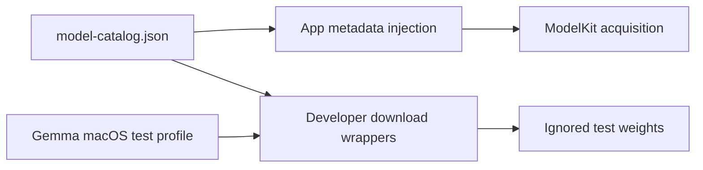

# Model Source Declarations

## Summary

Pinned production catalog and ignored, explicitly provisioned local test artifacts.

## Ownership and boundaries

This directory declares files and compatibility; it performs no inference or active-model selection. Vendor READMEs inside downloaded weights/compiled graphs remain untouched and are covered by this resource boundary.

## External relationships and data flow

Arrows show build-time asset/metadata movement; runtime acquisition is owned outside this directory.

## Catalog and selection

`model-catalog.json` schema v2 defines package IDs, capability, destination directory, compatibility, license, advisory size and source declaration. Hugging Face sources pin repository/revision, path selection and optional prefix stripping; per-file size/LFS hash is resolved at acquisition. ZIP sources supply archive hash and required files. [Management](../../ModelKit/Support/Management/README.md) owns validation, bounded installation, receipts and removal.

| Package / local directory | Use |
| --- | --- |
| `nemotron` / Nemotron | Multilingual 2240 ms streaming ASR, shared pinned iOS/macOS export |
| `silero` / Silero | Optional neural VAD, independent of custom-recognition preference |
| `gemma4-e2b` / Gemma4 | Production h18p CoreAI binding; separate macOS decoder test profile |
| `moss-tts-nano` / MossTTSNano | Optional custom synthesis |
| `yolo26n-pose` / YOLOPose | Explicitly provisioned native pose graph |
| `d3-edge` / D3Edge | Local candidate scoring with pinned CoreAI graph, tokenizer and configuration |

Old Qwen receipts are not Gemma installations. Apple ASR/TTS assets are OS-managed. Acquisition does not enable a custom mode. Kokoro adapter tests require an external root; Kokoro has no production catalog binding.

## Developer artifacts

Existing download wrappers use the production catalog except `gemma4-e2b-macos.download.json`, which selects the matching uncompiled Mac decoder. `--endpoint` accepts Hugging Face/mirror/custom HTTPS sources; `--force` refreshes reused files. Metadata/file bounds, four workers, partial files and atomic replacement avoid replacing a valid local model with a failed download. ZIP extraction validates safe paths/hash/required files.

Ignored Nemotron/Gemma4/Silero/MossTTSNano/YOLOPose directories support opt-in tests, are not build prerequisites and are never committed. Model packages and binary graph subdirectories do not acquire application README contracts. Historical measurements are in [validation history](../../../docs/validation/Validation-History.md).

Production declarations and explicit developer provisioning.

## Related design

[Parent design](../README.md)

Decision 使用固定 revision 的 hugging-mac/d3-edge-CoreAI 制品，安装目录 D3Edge。目录只随包分发声明与下载信息，不含权重。图、tokenizer、manifest、配置和许可证一并校验安装，下载不切换业务偏好。
