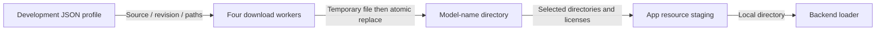

# Local model resources

Purpose: keep development download profiles beside ignored local model files. Design goals: one fixed production model per capability, predictable paths and no duplicate runtime artifact catalog.

| Directory | Use |
| --- | --- |
| Nemotron | Production iOS ASR; native h18p export |
| Nemotron-macos | Optional Mac ASR tests |
| Qwen35 | Production Qwen3.5-2B 4-bit MLX chat |
| Silero | Production Core ML VAD |
| KokoroCoreML | Default Mandarin/English Core ML TTS and diagnostics |
| Qwen35-4B / Audio8 | Download destinations for retained comparison profiles; not bundled |

Required model files live directly inside each directory, preserving backend-required internal structure. Native model containers can contain their own metadata and hashes; these are part of the backend format. Production TTS uses Kokoro Core ML with Mandarin zf_001 and US English af_heart. The kokoro profile installs into KokoroCoreML; the old Kokoro CoreAI directory is not staged.

## Download configuration

Each *.download.json contains source (repository URL), revision (fixed upstream commit), directory and files (relative remote paths). Platform-specific exports use platforms plus defaultPlatform instead of files. Optional fileURLs map individual assets to separately pinned sources (the Kokoro Mandarin BERT vocabulary). Revisions exist only in development configuration, never as runtime directory names or Swift model constants.

Run python3 scripts/download-qwen35.py for 2B; --size 4b downloads the comparison model. Nemotron defaults to iOS; --platform macos downloads Mac test assets. Audio8's profile and downloader remain available, but using it in App requires restoring its adapter and dependencies.

Existing files are reused. Use --force when changing the configured revision or repairing an incomplete/corrupt file. A bounded pool of four workers downloads to temporary .partial files and atomically replaces completed files; failures propagate. Neither downloading nor inference compares per-file checksums. Backend loaders still reject missing or unsupported model data.

- ✅ Flat resource paths, fixed production ASR/chat, development-only download profiles.
- ✅ Audio8 and Qwen4B weights excluded; ONNX is not an App dependency.
- ✅ Privacy declarations and redistribution licenses remain separate from model configuration.
- ❌ In-app downloads, automatic fallback, multiple production variants and automatic cache repair.

Never commit weights, user recordings, credentials or local signing settings. Update this table and staging inputs when changing bundled resources.

✅ Validation: real Mac Qwen2B, Nemotron, Silero and Kokoro loading passed after migration. The signed Debug App contains only the selected resource directories and is about 3.3 GiB uncompressed; physical-device acceptance remains outstanding.

✅ Supported chat download profiles are Qwen3.5-2B and optional 4B. Native CoreAI resources support ASR; Kokoro TTS uses Core ML.

✅ yolo26-pose.download.json pins the official Ultralytics YOLO26n-Pose INT8 archive and extracted file hashes; download with scripts/download-yolo26-pose.py. The model metadata declares AGPL-3.0. ✅ Physical App staging includes these artifacts.

✅ YOLOPose is now included in physical-device model staging for the camera pipeline. Download via scripts/download-yolo26-pose.py before device builds; weights stay ignored.

✅ Current pose asset is official YOLO26n-Pose INT8/end2end. yolo26-pose.download.json pins the ZIP asset and every extracted member by SHA-256. The old Hugging Face YOLOv8 profile and installed package are removed; no weights are committed.
