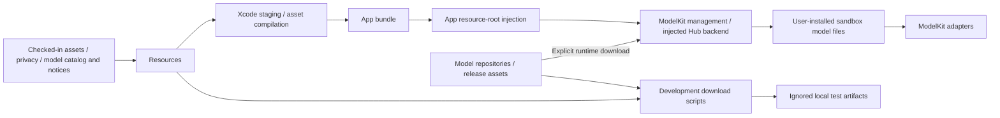
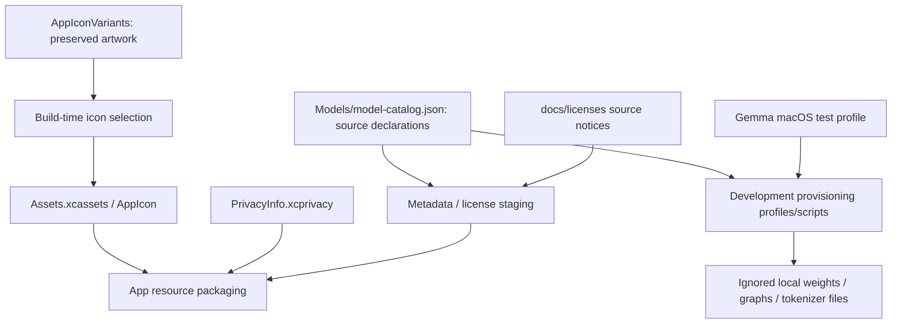

# Resources — Packaged Assets and Model Metadata

Resources stores app assets, privacy declarations and pinned model source/license metadata. It is a packaging directory, not an execution module or business service. Production builds package metadata; installed model weights live in the device sandbox and are not source-controlled or build prerequisites.

Design goals: reproducible packaging, explicit sources/notices and separation of shipped metadata, ignored development artifacts and user-installed files.

## Upstream and downstream

Arrows show metadata/build/download flow, not Swift dependencies. Agent configurations remain owned by Agents and bundled through that target's resources.

## Internal structure

Arrows show the processing of each resource category. Downloads are performed by scripts or runtime services outside this directory.

## Design principles and core mechanisms

**Separate declarations from installations.** A source catalog says what can be acquired; an installation receipt records what was actually installed. Neither proves runtime availability or selects a model. App/ModelKit combines saved preferences, capability validation and real installation state.

| Artifact | Source / destination | Purpose |
| --- | --- | --- |
| Model catalog schema v2 | Checked-in Models → App bundle | Pinned repository/revision/selection or archive source, required files, compatibility and license references |
| License notices / privacy / icons | Checked-in notices/assets → build staging | Reproducible packaging and platform declarations |
| Installed model files / receipts | Explicit runtime download → device sandbox | Actual inference resources and installation evidence; not bundled weights |
| Development model files | Provisioning scripts → ignored local directories | Opt-in tests; separate Mac profiles must not redefine production bindings |
| Agent configuration JSON | Agents → SwiftPM resource bundle | Agent-owned grants and communication contracts; not a Resources prompt registry |

**Validation follows the source contract.** HF file metadata/selection is resolved by the injected Hub SDK; bundled per-file hashes are not invented. YOLO's ZIP uses its explicit archive hash and safe extraction checks. Bounded staging/atomic publication belongs to runtime management/storage or development scripts, not an asset-directory service. Downloading a model does not automatically enable a saved speech mode.

## Ownership and boundaries

- [AppIconVariants](AppIconVariants/README.md) preserves original/robot-camera artwork; `scripts/select-app-icon.sh` selects the next build's icon.
- `Assets.xcassets/` owns asset-catalog metadata and the shared app icon. `PrivacyInfo.xcprivacy` supplies platform privacy declarations.
- [Models](Models/README.md) owns schema-v2 source/selection metadata, license references and development provisioning profiles. Source notices come from [docs/licenses](../../docs/licenses/README.md) and are staged into the bundle by the build script. HF resolution uses remote SDK metadata; YOLO has its explicit archive hash/source. Gemma's macOS test profile is separate from production.
- App supplies resource roots; ModelKitDefaults owns provider bindings, Management owns installation/removal and adapters own model loading. Resources chooses no active model or inference policy.
- Agent JSON configurations belong in Agents and are packaged by SwiftPM. Credentials, local signing settings, weights and user media must not be committed.

## Implementation status

✅ Metadata-only production staging, privacy/icon assets, pinned source declarations/notices and shared development provisioning. In-app downloads use sandbox storage; HF native background-session restoration is implemented outside Resources.

❌ Dedicated prompt collection and separate icon appearance variants remain unimplemented. Physical background/server-resume acceptance is separate from packaged metadata and synthetic tests.

See [ModelKit](../ModelKit/README.md) for current providers and [Management](../ModelKit/Management/README.md#local-model-resources--current-contract) for resource lifetimes. This directory makes no fixed TTS/ASR default claim: installed availability and saved preferences are resolved by the model assembly.
