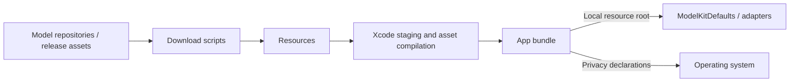
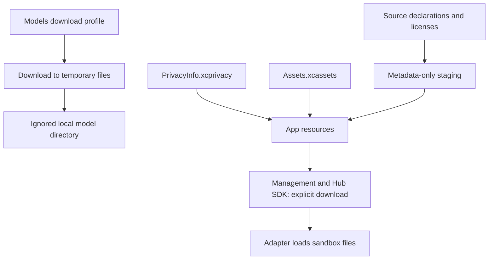

# Resources — App Assets and Local Models

Stores privacy declarations, visual assets and development download profiles. The goal is reproducible local packaging without committing weights, user media, credentials or signing settings. This directory is resource storage, not a Swift runtime module.

## Directory structure

```text
Resources/
├── PrivacyInfo.xcprivacy       # App privacy declarations
├── AppIconVariants/           # Original and robot-camera artwork for build-time selection
├── Assets.xcassets/
│   ├── Contents.json          # Asset catalog metadata
│   └── AppIcon.appiconset/     # Shared app icon and metadata
├── Models/
│   ├── *.download.json        # Pinned development download profiles
│   └── <model directory>/     # Ignored local weights, created by download scripts
└── README.md                  # Packaging boundary
```

## Upstream and downstream

Arrows show download, packaging and resource loading.



## Internal flow



The local configuration uses Nemotron ASR, Qwen3.5-2B chat, Silero VAD and YOLO26n-Pose; explicit cloud configuration selects the OpenAI-compatible chat provider. MOSS-TTS-Nano is default and diagnostic TTS (beta); Kokoro and Apple are not selected.  Qwen3.5-4B retains a comparison profile; Audio8 and Kokoro provisioning are removed. Production developer wrappers share model-catalog.json, including the same Nemotron multilingual/2240ms Core ML export for Mac and iOS.

Download scripts own bounded workers, temporary files and failures; [Models](Models/README.md) documents that workflow. YOLO reads its archive source/hash from the shared catalog; HF wrappers resolve selected remote metadata. Separate test profiles retain their own explicit sources. App/build settings choose packaged resources; ModelKit owns loading and execution.

## Packaged scope

- ✅ Privacy manifest, shared 1024 × 1024 app icon and model source metadata.
- ✅ Original and robot-camera icons are preserved in [AppIconVariants](AppIconVariants/README.md); `scripts/select-app-icon.sh` selects the icon for the next build.
- ✅ Model metadata/license staging; weights remain ignored by Git.
- ✅ In-app model downloads; ❌ automatic cache repair and separate icon appearance variants.
- ❌ Dedicated Prompts collection; current Agent configuration is bundled from Agents.

## Local model resources — current contract

✅ Device/simulator staging includes only model-catalog.json schema-v2 source declarations and license notices. HF repositories/selection rules replace per-file links/hashes; weights/config/tokenizers/graphs/voice assets are installed in the sandbox via Management and ModelKitHub. Production developer wrappers share this catalog; only Qwen4B uses a separate test profile. Local weights are not build prerequisites.

❌ Full iPhone/network acceptance and HF durable background/partial resume remain pending. See [Management](../ModelKit/Management/README.md#local-model-resources--current-contract).
