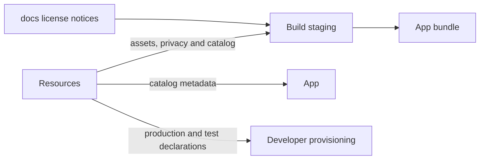
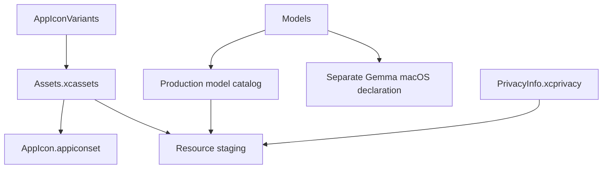
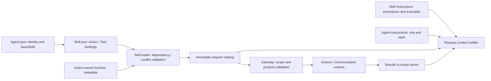

# Resources — Assets and Model Metadata

## Summary

Metadata-only production resources, privacy declarations, app icons and reproducible model source catalogs.

## Ownership and boundaries

Packaging module with no Swift implementation. App/build tools consume metadata; ModelKit owns runtime acquisition/loading. Downloaded weights, vendor-package contents and user media are excluded from source-controlled design docs.

## External relationships and data flow

Arrows show build-time asset/metadata movement; runtime acquisition is owned outside this directory.

## Internal structure

## Packaging contract

The bundle contains source declarations/license notices, not model weights. Catalog declarations identify acquirable artifacts; installed receipts record actual sandbox installation. Neither proves capability readiness or selects an active provider. App injects paths; ModelKit Defaults combines installation state, compatibility and preferences.

✅ Pure Agent/Skill assets live here as Agents/, Skills/ and Catalog.json. Agents owns their schema and runtime policy; Resources owns source asset organization. The Agents package target compiles only Agents sources and copy these explicit resources without adding a new module. Runtime lookup must locate Catalog.json with Bundle APIs rather than append Resources to resourceURL. Build staging uses [license notices](../../docs/licenses/README.md). `PrivacyInfo.xcprivacy` and the asset catalog supply platform declarations. Original icon artwork is retained separately from the selected build icon.

✅ Pinned schema-v2 catalog, metadata/notices staging, privacy declaration and app-icon artwork.

❌ Separate icon appearance variants.

Runtime/server/device acceptance belongs in [validation history](../../docs/Validation-History.md).

✅ Agents packages Agents/, Skills/ and Catalog.json from this shared source root; Models and app assets remain independently packaged. AgentCore separately packages its generic Function Token prompt resource. The final app resource verifier checks exact source bytes and missing/stale files for both bundles.

## Related design

[Parent design](../README.md) · [AppIconVariants](AppIconVariants/README.md) · [Assets.xcassets](Assets.xcassets/README.md) · [Models](Models/README.md)

## Agent and Skill resource contracts

## 职责与组织

✅ 纯随 App 打包的配置与文本，由 Catalog.json 显式索引。Agents 保存 v7 身份、角色指令、通信契约、baseSkills、backgroundTasks 支持声明；Skills 保存 v1 配置、revision、流程说明和函数引用。固定模式资源已删除。

这里不包含 Swift、脚本、函数实现、凭据或用户媒体。Actions 独立提供实现，FunctionContracts 提供中立元数据。没有第二套生效的旧版 Agent.json/Prompts.json。

## 加载与验证

AgentConfigurations 限定相对路径、单资源 64 KiB、catalog 32 Agents/64 Skills。Skill 依赖最多 8 层、同时加载最多 16；同函数重复且绑定相同可合并，未知函数、冲突、重复别名、Action/Tool 重叠整体拒绝。参数与文档不能由 Skill 重写。每个请求保存当时目录，不使用当前配置解释历史请求。

## 生命周期

Agent 配置声明基础交互与机械臂 Skill，任务和交互链按需要加载辅助 Skill；只有一个前台任务，不支持挂起恢复。等待用户保留任务；结束经过执行屏障后回默认。重启中断，不重放。❌ 远程下载、热更新与任务栈不在首版范围内。

## 泛化 Task 与独立 Skill

✅ No fixed task-modes resources remain. Agent resources declare baseSkills and backgroundTasks; production backgroundTasks are empty until an executor implements and declares a business contract. Skill assets retain reusable instruction/function bindings. Task goals are runtime data, never bundled mode definitions.

✅ Source organization audit (2026-10-11): Rename existing Agent/Skill resource trees to Agents/Skills with UpperCamelCase role/Skill directories; Catalog.json, Agent.json, Skill.json, Prompts.json, TitlePrompts.json and runtime Instructions.md. IDs remain unchanged. No executable Skill code.

✅ 资源叶目录说明收拢到 [Agents](Agents/README.md) 与 [Skills](Skills/README.md)，不再为每个 Agent/Skill 放置开发 README；Skill 注册与运行时教学保留在各自目录。

## Skill 函数目录：取消资源权限上限

✅ 已删除 Permissions.json 和 Agent.json 的 permissions 字段。Agent.json 不声明函数；基础和动态模型函数完全由已加载 Skill 组合，不再与 Agent 权限上限求交。保留 canonical 元数据、重复/冲突、容量、通信授权、真实执行身份和任务范围校验。Gateway 对有轮次快照的调用使用该快照，对无模型轮次的固定调用使用 Agent 固定目录。App 对所有 Skill 目录检查真实实现覆盖，不把全局 Skill 合并成权限白名单。后台 Skill 校验仍要求目标业务契约支持，但不再校验 Permissions。历史快照不重写。

✅ ADR0213: RobotInteraction instructions teach Channel/wait ordering and explicit resource conflicts; the arm writer group remains authoritative.

## Agent → Skill → Function registration

✅ Implemented: Agent.json references baseSkills; Skill.json alone registers model Actions/Tools. BasicSkill owns task orchestration and environment reading; ExpressionInteraction owns expression Actions. Role instructions retain identity/responsibility/style. Business roles reuse existing Skills; internal trusted bindings remain separate. Historical snapshots are preserved.

✅ Implemented (2026-10-13 Skill scope review): canonical Actions unify trusted business calls and model calls; Skill exposure is optional and must serve an actual procedure. ExpressionInteraction retains two expression functions; Feedback/Notice/Light model exposure is removed while implementations and business bindings remain. ApplicationControl keeps navigation/status/resource/Bluetooth operations, removing duplicate robot functions; RobotInteraction owns them. BasicSkill removes unused send while production background contracts are absent. Affected instructions/revisions and explicit communication-only test catalogs are aligned; all six Skills were audited for prerequisites, result handling and cross-Skill references.
