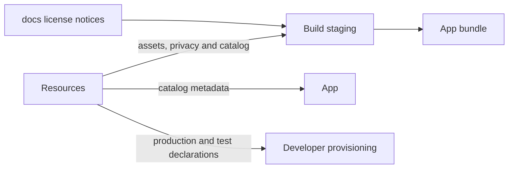
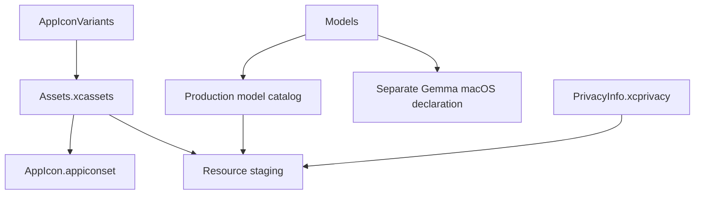
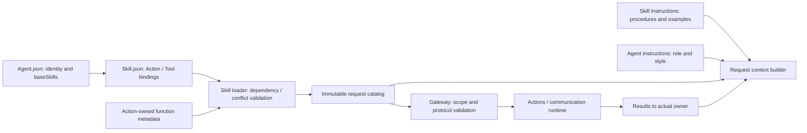

# Resources — Assets and Model Metadata

## Summary

Metadata-only production resources, privacy declarations, app icons and reproducible model source catalogs.

## Ownership and boundaries

Packaging module with no Swift implementation. App/build tools consume metadata; ModelKit owns runtime acquisition/loading. Downloaded weights, vendor-package contents and user media are excluded from source-controlled design docs.

## External relationships and data flow

Arrows show build-time asset/metadata movement; runtime acquisition is owned outside this directory.

## Internal structure

## Packaging contract

The bundle contains source declarations/license notices, not model weights. Catalog declarations identify acquirable artifacts; installed receipts record actual sandbox installation. Neither proves capability readiness or selects an active provider. App injects paths; ModelKit Defaults combines installation state, compatibility and preferences.

Pure Agent/Skill assets live here as Agents/, Skills/ and Catalog.json. Agents owns their schema and runtime policy; Resources owns source asset organization. The Agents package target compiles only Agents sources and copy these explicit resources without adding a new module. Runtime lookup must locate Catalog.json with Bundle APIs rather than append Resources to resourceURL. Build staging uses [license notices](../../docs/licenses/README.md). `PrivacyInfo.xcprivacy` and the asset catalog supply platform declarations. Original icon artwork is retained separately from the selected build icon.

Pinned schema-v2 catalog, metadata/notices staging, privacy declaration and app-icon artwork.

Runtime/server/device acceptance belongs in [validation history](../../docs/validation/Validation-History.md).

Agents packages Agents/, Skills/ and Catalog.json, including the [Assistant input protocol, shared output protocol and Action catalog templates](Agents/README.md#提示词与模板字段). Models and app assets are independently packaged. The final app resource verifier checks exact source bytes and missing or stale resources in the Agents bundle.

## Related design

[Parent design](../README.md) · [AppIconVariants](AppIconVariants/README.md) · [Assets.xcassets](Assets.xcassets/README.md) · [Models](Models/README.md)

## 职责与组织

随 App 打包的 Agent 与 Skill 配置由 Catalog.json 显式索引。Agents 保存 v10 身份、静态类别、角色自有公开 description、私有角色指令、通信契约和 baseSkills。共享协议由 Agents 按固定资源路径读取。Skills 保存 v3 配置、revision、可选的角色归属、流程说明和函数引用。Task 目标作为运行时数据。

Actions 独立提供函数实现，FunctionContracts 提供中立元数据。Catalog 是 Agent 与 Skill 定义的唯一索引。

## 加载与验证

AgentConfigurations 限定相对路径、单资源 64 KiB、catalog 32 Agents/64 Skills。Skill 依赖最多 8 层、同时加载最多 16；同函数重复且绑定相同可合并，未知函数、冲突、重复别名、Action/Tool 重叠整体拒绝。参数与文档不能由 Skill 重写。每个请求保存当时目录，不使用当前配置解释历史请求。

## 生命周期

Assistant 配置声明基础交互 Skill，前台任务和交互链按需要加载共享 Skill。等待用户保留任务，任务结束后经过执行屏障回收其持有的 Skill。Writer 从作品库基础 Skill 起步，按已绑定的编辑域激活文件编辑 Skill。两种工作流的生命周期分别由所属 Agent 管理。

## 泛化 Task 与独立 Skill

Agent resources declare baseSkills and communication permissions. Skill assets retain reusable instruction/function bindings. Delegation sends the runtime goal and original input to the receiving role.

资源叶目录说明收拢到 [Agents](Agents/README.md) 与 [Skills](Skills/README.md)，不再为每个 Agent/Skill 放置开发 README；Skill 注册与运行时教学保留在各自目录。

## Skill 函数目录

Agent.json 声明基础 Skill。模型函数由已加载 Skill 组合，校验 canonical 元数据、重复/冲突、容量、通信授权、真实执行身份和 Task 范围。Gateway 使用调用所属轮次快照；固定调用使用 Agent 固定目录。Agents 检查所有 Skill 目录的真实实现覆盖。后台委派由接收角色使用自己的工具和上下文处理。历史目录快照不可变。

RobotInteraction instructions teach Channel/wait ordering and explicit resource conflicts; the arm writer group remains authoritative.

## Agent → Skill → Function registration

Agent.json references baseSkills; Skill.json alone registers model Actions/Tools. BasicSkill owns Task/Skill orchestration and automatic State selection; ExpressionInteraction owns expression Actions. Role instructions retain identity/responsibility/style. Business roles reuse existing Skills; internal trusted bindings remain separate. Historical snapshots are preserved.

Actions 为可信业务调用和模型调用提供统一实现与元数据。Skill 仅暴露实际流程需要的函数：ExpressionInteraction 提供表情，ApplicationControl 提供导航/状态/资源/Bluetooth，RobotInteraction 提供机械臂操作。BasicSkill 提供 Task/Skill 控制与自动 State 选择。具体清单和当前教学契约见 [Skills](Skills/README.md)。

## 待实现

- Separate icon appearance variants.

- 远程下载、热更新与任务栈不在首版范围内。

## 公开 State 边界

✅ Skill 资源采用 schema v3/useActions/useStates/useInstructions；教学使用 CURRENT STATE 公开事实，不依赖 activeTaskID、Skill 持有关系等私有字段。资源打包仍保留原目录和历史证据。

[容器上下文契约](../Agents/Support/Context/README.md)

✅ 精简 BasicSkill/Photography 和交叉规则，递增变更 Skill revision；保留别名、能力、错误与业务完成契约，Robot 常驻列表不变。

✅ 依据真实 Qwen 调用回归重写 Core/Skill 教学边界。内置 Skill 所有函数使用 Function Token XML Actions，包括 Query Channel 的只读查询；通用原生 Tool 基础能力保留。明确设备阻断、照片终态、先执行后确认以及跨请求控制边界，递增变更 Skill revision。Skill 声明与执行协议投影保持一致，业务实现与底层原生传输能力独立。

真实云回归使用固定合成场景，修订收益、回退和未解决的原生协议错误见[提示词优化验证](../../docs/validation/Qwen-Prompt-Optimization.md)；不等于真机执行验收。

✅ Implemented: bundled Skill registrations become Action-only; ApplicationControl/HistoryQuery revisions and BasicSkill instructions change together. Native Tool base schemas and Agent internal grants remain intact.

Assistant 的技术诊断输入声明属于 Agents 资源契约；container.failure 是被动框架 observation，不新增模型函数或 Skill 暴露。

## ApplicationControl 异常展示

✅ ApplicationControl 配置声明 container.failure/runtime.failure 的 runtime 来源订阅；Assistant 保留被动容器诊断。内部呈现函数由代码授权，不加入模型 Skill 或改变资源 schema 版本。

BasicSkill selects eight passive native platform.* State sources alongside UI navigation. Source schemas and native lifetime remain owned by [PlatformKit](../PlatformKit/README.md#native-state-port); [Skill declarations](Skills/README.md#basic-native-state-selection) select reads without starting hardware or granting execution authority.

Assistant 身份只介绍自身。BasicSkill 说明如何区分自己的前台任务和发给其他 Agent 的后台消息。各 Agent.json.description 维护各自用途，加载器按实际路由与实例通信权限生成公开目录。作品查找、打开与创作由 Writer 原生工具拥有。详见 [Skill 契约](Skills/README.md) 与 [角色配置](Agents/README.md)。

## 提示词目录归属

Agents/Shared 保存 cognition Agent 共享协议与目录模板；Agents/<Role> 保存角色身份和按业务拆分的请求模板。完整固定指令用 Markdown，动态插值与具名短模板用 JSON；未细分业务的模板名为 Prompts.json。perception 角色不配置提示词。

本次提示词资源只供 cognition Agent 使用；Shared 是这些 Agent 的共享目录。Actions 的描述、返回值、异常及编辑上下文继续在代码内管理，ModelKit 的适配和预热文本也由内部管理，两者均不依赖提示词资源。现有 Models 下载声明等非提示词资源保持独立职责。资源代码负责读取、校验与排版，权限、排序、选择和执行逻辑留在原模块。
