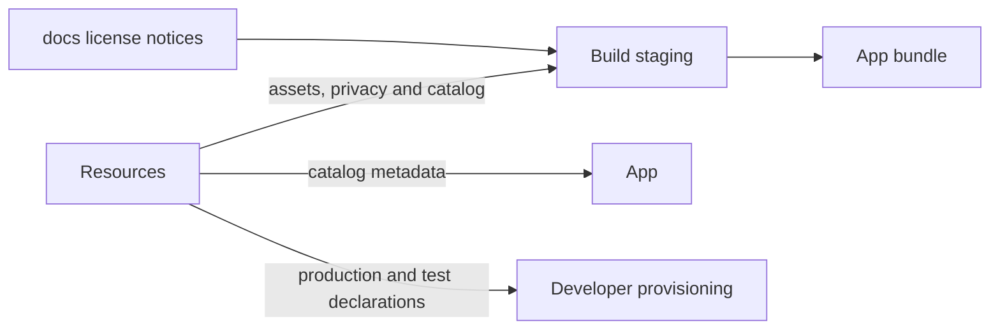
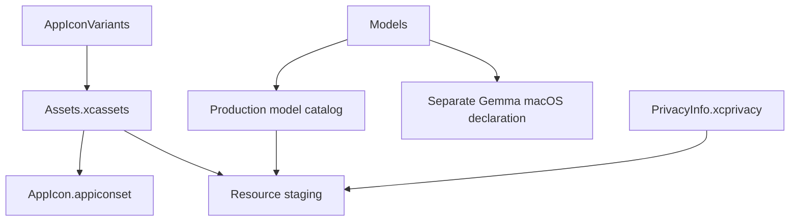

# Resources — Assets and Model Metadata

## Summary

Metadata-only production resources, privacy declarations, app icons and reproducible model source catalogs.

## Ownership and boundaries

Packaging module with no Swift implementation. App/build tools consume metadata; ModelKit owns runtime acquisition/loading. Downloaded weights, vendor-package contents and user media are excluded from source-controlled design docs.

## External relationships and data flow

Arrows show build-time asset/metadata movement; runtime acquisition is owned outside this directory.

## Internal structure

## Packaging contract

The bundle contains source declarations/license notices, not model weights. Catalog declarations identify acquirable artifacts; installed receipts record actual sandbox installation. Neither proves capability readiness or selects an active provider. App injects paths; ModelKit Defaults combines installation state, compatibility and preferences.

Agent JSON resources belong to Agents, not Resources. Build staging uses [license notices](../../docs/licenses/README.md). `PrivacyInfo.xcprivacy` and the asset catalog supply platform declarations. Original icon artwork is retained separately from the selected build icon.

✅ Pinned schema-v2 catalog, metadata/notices staging, privacy declaration and app-icon artwork.

❌ Separate icon appearance variants.

Runtime/server/device acceptance belongs in [validation history](../../docs/Validation-History.md).

Packaging: Agents packages four role prompt JSON files alongside the seven Agent declarations. AgentCore separately packages its generic Function Token prompt resource. The final app resource verifier checks exact source bytes and missing/stale files for both bundles.

## Related design

[Parent design](../README.md) · [AppIconVariants](AppIconVariants/README.md) · [Assets.xcassets](Assets.xcassets/README.md) · [Models](Models/README.md)
