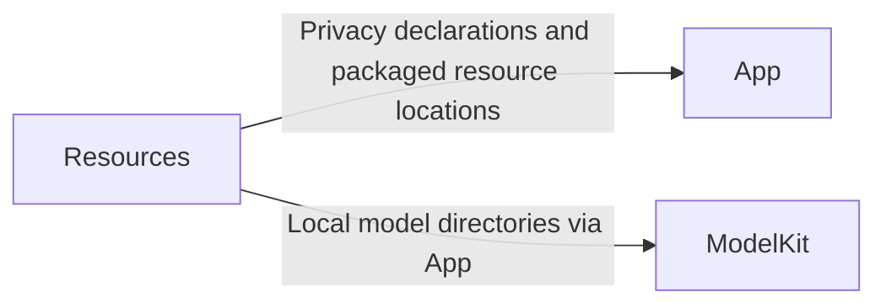

# Resources — Packaged Assets and Model Download Profiles

Resources stores non-executable application resources and declarations. Architecture section 37 reserves model, prompt, and asset areas; directories are created only when they have actual content.

## Direct relationships

These are build-time packaging and load-time resource relationships, not message-processing stages.

## Implementation status

- ✅ [Models](Models/README.md): development-only download profiles and flat model directories.
- ✅ `PrivacyInfo.xcprivacy`: application privacy declarations for relevant system APIs and data practices.
- ✅ Local artifact download and platform selection workflows; weights are excluded from version control.
- ✅ `Assets.xcassets/AppIcon.appiconset`: 1024 × 1024 full-bleed app icon shared by device and simulator app targets. iOS supplies the corner mask.
- ❌ Dedicated `Prompts/` collection and separately art-directed icon appearance variants.

App and build configuration select and package resources. ModelKit and its adapters validate and load model artifacts and perform inference. Resources does not own model lifecycle, execution, or business logic. Never commit model weights, user media, credentials, or local signing configuration.

## Maintenance

Keep this README synchronized with changes to responsibilities, files, interfaces, and implementation status. ✅ means implemented; ❌ means planned or incomplete. Do not create unused placeholder modules. The [technical architecture](../README.md) defines the target; the [layout audit](../../docs/Repository-Structure.md) records implementation exceptions.
