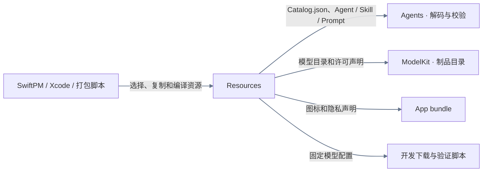
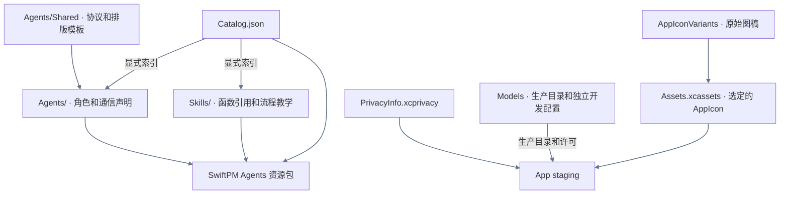
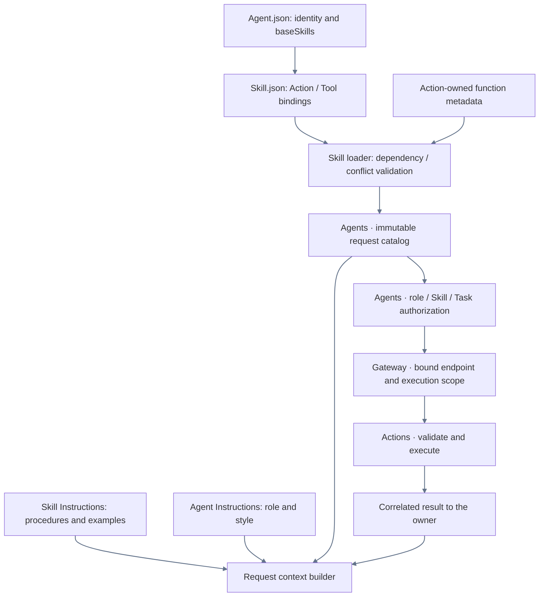

# Resources — Assets and Model Metadata

## 职责与边界

Resources 管理随包分发的 Agent 与 Skill 声明、模型制品元数据、应用图标和隐私清单。Agents 定义声明的 schema、加载、目录投影和授权。ModelKit 负责制品获取、校验、安装及模型选择。App 注入资源根与宿主能力。

## 上下游链路

## 内部资源流

## Packaging contract

Agent prompt translations use `.zh-Hans` siblings in the existing role and Skill directories. Unsuffixed prompt resources are English and provide runtime fallback. The packaged-resource check compares both versions’ template keys and interpolation variables. Role and Skill descriptions and localizable function prose are projected by stable identifiers while their declarations remain canonical.

The bundle contains source declarations/license notices, not model weights. Catalog declarations identify acquirable artifacts; installed receipts record actual sandbox installation. Neither proves capability readiness or selects an active provider. App injects paths; ModelKit Defaults combines installation state, compatibility and preferences.

Pure Agent/Skill assets live here as Agents/, Skills/ and Catalog.json. Agents owns their schema and runtime policy; Resources owns source asset organization. The Agents package target compiles Agents sources and copies these explicit resources. Runtime lookup must locate Catalog.json with Bundle APIs rather than append Resources to resourceURL. Build staging uses [license notices](../../docs/licenses/README.md). `PrivacyInfo.xcprivacy` and the asset catalog supply platform declarations. Original icon artwork is retained separately from the selected build icon.

Runtime/server/device acceptance belongs in [validation history](../../docs/validation/Validation-History.md).

Agents packages Agents/, Skills/ and Catalog.json, including the [Assistant input protocol, shared output protocol and Action catalog templates](Agents/README.md#提示词与模板字段). Models and app assets are independently packaged. The final app resource verifier checks exact source bytes and missing or stale resources in the Agents bundle.

## Related design

[Parent design](../README.md) · [AppIconVariants](AppIconVariants/README.md) · [Assets.xcassets](Assets.xcassets/README.md) · [Models](Models/README.md)

## 职责与组织

随 App 打包的 Agent 与 Skill 配置由 Catalog.json 显式索引。Agents 保存 v10 身份、静态类别、角色自有公开 description、私有角色指令、通信契约和 baseSkills。共享协议由 Agents 按固定资源路径读取。Skills 保存 v3 配置、revision、可选的角色归属、流程说明和函数引用。Task 目标作为运行时数据。

Actions 独立提供函数实现，FunctionContracts 提供中立元数据。Catalog 是 Agent 与 Skill 定义的唯一索引。

## 加载与验证

AgentConfigurations 限定相对路径、单资源 64 KiB、catalog 32 Agents/64 Skills。Skill 依赖最多 8 层、同时加载最多 16；同函数重复且绑定相同可合并，未知函数、冲突、重复别名、Action/Tool 重叠整体拒绝。参数与文档不能由 Skill 重写。每个请求保存当时目录，不使用当前配置解释历史请求。

## 生命周期

Assistant 配置声明基础交互 Skill，前台任务和交互链按需要加载共享 Skill。等待用户保留任务，任务结束后经过执行屏障回收其持有的 Skill。Writer 从作品库基础 Skill 起步，按已绑定的编辑域激活文件编辑 Skill。两种工作流的生命周期分别由所属 Agent 管理。

## 泛化 Task 与独立 Skill

Agent resources declare baseSkills and communication permissions. Skill assets retain reusable instruction/function bindings. Delegation sends the runtime goal and original input to the receiving role.

资源叶目录说明收拢到 [Agents](Agents/README.md) 与 [Skills](Skills/README.md)，不再为每个 Agent/Skill 放置开发 README；Skill 注册与运行时教学保留在各自目录。

## Skill 函数目录

Agent.json 声明基础 Skill。模型函数由已加载 Skill 组合，校验 canonical 元数据、重复/冲突、容量、通信授权、真实执行身份和 Task 范围。Gateway 使用调用所属轮次快照；固定调用使用 Agent 固定目录。Agents 检查所有 Skill 目录的真实实现覆盖。后台委派由接收角色使用自己的工具和上下文处理。历史目录快照不可变。

RobotInteraction instructions teach Channel/wait ordering and explicit resource conflicts; the arm writer group remains authoritative.

## Agent → Skill → Function registration

Agent.json references baseSkills; Skill.json alone registers model Actions/Tools. BasicSkill owns Task/Skill orchestration and automatic State selection; ExpressionInteraction owns expression Actions. Role instructions retain identity/responsibility/style. Business roles reuse existing Skills; internal trusted bindings remain separate. Historical snapshots are preserved.

Actions 为可信业务调用和模型调用提供统一实现与元数据。Skill 仅暴露实际流程需要的函数：ExpressionInteraction 提供表情，ApplicationControl 提供导航/状态/资源/Bluetooth，RobotInteraction 提供机械臂操作。BasicSkill 提供 Task/Skill 控制与自动 State 选择。具体清单和当前教学契约见 [Skills](Skills/README.md)。

## 公开 State 边界

Skill schema v3 通过 useActions、useStates 和 useInstructions 声明函数、公开事实路径和教学来源。Agents 在每轮投影 CURRENT STATE。共享 Skill 使用 XML Action，公开查询使用 Query Channel。Writer 私有 Skill 提供原生 Tool，运行时内部调用另有固定授权。详见 [容器上下文契约](../Agents/Support/Context/README.md) 与 [Skill 配置](Skills/README.md)。

## ApplicationControl 异常展示

ApplicationControl 配置声明 container.failure/runtime.failure 的 runtime 来源订阅；Assistant 保留被动容器诊断。内部呈现函数由代码授权，不加入模型 Skill 或改变资源 schema 版本。

BasicSkill selects eight passive native platform.* State sources alongside UI navigation. Source schemas and native lifetime remain owned by [PlatformKit](../PlatformKit/README.md#native-state-port); [Skill declarations](Skills/README.md#basic-native-state-selection) select reads without starting hardware or granting execution authority.

Assistant 身份只介绍自身。BasicSkill 说明如何区分自己的前台任务和发给其他 Agent 的后台消息。各 Agent.json.description 维护各自用途，加载器按实际路由与实例通信权限生成公开目录。作品查找、打开与创作由 Writer 原生工具拥有。详见 [Skill 契约](Skills/README.md) 与 [角色配置](Agents/README.md)。

## 提示词目录归属

Agents/Shared 保存 cognition Agent 共享协议与目录模板；Agents/<Role> 保存角色身份和按业务拆分的请求模板。完整固定指令用 Markdown，动态插值与具名短模板用 JSON；未细分业务的模板名为 Prompts.json。perception 角色不配置提示词。

[共享模板](Agents/README.md#shared-prompt-templates) 由 Agents 按需读取、校验和排版。Actions 的函数描述及 ModelKit 的推理适配由各自代码拥有。
