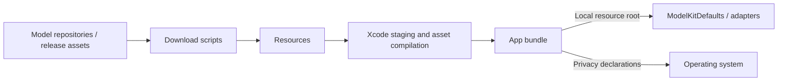
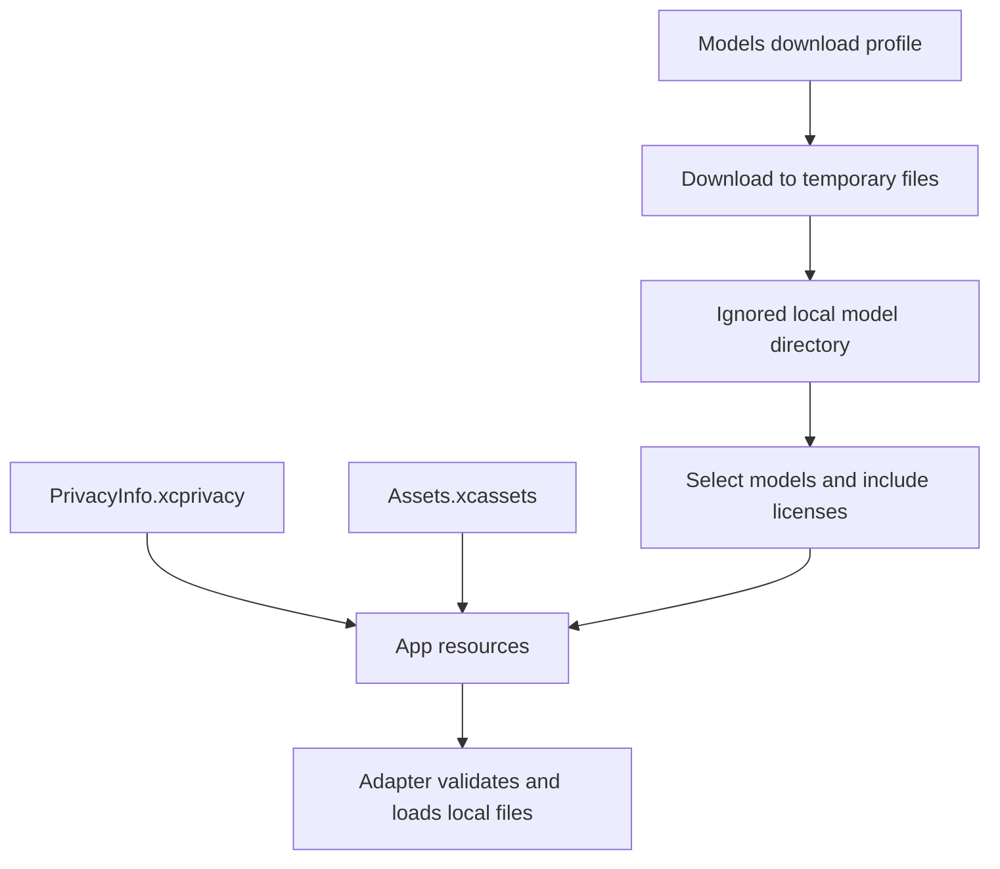

# Resources — App Assets and Local Models

Stores privacy declarations, visual assets and development download profiles. The goal is reproducible local packaging without committing weights, user media, credentials or signing settings. This directory is resource storage, not a Swift runtime module.

## Directory structure

```text
Resources/
├── PrivacyInfo.xcprivacy       # App privacy declarations
├── AppIconVariants/           # Original and robot-camera artwork for build-time selection
├── Assets.xcassets/
│   ├── Contents.json          # Asset catalog metadata
│   └── AppIcon.appiconset/     # Shared app icon and metadata
├── Models/
│   ├── *.download.json        # Pinned development download profiles
│   └── <model directory>/     # Ignored local weights, created by download scripts
└── README.md                  # Packaging boundary and status
```

## Upstream and downstream

Arrows show download, packaging and resource loading.



## Internal flow



Production uses Nemotron ASR, Qwen3.5-2B chat, Silero VAD and YOLO26n-Pose. System TTS uses Apple voices. Kokoro is diagnostic TTS; Audio8 and Qwen3.5-4B profiles are retained for comparison, not normal App inference. Profiles are development inputs, not runtime manifests.

Download scripts own bounded workers, temporary files and failures; [Models](Models/README.md) documents that workflow. YOLO's profile pins archive/member hashes. Other profiles pin revisions without universal per-file checksum verification. App/build settings choose packaged resources; ModelKit owns loading and execution.

## Feature status

- ✅ Privacy manifest, shared 1024 × 1024 app icon and model download profiles.
- ✅ Original and robot-camera icons are preserved in [AppIconVariants](AppIconVariants/README.md); `scripts/select-app-icon.sh` selects the icon for the next build.
- ✅ Local model staging with licenses; weights remain ignored by Git.
- ❌ In-app model downloads, automatic cache repair and separate icon appearance variants.
- ❌ Dedicated Prompts collection; current Agent configuration is bundled from Agents.

## Issue record

| Status | Issue / next step |
| --- | --- |
| Open | Confirm package size, startup and model behavior on physical devices; local files alone do not prove readiness. |
