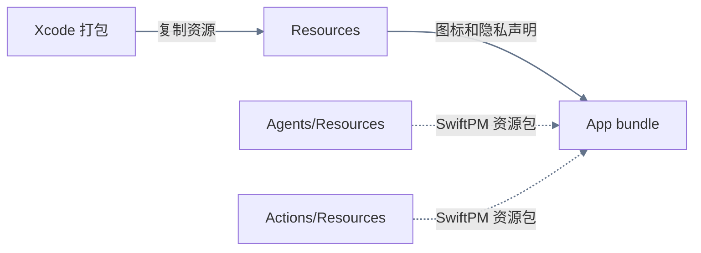
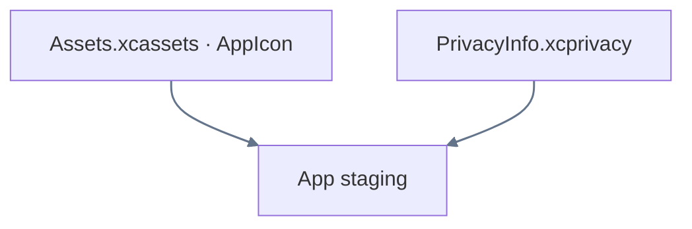

# Resources — Application Assets

[开发规范](AGENTS.md)

## 职责与边界

Resources 只保存 App 层随包资源：应用图标资产目录和隐私清单。模块资源跟随所属 SwiftPM target：[Agents/Resources](../Agents/Resources/README.md) 保存 Agent、Skill 与 Catalog 声明，[Actions/Resources](../Actions/Resources/README.md) 保存 Action 翻译。ModelKit 自带制品声明并负责获取、校验和安装；业务层负责模型选择。

## 上下游链路

## 内部资源流

## Packaging contract

Module resources are copied by their own SwiftPM targets and read through `Bundle.module`; App does not inject resource roots. The bundle contains source declarations and license notices, not model weights. Build staging uses [license notices](../../docs/licenses/README.md). `PrivacyInfo.xcprivacy` and the asset catalog supply platform declarations. Original icon artwork is retained separately from the selected build icon. The final app resource verifier checks exact source bytes and missing or stale resources in the Agents and Actions bundles.

Runtime/server/device acceptance belongs in [validation history](../../docs/validation/Validation-History.md).

## Related design

[Parent design](../README.md) · [Assets.xcassets](Assets.xcassets/README.md) · [Models](../ModelKit/Support/Config/README.md)
