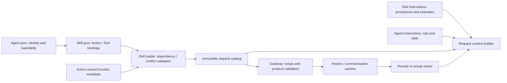
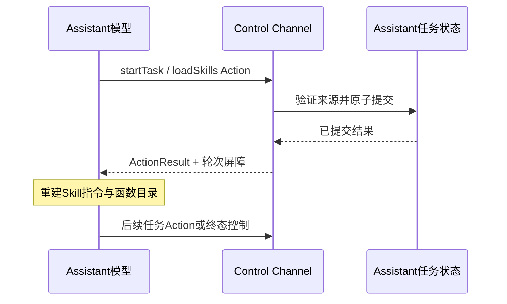

# Skill 配置与撰写规范

## 职责与边界

✅ 每个 Skill 目录是完整的运行时加载单元：`Skill.json` 注册可用函数及依赖，`Instructions.md` 教学业务流程、规则和注意事项。本层集中维护开发规范，Skill 子目录不放 README。

Skill 是可复用的流程与能力集合，Task 是运行时目标、状态和上下文的拥有者。一个 Task 可组合多个 Skill，同一 Skill 可服务不同目标。Skill 不包含 Swift、可执行脚本、Action 实现、凭据或用户数据；[Actions](../../Actions/README.md) 独立实现函数，[Agent 配置](../Agents/README.md) 声明身份、通信和基础 Skill。

## 文件与索引

| 文件 | 作用与要求 |
| --- | --- |
| `../Catalog.json` | `version: 1`，`skills` 显式映射 Skill ID 到 `Skills/<SkillName>/Skill.json`。运行时按 ID 加载，不扫描文件夹。 |
| `<SkillName>/Skill.json` | 必需。v1 资源配置，引用 canonical 函数绑定，不复制参数或文档。 |
| `<SkillName>/Instructions.md` | 必需。UTF-8 静态运行时指令，与 Skill.json 同目录；加载后进入模型上下文。开发 README 不能替代它。 |

目录用 UpperCamelCase，如 `Photography`；ID 用稳定的 kebab-case，如 `photography`、`history-query`。ID 必须与 Catalog 键完全一致。文件名固定为 Skill.json 和 Instructions.md；路径相对 Resources，不允许绝对路径、反斜杠和 `.` / `..` 段。Skill 引用其他 Skill 使用 ID，不使用文件路径。

## Skill.json 字段

所有下列字段必须填写，空列表写 `[]`；不得额外放任务实例、模型配置、函数实现或未实现选项。

| 字段 | 类型 | 作用与校验 |
| --- | --- | --- |
| `version` | integer | Schema 版本，当前固定为 1。 |
| `id` | string | 稳定 Skill 身份，必须等于 Catalog 中的键。 |
| `revision` | integer | Skill 内容修订号，必须大于 0；流程、绑定、依赖等语义变更应递增，以便历史快照区分。不是 Schema version。 |
| `description` | string | 可用 Skill 概述，尚未加载时也会提供给 Assistant，用来判断何时加载。简洁写明用途、适用范围，不在此放完整流程。 |
| `dependencies` | string array | 前置 Skill ID，最多 16 个；应唯一、必要且可加载。禁止自依赖和环，加载器先展开依赖再加入当前 Skill。 |
| `functions` | object array | 本 Skill 所需函数绑定，最多 128 项，canonical path 不重复。组合后的总目录还受容量与函数合法性限制。 |
| `contextFields` | string array | 声明流程所需的结构化上下文类别，仅允许 runtimeFacts / taskState / actionResults。 |

### functions 绑定

| 字段 | 作用与规范 |
| --- | --- |
| `path` | `Domain.Module.function` 三段 canonical 路径，必须有所属实现维护的中立声明和真实执行路由；通信函数声明由 Agents/Support/Communication 维护。 |
| `callType` | `action` 或 `tool`。对话中设备操作、展示和通信使用 Action；Task/Skill 控制使用 Action；明确的原生查询或事务使用 Tool。 |
| `alias` | 模型调用名，组合目录内唯一，不使用保留名 wait 或 channel. 前缀。 |
| `channel` | Action 必需，声明该函数的调度 Channel；Tool 不填写，不能靠 channel 将 Tool 变成调度 Action。 |

加载了 Skill 即可使用其全部合法 Action/Tool，不再维护 Agent 权限上限或重复登记函数。不同 Skill 引用同一 path 时，绑定完全相同才合并；类型、别名或 Channel 冲突时整个加载失败。不同 path 也不能共享 alias；同一函数不能同时作为 Action 和 Tool。send 只能是 Action，不能作为原生 Tool。Task 控制 Actions 由 BasicSkill 注册，通过 baseSkills 常驻；组合器没有固定 Task 函数注入特例。

`doc`、参数 Schema、必填项、约束和完成语义来自函数自己的 `@Action`，不放在 Skill.json。函数不注册 examples；全部业务示例放在 Instructions.md，并遵循真实函数参数与当前 Skill 别名。

### contextFields 的实际边界

| 值 | 表达的需求 |
| --- | --- |
| `runtimeFacts` | 摄像头、资源、设备等结构化事实。 |
| `taskState` | 当前任务目标、状态、等待事项及任务关联。 |
| `actionResults` | 已完成的真实动作反馈及产物引用。 |

✅ 当前加载器校验合法值。❌ 当前没有根据此数组自动过滤、查询或注入数据；实际上下文仍由 Agent 的 Context Builder 选择和组装。新增类别须先实现读取和组装契约，不能只改 JSON。此字段不是订阅声明，也不是读取其他 Agent 私有状态的权限。

## Instructions.md 撰写标准

指令应围绕可复用流程，不包含某次任务目标、用户原文、任务 UUID、实时设备状态或固定 photoID。这些是运行时上下文数据。不得复制 Assistant 身份、Core 函数协议或整个有效函数目录；不得假设未加载函数可在本轮调用。

新增或重写 Skill 时按下列顺序组织教学，篇幅以必要内容为限：

1. **用途与边界**：服务什么目标、何时使用、哪些工作属于其他 Skill 或独立后台 Agent。
2. **前置检查**：依赖哪些事实、权限、设备或产物；未知状态先读取，不由模型猜测。
3. **执行流程**：分步骤说明使用哪些已注册函数、依赖关系、需要等待结果的节点。涉及先后顺序遵守 Core wait / Channel 规则。
4. **反馈与 ReACT**：以真实 Action / Tool 结果决定下一步；失败保留真实效果，不自动重复有副作用动作。
5. **用户交互**：明确何时询问、等待什么答案。等待用户保留 Task，不因模型回复结束而 finishTask。
6. **完成、取消与异常**：明确可确认的完成条件、需要的清理和摘要。Skill 释放不等于设备清理；清理通过已实现的 Action 和任务屏障完成。
7. **例子（必要时）**：以“当前条件/用户输入 → 本轮精确输出 → 真实反馈后的下一轮”组织。可执行回复单独放在 `xml` 代码块中，不把条件、步骤编号、引号或解释拼进模型输出；参数来自 canonical 元数据。示例反馈须标明为假设数据，photoID 等标识仅用于该示例，运行时使用真实返回值。

提示词可以使用项目约定语言，但术语、别名和流程必须一致。措辞用明确条件与动作，避免同一规则多处重复、与依赖 Skill 冲突或无上限重试。指令是静态教学，不接受用户内容作为可信规则。不要新增 `{{variable}}` 期待自动替换：当前 Skill Instructions.md 是原文加载，没有模板渲染契约。

摄影流程应读取相机事实、按需打开或切换、拍摄并使用返回的 photoID；询问保存、忽略或重拍时保留任务，保存或忽略确认后才能结束。普通相机控制请求可在效果确认后完成。摄影对话由 Assistant 维护，不 send 给 Photographer 来回对话。

## 最小配置示例

下面是仅开放拍摄函数的教学示例，不是新增生产资源；完整摄影流程还需注册实际使用的打开、保存、忽略等函数。

```json
{
  "version": 1,
  "id": "capture-only",
  "revision": 1,
  "description": "Capture a photo when the camera is already ready.",
  "dependencies": [],
  "functions": [
    {
      "path": "Camera.Capture.takePhoto",
      "callType": "action",
      "alias": "takePhoto",
      "channel": "Camera"
    }
  ],
  "contextFields": ["runtimeFacts", "taskState", "actionResults"]
}
```

对应 Instructions.md 至少说明：先确认相机已就绪；执行 takePhoto 后等待真实结果；成功记录返回产物，失败报告原因；不调用未注册的保存等函数。若要正式使用此 Skill，须先有 Catalog 索引、真实函数实现及完整验收。

## 加载、释放与 Task 生命周期

✅ 默认基础能力由 Agent 的 baseSkills 初始化。`loadSkills` / `releaseSkills` 是 Control Channel Action Call；`startTask(goal, skills, ...)` 可在创建任意目标任务时同时加载 Skill 组。输入参数及数组编码以 Agent.Task canonical 元数据为准。

✅ BasicSkill Instructions.md明确单步相机控制/只读查询使用 loadSkills，多轮持续目标使用 startTask；✅ 一次拍照且无后续操作也使用 loadSkills，不强制创建 Task。直接加载只扩展能力，不建立任务目标；默认决策链可包含多次模型请求，但临时 Skill 不跨链保留。Task 先设定目标及可判断的完成条件，等待用户时持续保留；模型根据真实结果判断目标达成或用户明确替换目标后使用 finishTask，并如实记录结果；用户取消使用 cancelTask。可恢复动作失败不等于任务结束；运行时决策异常进入 failed，重启进入 interrupted。在已有 Task 中 loadSkills 仅补充任务能力，不创建或替换目标。一次性历史查询使用直接加载，多轮筛选与确认示例使用 Task；运行时实现未改变。

加载先展开依赖，再验证资源、canonical 函数、别名和 Channel，全部成功后提交；任一失败保持原状态。依赖链最多 8 层，展开后最多 16 个 Skill，有效函数含内部能力最多 128 项，Channel 最多 16 个。

每次模型请求持有不可变的 Skill / 函数快照。切换只影响后续请求，本轮不能立即调用刚加载的函数；成功结果通过现有屏障进入 ReACT。默认决策链的临时 Skill 在该链结束后释放；任务所属 Skill 在 waitingUser 保留，任务终态清理后释放，基础 Skill 继续有效。Skill 不保存运行时业务状态，不能通过修改文件恢复旧任务或重放动作。

后台任务可携带 Skill 组，但必须由目标 Agent 实现并声明对应 backgroundTasks 契约、拥有通信授权及独立 Context；不能用 Skill 配置制造后台执行能力，也不能抢占前台。当前生产后台契约未开放。

## 开发与 Review 标准

1. 先判断是否能复用现有 Skill 或组合 Skill；新增目录必须取得仓库要求的批准。不要为每个具体 Task 目标创建一个固定 Skill。
2. 先更新本目录规范或 owning Agent 设计中受影响的契约，再修改配置和教学。注册与教学一起 review，实际使用的每个函数必须已开放。Action 实现不是 Skill 注册理由；只注册当前需求、流程实际用到的函数。纯 App 编排/反馈 Action 可不属于任何 Skill，不能为了覆盖实现而扩张模型目录。
3. 添加 Catalog 映射并核对 ID、revision、依赖、canonical 元数据；检查与其他可组合 Skill 的函数及规则冲突。
4. 修改流程需同时检查等待、结束、取消、异常及有副作用重试行为；涉及 Context 新数据应修改 Builder / Schema，不能用提示词冒充事实。
5. 验证依赖环、深度、超限、未知函数、重复 path / alias、Action/Tool 冲突和加载失败不改状态；验证请求快照、ReACT 配对及等待用户生命周期。配置行为变更运行 `./scripts/check.sh`，完整 Xcode 可用时运行 `./scripts/build-ios.sh`，核对最终 App 资源；真实设备和模型单独验收。
6. 不用当前 Skill 配置重新解释历史记录。历史应使用当轮 Skill revision 和目录证据；缺失目录时明确返回预览失败。

## 已有 Skill

| ID / 目录 | 职责 |
| --- | --- |
| basic-skill / BasicSkill | 常驻任务/Skill 编排、环境读取及交互执行规则。 |
| expression-interaction / ExpressionInteraction | 表情互动，仅注册双眼表情 Actions。 |
| robot-interaction / RobotInteraction | 默认机械臂交互动作。 |
| photography / Photography | Assistant 内的摄影任务流程和相机 Actions。 |
| history-query / HistoryQuery | 历史查询的原生 Tools。 |
| application-control / ApplicationControl | 应用配置、资源、设备及 UI 能力。 |

✅ 仅随包加载纯资源，无远程下载或热更新。❌ contextFields 自动筛选、生产后台流程、多前台任务栈尚未实现。

[Resources 总览](../README.md) · [Agent 规范](../Agents/README.md) · [Skill 组合实现](../../Agents/Support/AgentSkillLoader.swift) · [Task / Context](../../Agents/Support/Context/README.md)


## Action-owned documentation and Skill instruction contract

✅ Skill.json 只选择函数、调用类型、别名与 Channel；Instructions.md 包含用途、条件、流程、规则、失败处理及多轮示例。五个内置 Skill 的 revision 已升至 2。函数 doc/parameters 不重复配置；示例不再来自公共函数元数据。

### Instructions.md 撰写标准

每个 Skill 必须包含：目的与适用场景、需要的事实与前置条件、有分支的执行流程、等待/完成条件、失败与重试规则、基于真实函数的多轮示例。避免把“调用工具完成任务”作为全部教学。示例必须解释执行前条件与结果到达后的下一步，ID 使用真实反馈值，占位符必须显式标为不可执行。摄影流程须检查相机、等待拍摄结果、仅描述真实图像、询问保存/忽略/重拍，并在确认处理结果后结束任务。

只加载概述用于选择 Skill；加载后才注入全文。保留 Skill.json + Instructions.md 的本项目配置格式，目录内不加入编译代码或脚本。参考 [Agent Skills 规范](https://agentskills.io/specification)与[编写实践](https://agentskills.io/skill-creation/best-practices)：具体步骤、输入输出示例、边界情况和逐步披露。避免重复 Core 协议或复制全部函数文档；每个指令文件保持紧凑且低于资源加载上限。

✅ ADR0213: RobotInteraction instructions teach Channel/wait ordering and explicit resource conflicts; the arm writer group remains authoritative.

## Task controls through Action Calls

✅ BasicSkill 的五个 Task/Skill 控制函数使用 Control Channel Action Call；App 通过 ChannelScheduler 返回已提交状态。startTask/loadSkills/releaseSkills 返回的已提交业务状态在结果屏障后重建目录并 ReACT，finishTask/cancelTask 加入回复及清理屏障后恢复默认。新目录仅影响后续请求，不允许加载轮提前调用新函数。可信固定调用复用同一实现。

## Agent → Skill → Function registration

✅ Implemented: Agent.json references baseSkills; Skill.json alone registers model Actions/Tools. BasicSkill owns task orchestration and environment reading; ExpressionInteraction owns expression Actions. Role instructions retain identity/responsibility/style. Business roles reuse existing Skills; internal trusted bindings remain separate. Historical snapshots are preserved.



## Agent 和 Skill 撰写标准

- Agent.json 只引用 Skill，不允许 functions/actions/tools；空 baseSkills 用于无需模型函数的感知 Agent。
- Agent Instructions 只定义角色、职责和风格，不写具体函数参数、例子或业务执行流程。
- Skill.json 是函数注册的唯一配置来源；参数与 doc 引用实际函数声明，不在 Skill 重新定义。
- Skill Instructions 必须包含目的/范围、输入和前提、操作流程、规则与失败处理、完成条件、可执行协议一致的例子。
- BasicSkill 常驻需要任务编排的 Agent；ExpressionInteraction 专注表情，不能混入任务控制、设备查询或机械臂动作。
- 确定性 Agent 也通过 baseSkills 组合其函数目录，不因此新增模型 worker。
- 同一函数可被不同 Skill/Agent 复用；完全一致的绑定合并，类型/别名/Channel 冲突整体拒绝。
- 通信函数同样需要 Skill 注册；通信契约只限定目标与消息种类。可信内部固定调用保持代码绑定，不自动成为模型函数。

## Startup publication and foreground task regression

✅ BasicSkill revision 2 的教学明确摄影为本 Agent 的前台任务，必须省略所有后台字段；其他 Skill 的注册和权限保持原契约。

✅ 摄影 Skill 补充自动推进规则：用户已授权拍照时，加载后必须执行下一项前置检查/摄影 Action；口头承诺不算执行，不能无故结束为等待用户。

✅ BasicSkill 明确下一次 ReACT 已使用成功加载后的目录，禁止重复 startTask 或重复加载已有 Skill；Action tags 与原生 Tools 是并存的输出形式。

Task/Skill 控制沿用同一函数实现与真实结果，不通过自发 send 切换模式：




## Agent request failure continuation

✅ 已实现：BasicSkill revision 10 包含有界 Agent 异常重试；首个 HTTP/生成/解析异常可继续 Task，无法恢复或预算耗尽才 failed，取消/重启语义不变。


## Result-driven ReACT (ADR0214)

✅ ADR0214：BasicSkill revision 14 教学三种实际结果驱动规则；结束回复或完成回执不生成无意义观察轮，异常与业务输出可继续。注册 JSON 不加入反馈策略。


✅ BasicSkill修订8：精简重复说明，把入口和可执行示例前置，明确Skill ID通过skills参数加载，不是可执行标签；保持任务/临时/后台、等待和错误规则。

✅ Photography修订7补充加载后的直接Action示例，明确拍照前不得以口头准备结束，等待用户只适用于真实需要用户决策的节点。


✅ 提示词精简已实现：统一为## Skill及###范围、流程、规则/例外、示例；BasicSkill负责控制，业务Skill负责流程。Robot共性规则集中教学，Action doc仅独有含义。编辑Skill增加revision，历史证据不重写。

✅ 示例核对：RobotInteraction挥手例子必须使用函数实际参数count；不能沿用其他动作的cycles。注册与执行签名不变。

✅ 真实模型回归补充：摄影概述明确覆盖关闭相机；BasicSkill声明无后台契约时不发送send，前台用户操作加载Skill。保存/忽略回执按真实CameraPhotoCommandReceipt的state提供。

✅ 路由示例补充：关闭摄像头在默认目录用loadSkills(photography)，不通过send。实际操作仍必须由加载后的closeCamera完成。

✅ 本次修正：普通拍照并等待保存/忽略/重拍时创建/继续前台Task；✅ 明确不要后续操作的一次拍摄用临时加载，Task 不作为 Camera 授权前提。用户明确换任务时先finishTask并等待关闭结果，再startTask；完成历史不限制新任务。

✅ ApplicationControl注册调整：Bluetooth.control、ModelResources.download/cancel改为System Channel的Action Call；snapshot/readSettings/readStatus保持原生Tool，11个NexArm只由常驻RobotInteraction注册，ApplicationControl不再重复注册。别名、参数、函数实现与内部固定调用不变；模型加载后的XML教学、revision和组合/解析回归同步更新。


✅ Implemented: ExpressionInteraction teaches closed for transient or persistent eyelids and bumps revision; registration paths/channels remain the same.

✅ BasicSkill revision17 / Photography revision16 已实现：BasicSkill 的 startTask 入口严格只输出一个自闭合标签，删除极短确认例外；所有准备话术仅在 wait 内输出一次，结果续轮只说新增事实，不复述任务、上一轮话术或观察数据。Photography 按真实就绪/镜头结果分轮打开、切换、拍摄，避免前序失败仍执行依赖动作；提供可独立解析的静默入口、一次准备、disabled 恢复、保存/重拍/权限失败示例。已更新两项 revision；函数注册及运行时 Swift 不变。

✅ Task关闭续轮修正：finishTask默认在收尾后结束当前决策，不重新提交已处理用户输入。仅显式continueDecision=true允许同一输入中尚未执行的新目标续轮；cancelTask始终结束。该可选参数在Action声明和Task状态中严格验证，默认false。跨边界模型回执使用实际终态/default目录，保留原始执行回执为历史证据。

✅ 前置话术顺序教学修正：准备/预告语本身表示说完再操作，必须把整句放入wait，不能用文字位置表达先后。摄影示例覆盖打开摄像头与拍照；静默动作和真正独立的并行操作不加wait。只修改提示词/revision及测试修订预期，不增加执行器自动改写。


✅ Implemented: ExpressionInteraction exposes only the two expression Actions. Cue/haptic canonical Actions remain available to trusted business composition without Skill registration. No new Skill directory or user-media asset.


✅ Implemented: Seven cue profiles remain canonical business capabilities, absent from Skill instruction/exposure. Photography revision 13 documents automatic save/ignore departure/cues and actual-success versus feedbackIssues, without duplicate model-selected cues.

✅ 2026-10-13 已实现：BasicSkill revision 14 明确成功执行报告/活动句柄不是业务返回，失败仍需 ReACT；查询或其他所需数据用显式 value。


✅ Implemented (2026-10-13): UI.Notice.showNotice/dismissNotice and UI.Light.updateLight are canonical presentation Actions for trusted business calls, currently registered by no Skill. Neutral Actions values cross RuntimePresentation into root-owned HomeEffectsWorkflow, which retains one replaceable notice expiry and one light expiry, UUID-fenced cleanup, and explicit stop. Notices remain separate from factual ExecutionIssue history; actual upper-layer errors have display priority and Action failures remain panel-only. Decorative light accepts normalized origin, initial opacity/intensity and duration; it never changes consent, microphone or eyes. Native renderer separates light generations from listening eye generations and preserves existing exit fade. RuntimePresentation converts neutral Action requests into UI-owned values; AppPresentationWorkflow retains existing dependencies. No UI project dependencies or new directories.


✅ Implemented (2026-10-13 Skill scope review): canonical Actions unify trusted business calls and model calls; Skill exposure is optional and must serve an actual procedure. ExpressionInteraction retains two expression functions; Feedback/Notice/Light model exposure is removed while implementations and business bindings remain. ApplicationControl keeps navigation/status/resource/Bluetooth operations, removing duplicate robot functions; RobotInteraction owns them. BasicSkill removes unused send while production background contracts are absent. Affected instructions/revisions and explicit communication-only test catalogs are aligned; all six Skills were audited for prerequisites, result handling and cross-Skill references.


## Current Skill scope audit (2026-10-13)

✅ 六个 Skill 的提示词、注册、前置检查、结果/失败处理和引用关系已逐项核对。Action 定义与 Skill 暴露独立：可执行协议可以服务业务代码而不提供给 LLM。

| Skill | Current functions | Procedure and decision |
| --- | --- | --- |
| BasicSkill revision17 | 5 Task/Skill controls + readEnvironment | 创建/关闭/取消真实任务、加载/释放流程能力、读取缺失事实。没有生产后台契约，移除 send 注册；通信协议本身保留。 |
| ExpressionInteraction revision10 | express / setExpression | 短暂/持续双眼表情。移除提示音、振动、通知和光效绑定及教学；这些仍是 App 可用 Action。 |
| RobotInteraction revision6 | 11 NexArm Actions | 明确用户意图的手势/电机操作及真实完成/失败反馈。说明 readEnvironment/可选 express 来自 Assistant 的已加载基础 Skill，不能假设独立宿主拥有。 |
| Photography revision16 | 7 Camera.Capture Actions | 镜头/开关、实际拍摄、保存/忽略/重拍、显式重试。保留所有必要入口；Task/环境读取来自 Assistant BasicSkill，原生保存/忽略反馈由业务编排提供。 |
| HistoryQuery revision5 | History.list / read native Tools | 只读分页查找与证据回答。保留两项；finishTask 只适用于具备 BasicSkill 的 Assistant 查询任务，独立宿主只返回查询结果。 |
| ApplicationControl revision6 | openPage + 3 status Tools + 3 System Actions | 页面导航、资源/Provider/蓝牙状态、蓝牙操作和资源下载/取消。移除11个重复机械臂动作，运动流程由 RobotInteraction 管理。 |

✅ 当前没有 Skill 注册 UI.Feedback、UI.Notice、UI.Light 或 Agent.Communication.send。可信业务调用、聆听复合 Action、拍照反馈、实际错误展示和底层通信实现保留。测试需要通信暴露时使用显式测试目录，不依赖生产 BasicSkill。❌ 实际 LLM 操作与真机交互效果仍须单独验收。


✅ BasicSkill revision17 / Photography revision16 已新增“拍照但不要后续操作”分支与完整分轮示例：临时加载、按真实状态打开/拍摄、成功后简短确认并结束，不自动保存/忽略、不追问、不创建 Task。普通多轮摄影保留 Task 流程；更新两项 revision。

✅ BasicSkill revision18 teaches cancellation as terminal evidence: never regenerate speech or replay effects for cancellation. Agent provider/generation/parser/observation errors end the decision without automatic retry. Successful acknowledgments remain non-business evidence.
