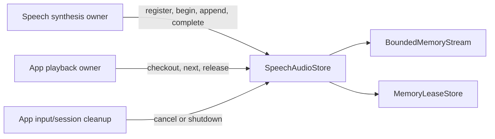

# StorageAudio — Scoped PCM Handles

## Summary

Share bounded, single-use PCM streams between independent synthesis and playback owners.

## Ownership and boundaries

Depends only on Storage. The store owns bytes/handles and exact caller identity, without ModelKit, PlatformKit, scheduling or inference. Producer completion differs from player drain.

## External relationships and data flow

Runtime arrows show data or capability calls; dashed arrows show injection.

## Values and ownership

`SpeechPCMFormat` supports 8…192 kHz, 1…8 channels and Int16/Float32 encoding. Frames are nonempty, aligned, bounded to 1 MiB and sequenced. Callers convert backend/platform values into these independent types.

`SpeechAudioStore.Owner` is source/session/input, mapped to namespace `speech.pcm`. Default store capacity is 32, each stream allows 8 MiB and 2048 items. Queue/ready TTL and reader timeout default to nil: the owning input/session must retire handles. Terminal failures retain at most 128 tombstones for thirty seconds.

`register` installs cancellation ownership, `begin` starts producer use, `checkout` admits one matching reader, and `release` retires it after playback. `complete` finishes the stream but does not prove hardware drain. Exact-owner checks prevent cross-turn reads. Scope cancellation/shutdown joins cancellation hooks and fails waiting reads; failure translation preserves producer errors.

## Stream behavior

Append rejects capacity overflow; it has no producer backpressure wait. One `next` waiter is allowed. Finish drains queued PCM then returns nil; failure/cancellation drops queued bytes and wakes the reader with the original error. Playback and inference deadlines belong to their owners. The standalone `SpeechAudio` initializer defaults to 1 MiB, while the shared store explicitly supplies 8 MiB.

✅ Single-checkout handles, bounded PCM, owner-scoped cleanup and error retention.

❌ Durable PCM storage and multi-reader/mixed playback.

## Related design

[Parent design](../README.md)
