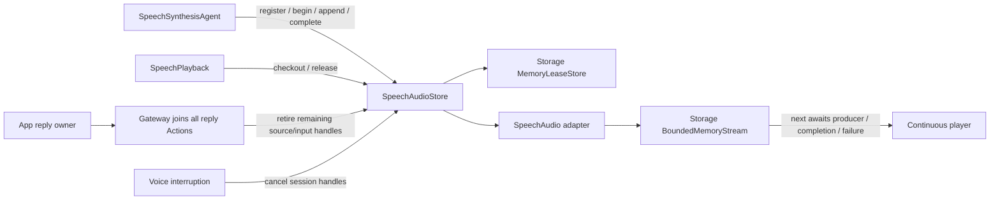

# StorageAudio — Process-local PCM adapter

Purpose: share bounded single-use PCM handles between synthesis Agents and scheduled playback without either depending on the other. This target adapts ModelKit `AudioFrame` and AgentCore identity to the Foundation-only Storage primitives; it performs no inference, routing or device I/O.

## Upstream and downstream

Compile-time dependencies are `Storage` (bounded streams and leases), `AgentCore` (source/session/input ownership), and `ModelKit` (AudioFrame values only). There is no model inference dependency. Direct consumers are Agents, Actions and App. App creates one shared SpeechAudioStore, injects it into SpeechSynthesisAgent and SpeechPlayback, and owns input/session cancellation and shutdown. SpeechSynthesisAgent writes frames; scheduled SpeechPlayback checks out a handle, forwards its PCM to the App-injected player, and releases the handle after playback drains. Store completion is distinct from physical playback completion.

## Design goals

- Preserve the existing audioID, ownership, cancellation and playback timing contract while moving shared storage under `Storage/`.
- Keep speech-specific media types and error messages out of the general Storage target.
- Reuse Storage's bounded memory stream and single-checkout handle store rather than duplicating queue and expiry logic.

✅ 32 live handles, 8 MiB PCM per handle (256 MiB aggregate upper bound), 2048 queued frames per handle, no files. Overflow explicitly fails synthesis; consumed frames are released immediately. The serial synthesis worker is never held waiting for a playback reader.

✅ Ownership is source Agent + session + originating input, converted to a `speech.pcm` Storage scope. One checkout per UUID. Queued and completed-unclaimed audio have no time-based expiry. Their lifetime belongs to the originating reply (source Agent + input ID) within the voice session. App retires remaining handles only after the reply completion/cancellation barrier; interruption cancels the whole voice session. Each read removes its frame from Storage; the player may still retain that frame until hardware consumption. The audioID is released after the whole segment drains, not retained for replay until reply end. Empty reads have no independent deadline by default: they wait for PCM, completion, producer failure or cancellation. SpeechSynthesisAgent retains its 60-second deadline from worker execution start; queue time is excluded, and there is no total deadline measured from playback checkout. An explicit waitTimeout remains available to callers that need a read deadline.

✅ Playback completion, reply/session cleanup, cancellation and error release PCM immediately; synthesis completion alone retains unplayed PCM. At most 128 terminal records retain errors for 30 seconds. The adapter translates general Storage failures to the existing `SpeechAudioError` cases, so Agent and Action behavior remains stable.

❌ Persistence, repeated playback and multi-consumer handles are unsupported. Physical-device latency and memory acceptance remain outstanding; model intermediate waveforms and player buffers are outside this cache.

✅ The production default matches the synthesis Agent’s 8 MiB per-request output limit: approximately 43.7 seconds of 48 kHz mono Float32 PCM. Memory is allocated as audio arrives, not reserved per handle. Increasing this from 2 MiB reduces overflow when MOSS runs ahead of playback; the 2048-frame cap and explicit failure policy remain; empty reads follow the producer lifecycle. ❌ This does not provide producer backpressure or guarantee arbitrarily long replies.

## Storage domain organization

✅ Audio remains a business storage domain compiled as StorageAudio. Generic streams and leases remain in the outer Storage core; sibling Chat compiles separately and introduces no Audio dependency.

❌ Image/video/semantic-memory stores remain planned; this migration adds no storage behavior.
