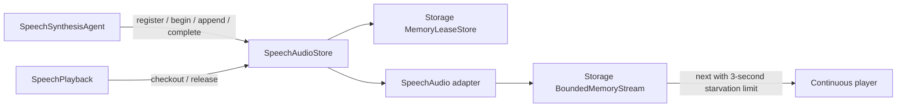

# StorageAudio — Process-local PCM adapter

Purpose: share bounded single-use PCM handles between synthesis Agents and scheduled playback without either depending on the other. This target adapts ModelKit `AudioFrame` and AgentCore identity to the Foundation-only Storage primitives; it performs no inference, routing or device I/O.

## Design goals

- Preserve the existing audioID, ownership, cancellation and playback timing contract while moving shared storage under `Storage/`.
- Keep speech-specific media types and error messages out of the general Storage target.
- Reuse Storage's bounded memory stream and single-checkout handle store rather than duplicating queue and expiry logic.

✅ 32 live handles, 2 MiB PCM per handle (64 MiB aggregate upper bound), 2048 queued frames per handle, no files. Overflow explicitly fails synthesis; consumed frames are released immediately. The serial synthesis worker is never held waiting for a playback reader.

✅ Ownership is source Agent + session + originating input, converted to a `speech.pcm` Storage scope. One checkout per UUID. Queued requests expire after 60 seconds; completed unclaimed PCM expires after 60 seconds. A checked-out handle suspends completed-cache expiration until release/cancel. Empty reads fail after 3 seconds, including midstream starvation.

✅ Completion, cancellation and error release PCM immediately. At most 128 terminal records retain errors for 30 seconds. The adapter translates general Storage failures to the existing `SpeechAudioError` cases, so Agent and Action behavior remains stable.

❌ Persistence, repeated playback and multi-consumer handles are unsupported. Physical-device latency and memory acceptance remain outstanding; model intermediate waveforms and player buffers are outside this cache.
