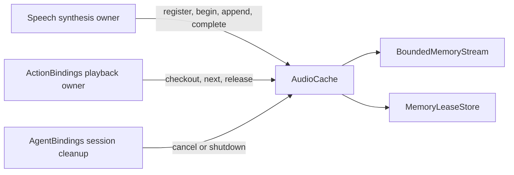

# StorageCache — Scoped PCM Handles

## Summary

Share bounded, single-use PCM streams between independent synthesis and playback owners.

## Ownership and boundaries

Compiled in StorageCache; depends only on StorageCore. The store owns bytes/handles and exact caller identity, without ModelKit, PlatformKit, scheduling or inference. Producer completion differs from player drain.

## External relationships and data flow

Runtime arrows show data or capability calls; dashed arrows show injection.

## Values and ownership

`AudioFormat` supports 8…192 kHz, 1…8 channels and Int16/Float32 encoding. Frames are nonempty, aligned, bounded to 1 MiB and sequenced. Callers convert backend/platform values into these independent types.

`AudioCache.Owner` is source/session/input, mapped to namespace `speech.pcm`. Default store capacity is 32, each stream allows 8 MiB and 2048 items. Queue/ready TTL and reader timeout default to nil: the owning input/session must retire handles. Terminal failures retain at most 128 tombstones without TTL; input/session retirement removes them.

`register` installs cancellation ownership, `begin` starts producer use, `checkout` admits one matching reader, and `release` retires it after playback. `complete` finishes the stream but does not prove hardware drain. Exact-owner checks prevent cross-turn reads. Scope cancellation/shutdown joins cancellation hooks and fails waiting reads; failure translation preserves producer errors.

## Stream behavior

Append rejects capacity overflow; it has no producer backpressure wait. One `next` waiter is allowed. Finish drains queued PCM then returns nil; failure/cancellation drops queued bytes and wakes the reader with the original error. Playback and inference deadlines belong to their owners. The standalone `AudioStream` initializer defaults to 1 MiB, while the shared store explicitly supplies 8 MiB.

Single-checkout handles, bounded PCM, owner-scoped cleanup and error retention.

## Related design

[Parent design](../README.md)

## Lifecycle-owned conversation and audio

语音句柄不设置读等待或错误记录 TTL；生命周期由播放完成、输入/会话结束、实际异常或显式取消决定。PCM 容量有界，超限及关闭明确失败；owner 负责取消并加入生成与播放工作。

Audio continues using common bounded memory/lease contracts; no SQLite, file backend or third-party package dependency is introduced.

## 待实现

- Durable PCM storage and multi-reader/mixed playback.

## Storage 容器关系

✅ CacheContainer 按会话创建、复用和关闭 AudioCache。根接纳屏障同步拒绝新句柄与读取；AudioCache.shutdown 合并并加入同一取消任务。AudioFrame 持有 CacheBuffer，流交接不重建字节。
