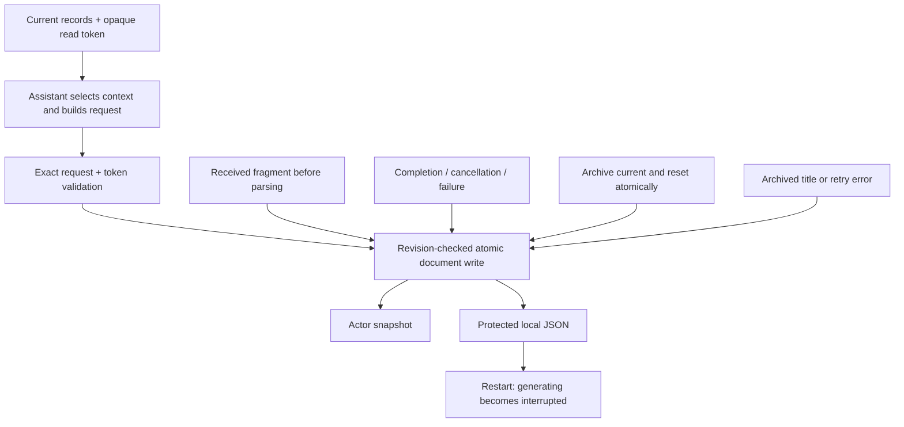
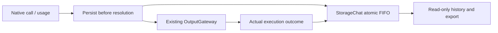

# StorageChat — Conversation storage

Purpose: own conversation schemas and current/archived chat persistence. Design goals: preserve raw data, explicit bounds, atomic revision-checked writes and predictable recovery. StorageChat depends only on Storage; it performs no inference, rendering or device I/O. App assembles the store, Agents use journal/context values, and UI consumes shared record values only.

✅ ConversationHistory.swift contains record values and ConversationHistoryStore, using the core LocalDocumentStore. This directory is excluded from the Storage core target and compiles once as StorageChat. The source move changes no on-disk path, schema, version or retention behavior.

❌ Semantic memory, media files and cross-device sync are separate domains/features, not inferred from conversation persistence.

## Conversation journal

✅ ConversationHistoryStore is the Foundation-only domain store for current and archived conversations. App provides one LocalDocumentStore<ConversationArchive> and injects that owner into Assistant and the history application workflow. A nil document explicitly selects volatile storage for tests, never production fallback. The versioned payload stores original user text, exact request messages, model label/options, received text fragments, generation status/finish reason/error and optional execution error. Credentials and media are not recorded. UI computes display titles from raw input and summaryTitle; Storage contains no localized fallback.

| Bound | Policy |
| --- | --- |
| Journal document | 32 MiB encoded envelope; reject excess, no automatic eviction |
| Conversations | One current plus at most 64 archives; explicit deletion of archives |
| Turns | At most 256 per conversation; start a new conversation when full |
| Input / system / model label | 4096 / 32768 / 512 UTF-8 bytes per record |
| Received raw response | 256 KiB / 8192 fragments; reject excess preserving prior data |
| Exact request | Up to 514 messages; system content up to 32 KiB and other content up to 256 KiB per message; document bound also applies |
| Title / error | 80 characters / 4096 characters |
| Mutations | One actor-owned writer plus 16 FIFO waiters; overflow fails busy |

Each accepted fragment is atomically persisted before current Action parsing. Admission/append reserve encoded headroom for terminal error state. Disk failures preserve the previous durable revision and surface explicitly. If a terminal write fails after the producer has stopped, the in-memory record is marked interrupted with an unsaved-status error so it cannot permanently fence the next input; a later successful write persists that recovery state. Interrupted generating records loaded after restart are marked interrupted in the snapshot and excluded from context by Assistant. A subsequent successful write persists that recovery state. New conversation is one atomic archive-and-reset write; pending title failure never loses the archived conversation. An active producer blocks archival until stopped/joined.

❌ Cross-process writers, cross-device sync, semantic retrieval, compressed archives and automatic retention are not implemented. Whole-document fragment writes favor diagnostic durability; no unbounded flush queue exists. Provider token budgets are independent of journal storage limits.

✅ Chat output-token budgets are optional and default to nil. Assistant/cloud requests omit max_output_tokens so the provider chooses its default; local Gemma 4 E2B uses remaining room in its existing 4096-token context. History omits max tokens display and preserves older explicit budgets on disk. The separate 2000-byte whole-reply cap is removed; parser, queue, timeout and per-segment bounds remain. Explicit title/warmup budgets are unchanged. ❌ Live-provider/device acceptance remains separate.

## Tool diagnostics and token usage

✅ Version-1 turns have optional toolDefinitions, toolCalls and tokenUsage fields; old files decode unchanged. Assistant persists the exact declarations and complete model-native call (provider ID, runtime UUID, name, raw argument JSON) before resolution/dispatch. App records Gateway's actual returning output, completion-only success, failure or cancellation against that UUID; late results can update archived turns. Internal presentation Tools are excluded. Received without an outcome means execution has not been confirmed; generation completion is separate.

✅ Bounds: 128 declarations / 64 KiB combined, 128 calls per turn, 512-byte provider ID, 64-byte name, 4096-byte arguments, 64 KiB result and 4096-character error. Journal still rejects over 32 MiB without eviction. A FIFO admits at most 16 waiting store operations, rejects overflow with busy, and joins each accepted atomic mutation even if the caller is cancelled. This serializes generation fragments and execution outcomes without lost updates; no inference/effect is retried.

❌ Old records cannot recover unrecorded calls/usage; partial native SSE calls and token IDs are not retained. Token counts are supplied by the provider/backend, never estimated from characters.

## Read and admission fencing

✅ readCurrent returns current records and an opaque token under the same bounded writer gate. begin accepts exact request messages and the token, never selects context, and rejects stale or foreign tokens with conflict. Every successful mutation invalidates the token, including archived metadata updates; failed terminal recovery also invalidates it. Reads and failed writes without state changes do not. Token values are process-local, not persisted; durable revision checks remain independent.

✅ Version-1 files and raw requests remain compatible. Admission precedes inference; Assistant reports conflicts/persistence failure without model calls or automatic retry.

❌ Cross-process transactional reads and automatic admission retry are unsupported.

## Bounded registered-observation continuation

✅ Implemented: Assistant correlates generated Action/Tool calls with runtime-only feedback under the original turn, awaits complete results and requests the next model round. Limits: four total model rounds,16 native calls,64 KiB aggregate feedback/transcript and one30-second joined generation worker. A failed call becomes data for the model, never an automatic function retry. Cancellation clears owned feedback state and joins model cleanup; unknown/stale/duplicate feedback cannot resume a turn. Internal UI receipts and explicit /status retain their existing handling.

✅ Implemented: ModelKit ChatMessage gains provider-neutral assistant tool-call declarations and tool-result messages. OpenAI serializes request-local aliases consistently across declarations and prior calls; Gemma rejects native transcripts explicitly. Storage keeps optional exact text/native request JSON and metadata-only image descriptors in modelRequests, with bounded records and unchanged v1 compatibility. Legacy continuationRequests remains decode-only. Camera native model calls use explicit observation registration so actual completion/error can continue reasoning. No change to camera or NexArm function implementation.

## Action/Tool generation rounds — ADR0183

✅ StorageChat persists optional bounded generationRounds and text/native continuation requests with metadata-only image descriptors; existing version-1 histories still decode. Execution evidence is distinct from raw model text.

❌ Live-model, native UI and physical-device acceptance remain pending; native/XML task delegation and specialist loops are implemented. See [ADR0183](../../../docs/adr/0183-generation-round-observations.md).

✅ ADR0184: multimodal continuation records explicitly retain photoID/MIME/byte count and omit attachment bytes; stored text/native messages retain their existing exact JSON. Future user turns do not implicitly reload prior photo bytes.

## Per-request conversation history

✅ Implemented: ConversationHistory.swift stores optional modelRequests (at most four) with round ID, record-admission date, optional adapter request-start/first-text-token dates and monotonic latency, current input, metadata-only exact request JSON, fragments, native calls/outcomes, provider usage and model terminal state. Request JSON is bounded to512 KiB to accommodate escaping of the64 KiB ChatRequest transcript; current input is bounded to64 KiB. Aggregate text/call and32 MiB document bounds still apply. Serialized mutations atomically update aggregate and request evidence; late outcomes update their original request, including archived records. Restart or failed terminal persistence marks unfinished requests interrupted. Model completion remains separate from execution/owner completion. No image bytes enter the journal. continuationRequests is decode-only legacy data; its writer was removed. Aggregate fields remain required by existing context/diagnostic consumers; removing them requires a separate consumer migration.

❌ Native UI, live-provider and physical-device acceptance remain separate from automated validation.

## Agent composition — ADR0187

✅ Agent 自有预处理、版本化结构化 Context 和 Builder 已接入；共享机制在现有 Agents/Support/Core 与 Agents 目录中。业务职责保持当前分界。函数结果按运行时捕获的执行所有者定向返回，通信投递回执只表示接纳；模型续轮不订阅自身广播。

✅ 上下文采用有界原子提交，重启将未完成工作标为中断，不重放设备动作。普通输入、反馈和控制分别接纳；所有容量或持久化失败显式返回。音视频和原生会话保持有界临时状态。

✅ 第二阶段已实现独立摄影 LLM、正式任务委派及任务定向后续输入。❌ 真实模型、原生 UI、真机语音验收仍待完成。

Storage 只提供原子通用文档和历史兼容接口，不选择 Agent 输入或续轮。Assistant 的 archive/query/delete/startNew/title 等接口连接同一 Context 仓库事务；旧 current/archive 在第一次成功提交后仅作为导入源。损坏、版本/容量或 CAS 失败显式返回，禁止空历史回退或旧新双写。

设计与阶段边界见 [ADR0187](../../../docs/adr/0187-agent-composition-and-react.md)；验证见 [Validation-History](../../../docs/Validation-History.md)。

✅ ADR0187 删除投影事务同步清理所属已结束任务的 Context 证据与消费记录；活跃任务禁止删除，不保留另一份可查询的已删除文本。

✅ Request timing metadata: optional modelRequestStartedAt and firstTokenLatency complement firstTokenAt; record date remains admission time. recordModelTiming atomically preserves one provider sample, validates finite timestamps/nonnegative elapsed time and matching first-text/elapsed presence. Removed the consumer-arrival writer. Version1 legacy records decode without new fields; no interface timing is invented.
