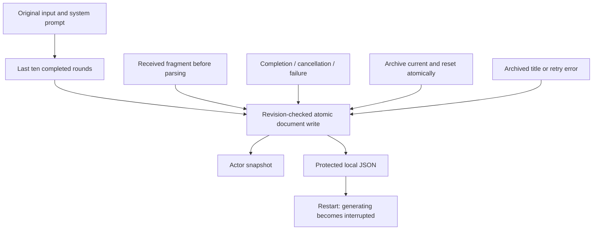

# StorageChat — Conversation storage

Purpose: own conversation schemas and current/archived chat persistence. Design goals: preserve raw data, explicit bounds, atomic revision-checked writes and predictable recovery. StorageChat depends only on Storage; it performs no inference, rendering or device I/O. App assembles the store, Agents use journal/context values, and UI consumes shared record values only.

✅ ConversationHistory.swift contains record values and ConversationHistoryStore, using the core LocalDocumentStore. This directory is excluded from the Storage core target and compiles once as StorageChat. The source move changes no on-disk path, schema, version or retention behavior.

❌ Semantic memory, media files and cross-device sync are separate domains/features, not inferred from conversation persistence.

## Conversation journal

✅ ConversationHistoryStore is the Foundation-only domain store for current and archived conversations. App provides one LocalDocumentStore<ConversationArchive> and injects that owner into Assistant and the history application workflow. A nil document explicitly selects volatile storage for tests, never production fallback. The versioned payload stores original user text, exact request messages, model label/options, received text fragments, generation status/finish reason/error and optional execution error. Credentials and media are not recorded. Current title is computed from the latest original user input; only archived conversations have a generated summary title.

| Bound | Policy |
| --- | --- |
| Journal document | 32 MiB encoded envelope; reject excess, no automatic eviction |
| Conversations | One current plus at most 64 archives; explicit deletion of archives |
| Turns | At most 256 per conversation; start a new conversation when full |
| Input / system / model label | 4096 / 32768 / 512 UTF-8 bytes per record |
| Received raw response | 256 KiB / 8192 fragments; reject excess preserving prior data |
| Context | Latest ten completed rounds of current conversation, oldest to newest; no archived or failed rounds |
| Title / error | 80 characters / 4096 characters |
| Mutations | One actor-owned write admission; concurrent mutation fails busy, no queue |

Each accepted fragment is atomically persisted before current Action parsing. Admission/append reserve encoded headroom for terminal error state. Disk failures preserve the previous durable revision and surface explicitly. If a terminal write fails after the producer has stopped, the in-memory record is marked interrupted with an unsaved-status error so it cannot permanently fence the next input; a later successful write persists that recovery state. Interrupted generating records loaded after restart are marked interrupted in the snapshot and excluded from context. A subsequent successful write persists that recovery state. New conversation is one atomic archive-and-reset write; pending title failure never loses the archived conversation. An active producer blocks archival until stopped/joined.

❌ Cross-process writers, cross-device sync, semantic retrieval, compressed archives and automatic retention are not implemented. Whole-document fragment writes favor diagnostic durability; no background unbounded flush queue exists. Provider token budgets are independent of journal storage limits.

✅ Chat output-token budgets are optional and default to nil. Assistant/cloud requests omit max_tokens so the provider chooses its default; local Qwen uses remaining room in its existing 4096-token context. History shows 模型默认 for omitted values and preserves older explicit budgets. The separate 2000-byte whole-reply cap is removed; parser, queue, timeout and per-segment bounds remain. Explicit title/warmup budgets are unchanged. ❌ Live-provider/device acceptance remains separate.
