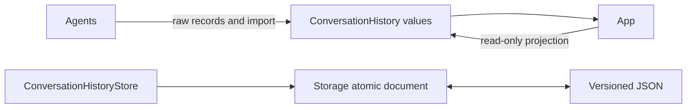

# StorageChat — Raw Conversation Evidence

## Summary

Versioned conversation schemas and a bounded legacy journal, independent of prompt construction or rendering.

## Ownership and boundaries

StorageChat depends only on Storage. Current Agent repositories own structured contexts and expose history through their own transactions. `ConversationHistoryStore` remains a compatibility/import mechanism, not a second live writer.

## External relationships and data flow

Runtime arrows show data or capability calls; dashed arrows show injection.

## Current ownership

Current Chat Agents persist through their [context repositories](../../Agents/Support/Context/README.md). Assistant archive/query/delete/startNew/title operations target that same repository. Old current/archive journals are imported on the first successful context commit; there is no old/new dual write. Corruption, capacity/version and CAS failure remain explicit. Context selection and generation-round policy belong to Agents.

## Compatibility journal bounds

| Value | Maximum |
| --- | --- |
| Encoded envelope | 32 MiB; rejection without automatic eviction |
| Conversations / turns | One current + 64 archives; 256 turns per conversation |
| Input / system / model label | 4096 / 32768 / 512 UTF-8 bytes |
| Raw response | 256 KiB / 8192 fragments |
| Request messages | 514; system 32 KiB, other message 256 KiB |
| Title / error | 80 / 4096 characters |
| Mutation waiters | One writer plus 16 FIFO waiters; busy on overflow |
| Tool evidence | 128 definitions/64 KiB; 128 calls; provider ID 512 bytes, name 64, arguments 4096, result 64 KiB |
| Per-request evidence | Four requests, 512 KiB exact request JSON and 64 KiB current input per request |

The journal read token binds exact request admission to an unchanged process-local snapshot. Successful mutations invalidate it; stale/foreign admission conflicts. Accepted atomic mutations are joined despite caller cancellation. Failed disk writes preserve the durable revision. Terminal-write failure marks in-memory unfinished work interrupted with an unsaved error, preventing permanent admission fencing; later success persists recovery. Restart similarly projects generating work as interrupted. Archive/reset commits before optional title generation.

## Schema and evidence

Version-1 optional fields retain exact requests, fragments, native call IDs/arguments/outcomes, generation rounds, usage, request-start/first-text-token timing and metadata-only image references. Model termination is separate from execution outcome; late results can update the original archived request. Legacy continuation fields remain decode-only. Image bytes never enter JSON. Missing old usage/timing/outcomes remain absent, without estimated values.

✅ Independent raw schemas, bounded compatibility journal, revision/read fencing and atomic recovery semantics.

❌ Cross-process writers, automatic retention, compressed archives and semantic retrieval.

## Related design

[Parent design](../README.md)
