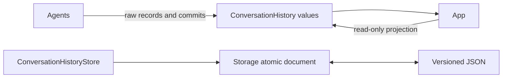

# StorageChat — Raw Conversation Evidence

## Summary

Versioned conversation schemas and a bounded transactional history store, independent of prompt construction or rendering.

## Ownership and boundaries

StorageChat depends only on Storage. Current Agent repositories own structured contexts and expose history through their own transactions. `ConversationHistoryStore` projects repository reads/commits; it is not a second live writer. Standalone document/in-memory stores support isolated consumers and tests.

## External relationships and data flow

Runtime arrows show data or capability calls; dashed arrows show injection.

## Current ownership

Current Chat Agents persist through their [context repositories](../../Agents/Support/Context/README.md). Assistant archive/query/delete/startNew/title operations target that same repository. Production reads only the Assistant context; standalone sibling history files do not participate in startup. Corruption, capacity/version and CAS failure remain explicit. Context selection and generation-round policy belong to Agents.

## History store bounds

| Value | Maximum |
| --- | --- |
| Encoded envelope | 32 MiB; rejection without automatic eviction |
| Conversations / turns | One current + 64 archives; 256 turns per conversation |
| Input / system / model label | 4096 / 65536 / 512 UTF-8 bytes |
| Raw response | 256 KiB / 8192 fragments |
| Request messages | 514; system 64 KiB, other message 256 KiB |
| Title / error | 80 / 4096 characters |
| Mutation waiters | One writer plus 16 FIFO waiters; busy on overflow |
| Tool evidence | 128 definitions/64 KiB; no cumulative call-count cap; provider ID 512 bytes, name 64, arguments 4096, result 64 KiB |
| Per-request evidence | No fixed request/round count cap; 512 KiB exact request JSON and 64 KiB current input per request |

The journal read token binds exact request admission to an unchanged process-local snapshot. Successful mutations invalidate it; stale/foreign admission conflicts. Accepted atomic mutations are joined despite caller cancellation. Failed disk writes preserve the durable revision. Terminal-write failure marks in-memory unfinished work interrupted with an unsaved error, preventing permanent admission fencing; later success persists recovery. Restart similarly projects generating work as interrupted. Archive/reset commits before optional title generation.

## Schema and evidence

Version-1 optional fields retain exact requests, fragments, native call IDs/arguments/outcomes, generation rounds, usage, request-start/first-text-token timing and metadata-only image references. Model termination is separate from execution outcome; late results can update the original archived request. Image bytes never enter JSON. Unavailable usage/timing/outcomes remain absent, without estimated values.

✅ Independent raw schemas, bounded transactional store, revision/read fencing and atomic recovery semantics.

❌ Cross-process writers, automatic retention, compressed archives and semantic retrieval.

## Related design

[Parent design](../README.md)

## Skill/task-mode contract

✅ ConversationModelRequest.decisionMetadata optionally persists taskID, mode, Skill revisions and catalogJSON. Snapshots retain the current schema version. No model request is synthesized from input aggregate fields. No storage-owned Agent policy or context selection.

## 泛化 Task 与独立 Skill

✅ DecisionMetadata freezes taskGoal, execution, Skill revisions and catalogJSON at request time.
✅ System messages accept up to 65,536 UTF-8 bytes, matching prompt construction. Reject 65,537 bytes explicitly; retain 32 MiB envelope, per-request JSON and user-input bounds. This prevents valid composed Skill prompts failing on a later user turn.

## Agent request failure continuation

✅ 已实现：finishModelRequest 增加可选 error 参数，失败尝试以现有 failed/error 字段保留，外层用户 turn 可继续 generating 并记录后续请求；成功路径保持兼容，无固定累计请求数限制。Storage 只记录事实，不决定重试或注入模型提示。

✅ Removed the four-entry model-request and generation-round journal admission caps, since decision lifetime is completion/cancellation-owned. Retain identity/generating-request validation and exact durable evidence, plus existing encoded-envelope I/O bounds.

✅ Per-turn native-call evidence has no cumulative 128-call cap; per-generation admission remains owned by Chat. Duplicate identity and actual record/envelope validity still fail explicitly.

## 历史记录收敛（2026-10-13）

✅ 已实现：ConversationHistoryStore 通过注入的 contextLoad/contextCommit 事务读写；生产不加载独立 history.json。ConversationRecord 不再包含旧续轮字段。当前请求、结果、取消、重启恢复、写入失败与 read token 契约保持有界。

❌ 历史记录页面板块重新设计及原生 UI/真机验收。
