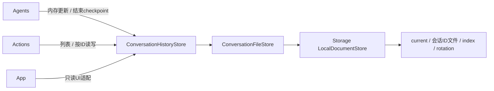

# StorageChat — 会话内存仓库与结束快照

## 职责与边界

✅ 独立于模型、Agent 策略和 UI 的会话数据、内存事务与文件机制，仅依赖 Storage。Agents 决定用户接纳、回复终态、Task 压缩和恢复策略；App 注入目录与恢复快照闭包。这里不执行模型或设备动作。

## 上下游和内部结构

- ConversationHistory.swift：schema v3、原文 response、请求和 Task 索引；仓库内存修改、read token、版本冲突检查及结束保存。
- ConversationFileStore.swift：current.json、conversation-<稳定会话ID>.json、index.json、rotation.json；共享文本表、归档恢复和单文件读取。
- ConversationArchive 是内存/展示投影，不再是持久化聚合文档。生产 context 中 past 为空；不带 files 的显式内存仓库可用于独立消费者和测试。

## 内存与保存契约

✅ user 接纳时先记录 awaitingModel 用户输入并 checkpoint；生成启动补全实际请求元数据，仅更新内存。delta 累加到完整 response，不保留分片数组。模型请求、timing、usage、Tool 调用/结果、ReACT 中间轮和 Task 状态不各自触发磁盘。

✅ finish 在完整决策完成、失败、取消或中断后 checkpoint。正常关闭/取消会话也保存变化后的任务恢复状态。一次捕获包含相同版本的当前会话与恢复数据；相同会话ID、history revision 和恢复数据不重复写入。一个写入者最多16个FIFO等待者，溢出明确 busy。失败保留实际内存终态和未保存数据，已保存版本不前移；异常退出允许丢失尚未保存的回复。恢复只标记中断，不重放动作。

✅ read token 约束进程内请求接纳；纯内存历史变更最多重试四次版本冲突，不重放推理或动作。流式修改不重新编码全历史或校验所有压缩源；完整结构校验发生在 checkpoint。

## 文件与归档

✅ 一个 current 文件始终对应一个稳定逻辑会话；语音运行 session 不决定文件名。档案正文按ID加载，列表仅使用小索引中的时间、标题、轮数、预览和输入ID。正常启动只读取 current、index 和可能存在的一个 rotation 标记。索引丢失时顺序检查已识别的归档文件重建；格式损坏明确失败。

✅ 新会话先保存带 archivedAt 的旧 current，记录归档事务、非覆盖移动到会话ID文件、建立新 current、发布索引、移除事务标记。中途失败可重复恢复；旧 current 已保存但事务标记尚未建立时，启动也识别并完成该归档。已有目标不被覆盖。新 current 缺失由原子写入建立；损坏文件不当成空数据。

✅ 标题和晚到结果只更新其归档及索引，不重写 current。标题推理由上层拥有。删除先移出索引再删除文件；删除失败明确传播，可能遗留不可见文件，不自动清除其他数据。当前会话不可通过归档删除端口删除。

## 共享文本与容量

✅ 请求JSON、提示词、工具定义和函数目录在文件内通过共享文本表去重；固定文本块不保留 delta 边界。解码按引用恢复准确原字符串，缺失引用/错误版本/展开超限均拒绝。图片仍只保存引用，不保存像素。

| 范围 | 上限与超限行为 |
| --- | --- |
| 每个会话文档 | 32 MiB 编码文档；共享文本累计展开32 MiB，单字符串512 KiB；拒绝，不自动删除 |
| 列表索引 / 归档事务标记 | 1 MiB / 4 KiB |
| 会话 / 输入轮 | 一个当前 + 64归档，每会话256轮 |
| 用户输入 / system / model label | 4 KiB / 64 KiB / 512 UTF-8字节 |
| 每输入累计原始回复 | 256 KiB完整字符串，无分片数量字段 |
| 每模型请求 | 512 KiB准确请求JSON，64 KiB观察输入；无固定累计轮数限制 |
| 模型请求接纳 | 检查当前内容字节预算并保留2 MiB余量；不在每个delta遍历全会话 |
| Task 压缩 | 每会话256项，每项8192源引用；goal/summary 4 KiB、failure16 KiB |

✅ 原位压缩使用 historyTaskID 与稳定 input/request 引用，在首次源位置替换；原文与准确请求保留供详情检查，归档携带压缩。historyOrder 维持跨输入续轮顺序。压缩仅使用真实终态和模型报告文本，不额外推理。

❌ 不支持旧schema、旧Assistant文件导入、跨进程写入、自动历史删除、跨设备同步、语义检索。原生UI和实机延迟验收独立于自动化检查。

[Storage](../README.md) · [Agent Chat](../../Agents/Support/Chat/README.md)
