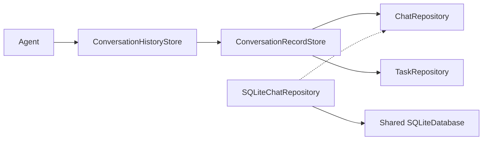

# StorageChat — Conversation Contracts and Checkpoints

## Ownership and direct relationships

Depends on StorageCore mechanisms and StorageTasks contracts. Agents own admission, summaries/context selection and execution. Actions/App consume history operations; App injects ChatRepository and TaskRepository from one backend family. SQLiteChatRepository remains in this directory but compiles solely in StorageSQLite and owns dialog/message/evidence/source schema and SQL.

## Files and interfaces

- ChatRepository.swift: neutral dialog/message/preview/compression/source values and async record contract.
- ConversationRecordStore.swift: protocol-to-history adapter, exact evidence restoration, dirty-input fingerprints, chronological windows/pages and archive/title operations. Its paired repositories must share storageScope; namespace mismatch fails before reads/writes.
- ConversationHistory.swift: authoritative memory projection, read tokens, bounded writes, complete-message checkpoints and Task source ownership. Standalone ephemeral mode retains records/IDs in memory and uses MemoryTaskRepository; it does not instantiate a database.
- SQLiteChatRepository.swift: indexed queries, schema, message UUID/role upserts, exact UTF-8 evidence deduplication and atomic compression/message/source updates. No backend implementation is imported by the contract/history target.

## Save and recovery

User admission, each finished Assistant generation and each ReACT observation commit independently. Delta never persists. Cancellation/failure saves received body and actual terminal state; generation completion differs from execution completion. Failed checkpoint retains dirty state, fingerprints and error for idempotent retry; the Agent starts no next model request. Root history writes admit16 waiters. The adapter uses a separate shared StorageOperationGate across async checkpoint/rotation/title/deletion awaits, keeping cache publication ordered without holding SQL transactions.

App runs startup recovery before admitting work; generating message identities become interrupted, and normalized Task/source rows produce interrupted compression without a live-state recovery blob. Ten projected blocks plus admitted unanswered inputs reconstruct the context; completed records remain durable after offloading. Current fingerprints are pruned to that window. Runtime restoration and Task interpretation remain Agent-owned; unfinished work is not replayed. ConversationCheckpoint is a capture DTO, ConversationArchive a memory/display DTO; neither is an obsolete file format.

## Task, queries and archives

TaskRepository commits running records before activation. SQLite checkpoints link raw messages and Task summaries to the first source position, including sources already offloaded from context; full sources remain available in20-item pages. Raw enumeration resolves the message cursor to (position, primary key), retaining tied user/Assistant rows. Preview queries read bounded preview columns; details load actual body/evidence by message ID. Agent identity checks reject foreign dialogs. Late outcomes locate their original input by index instead of scanning archives.

Current/archive rotation is atomic in the backend; asynchronous titles read at most32 caller-selected excerpts and never block creation of a new current dialog. Durable archive/turn counts have no old64/256 file-format cap. Memory history remains bounded32MiB; user/system/model limits4KiB/64KiB/512B, single-input response256KiB, request JSON512KiB/observation64KiB and single Task8192 sources. Overflows fail explicitly.

[Storage](../../README.md) · [Tasks](../Tasks/README.md) · [Agent Chat](../../../Agents/Support/Chat/README.md)

Cancellation completion: ordinary gate callers reject cancellation before their body; captured Chat checkpoints instead run a joined, store-owned operation independent of the cancelled caller, so cancelled/failed messages still commit. An actual cancelled-Task terminal checkpoint regression verifies received text and both terminal message states.

insert completed user messages and reserve Assistant identities before model admission, attach user/Assistant/observation message IDs to memory values, and never persist generating response bodies. User acceptance is its completion boundary; Assistant generation completes independently of action outcomes; each ReACT observation completes before the next model admission. Empty reserved rows recover as interrupted with truthful empty content. Interrupted Task compression is rebuilt from normalized SQL facts; live Task/Skill worker state is not serialized. Message/dialog writes use private GRDB records.

ConversationHistory.begin commits a complete user message directly, then attaches the returned SQL identity to memory. ChatRepository.save and ConversationRecordStore.saveCurrent return committed identity receipts in submitted-message order. Evidence fingerprints omit the separately stored user primary key. Failed publication retries the same runtime UUID idempotently. Assistant reservations and per-observation checkpoints use their own completion boundaries.

ConversationHistory tracks pending current synchronization, reloads SQL current before read/admission/rotation, and rejects mismatches with active/dirty work. A committed rotation clears persisted old dirty inputs, then publishes the new window; publication failure retains the synchronization fence for retry without a second rotation. Synchronization uses exact-ID comparison. SQLiteChatRepository rejects new message rows on archived dialogs, validates Agent ownership during rotation and permits existing-row late updates. Missing current is created transactionally; failures propagate rather than fabricating a draft.

paging that can initialize/recover current and dirty-input checkpoint publication use the same history operation gate; memory-only paging delegates to the existing gated conversation read.

HistoryPaging.pageSize supplies the shared20-item default for archived dialogs and timeline/Task previews; App uses the same value for archive EOF validation. Internal raw-message enumeration retains its independent50-row batch and complete-record reads remain complete.

## 待实现

- Additional persistent Chat backends and cross-process/sync/replay semantics are unimplemented. Real model/native UI acceptance is separate from contract tests.

## Storage 容器关系

✅ 本目录的领域端口由 DatabaseStorage 发布；SQL 适配器统一归 Database/SQLite 编译，业务调用方不导入 SQLite 后端。
