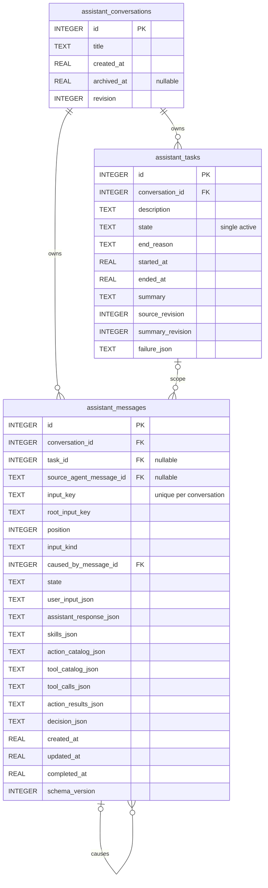
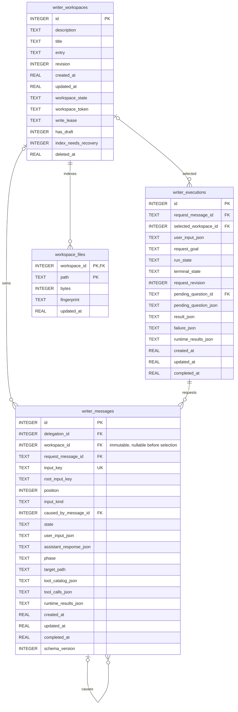
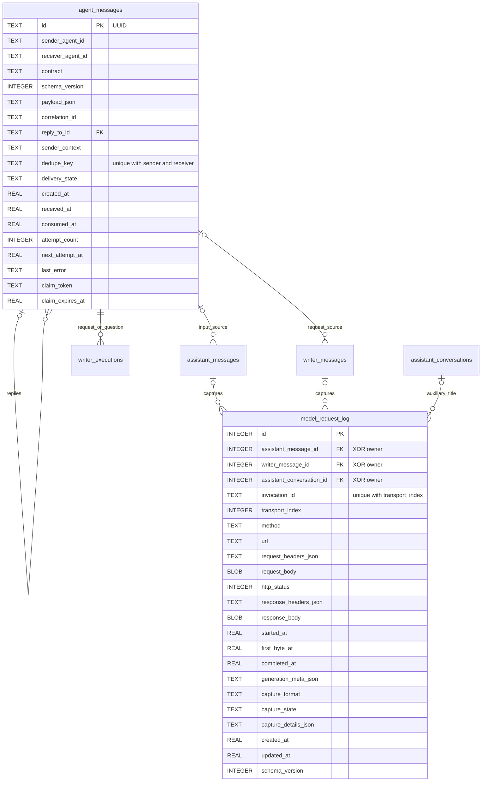

# Database — 独立 Agent 数据与共享存储

DatabaseStorage 拥有数据库生命周期及 AssistantConversations、AssistantMessages、AssistantTasks、WriterMessages、WriterExecutions、AgentMessages、Logs、Media、Devices、Workspaces 独立端口。Assistant 与 Writer 共用数据库连接和日志设施，各自拥有消息与任务链；通信表只记录实际消息及投递事实，不替目标 Agent 管理任务。Storage 不导入 Agents、Gateway 或 ModelKit，不负责模型调度、权限授予或 Agent 选择策略。

## 表与目录

Database 采用三层职责：根目录是数据库核心与整体装配；[Shared](Shared/README.md) 是不含 Agent 业务的编码、ID 和分页机制；业务表按持久化责任归属到对应目录，集中保存定义、映射、仓库操作和专属规则；WriterMessages 同时拥有请求表与执行表。共十一张业务表，版本迁移集中在 SQLiteSchema，无兼容视图。

## 数据库核心

根目录只保留五个 Swift 文件：SQLiteDatabase 管理连接池、读写准入、事务和关闭；SQLiteSchema 组合十一张表及版本策略；SQLiteRepositories 创建仓库并协调恢复；DatabaseStorage 定义总入口；SQLiteDatabaseStorage 实现启动/关闭和失败清理。SQLiteDatabase 接收外层传入的初始化闭包，不引用业务表或 schema 版本。不存在单独 SQLite 子目录。

Assistant 的会话、消息、前台任务和摘要接口分别由对应目录拥有；Writer 的执行接口由 WriterMessages 拥有，workspace 文件接口由 WriterWorkspaces 拥有。ModelRequestLogRepository、AgentMessageRepository 各自是独立共享表接口，没有统一 Chat/Task 仓库，也没有根据 agent 或 ID 选择两套业务表的门面。

AssistantRecordStore 注入本侧会话、消息、任务摘要和日志端口；WriterRecordStore 只注入 WriterMessageRepository 与日志端口。两侧各有历史类型、窗口、checkpoint 与 SQL 查询，不互相引用。Agents/Actions 的 Assistant 历史和 Writer 的记录详情分别适配到 UI 展示模型。ModelEvidence 是日志目录下的中立协议值（消息角色、工具调用、usage、失败诊断），不承载任务选择或会话生命周期。

消息首次建立日志、Assistant 消息更新使摘要失效、Writer 完成与通信 outbox 写入均在单一事务中执行。表拥有的内部操作接收当前事务，不进行嵌套提交。日志删除后，后续请求回调不会重建已清除的数据。

| 目录 / 表 | 责任 |
| --- | --- |
| [AssistantConversations](AssistantConversations/README.md) / assistant_conversations | Assistant 对话头、归档和版本 |
| [AssistantTasks](AssistantTasks/README.md) / assistant_tasks | 单一平铺前台任务、终态、摘要及来源版本 |
| [AssistantMessages](AssistantMessages/README.md) / assistant_messages | Assistant 已发起的模型请求、完整输入回复、Action 与工具结果 |
| [WriterWorkspaces](WriterWorkspaces/README.md) / writer_workspaces | Workspace 元数据、文件状态与历史身份 |
| [WriterMessages](WriterMessages/README.md) / writer_messages | 已发起的 Writer 模型请求、前序及 workspace 消息 |
| [WriterMessages](WriterMessages/README.md) / writer_executions | 委托入口、执行状态、交互及最终业务结果 |
| [WorkspaceFiles](WorkspaceFiles/README.md) / workspace_files | 当前文件索引，正文由 Files 保存 |
| [AgentMessages](AgentMessages/README.md) / agent_messages | 不可变 Agent 通信、接收/消费、投递重试 |
| [ModelRequestLog](ModelRequestLog/README.md) / model_request_log | 可删除 HTTP 请求/响应、图片、参数和 generation meta |
| [MediaFiles](MediaFiles/README.md) / media_files | 独立相册媒体及清理状态 |
| [Devices](Devices/README.md) / devices | 原生设备身份、选择与重连 |

## Assistant 链路

ReACT 是新消息行。task_id 是前台摘要 scope，无 parent，也不代表后台委派。一个前台任务结束后才能开始下一个；连续 start 由 Agents 加入副作用清理，再保存 superseded 终态并新建。消息已归属的旧 scope 不重绑。

摘要来源由 assistant_messages.task_id 推导；只有终态、非空摘要且 summary_revision 等于 source_revision 才可折叠。全双工 task.end 固定来源成员，后续原行证据更新同步推进摘要版本。其他摘要随输入、回复或工具结果变化失效。原始消息始终保留。列表使用 JSON 的有限投影。

## Writer 链路

writer_executions 拥有委托执行生命周期，通过 selected_workspace_id 关联选定的 workspace；writer_messages 通过 delegation_id 关联执行入口，只在模型发起时创建，workspace_id 保留创建时归属。接纳不创建 workspace，选择不搬移消息。WriterContainer 将委托与 workspace 两种查询投影到 UI；运行模型上下文始终以委托为单位。

workspace_token 防过期提交，write_lease 排斥并发写者，has_draft 标识未发布内容，index_needs_recovery 标识索引需核对；四者分别保留。Files 与 SQL 不共享事务，中断后按权威文件修复索引，不重放业务。活动/清理失败任务及持有 lease 的 workspace 不可删除。

## 通信与可删除日志

日志的三类 owner 恰好一个非空。一次业务轮可关联多次传输；ReACT 自身另建消息，不因多次 ReACT 共用一行。HTTP 日志是 URLSession 提供的应用层请求/响应字节，含 SSE；凭据型 header 和 URL 参数脱敏。非 HTTP 模型标为 local。每次采集以 64 KiB 块背压写入；后续回调只 UPDATE，清空后不会复建。图片与 generation meta 仅在 logs，清日志不删消息、任务、通信、workspace 或独立相册。

received 表示投递，consumed 表示接收方已持久化安排处理，均不代表任务完成。通信正文包含实际发送内容，不提取另一份目标任务模型。Writer 的业务终态与完成 outbox 同事务提交；权限退休保留在 Writer 本地收尾，结果投递采用 token 领取、最多八次重试和退避，耗尽进入 dead_letter。消息体上限 128 KiB。接收失败与目标明确拒绝分别记录。

## 编译与生命周期

Package.swift 显式将同目录公共契约编入 StorageChat/Tasks/Media/Devices，文件协调编入 StorageDatabase，全部 GRDB 实现仅编入 StorageSQLite；检查脚本验证每份源码只有一个编译拥有者。各表借用同一事务，不自行提交嵌套业务事务。

旧 schema 版本全量清除后初始化新十表；当前版本正常重开不清除；高于当前程序的版本拒绝打开。真机全新安装清除旧 SQL 和旧文件。启动完成 schema 与中断状态恢复后才发布仓库，关闭先停止准入并加入在途操作。重启将未完成生成/业务标记中断，不恢复执行权限、不自动重放文件或设备效果。

历史窗口重建保留在途输入的完整运行时状态；最后一条模型轮完成不代表整个输入已结束，等待 ReACT 的输入不能被另一个消息的完成刷新改写为 completed。

Schema 20261112 从20261110/20261111事务迁移：Writer 委托移至 writer_executions，保留执行及请求主键、业务结果、工作区与日志；删除无 invocation 的旧原始输入，检查全部外键后提交。具有 invocation 但日志已清理的请求仍保留。更早格式的已批准清格式转换独立处理；不对现有版本执行整库 erase。待发 Signal/请求只在内存，coordination 随真实请求输入保存。
