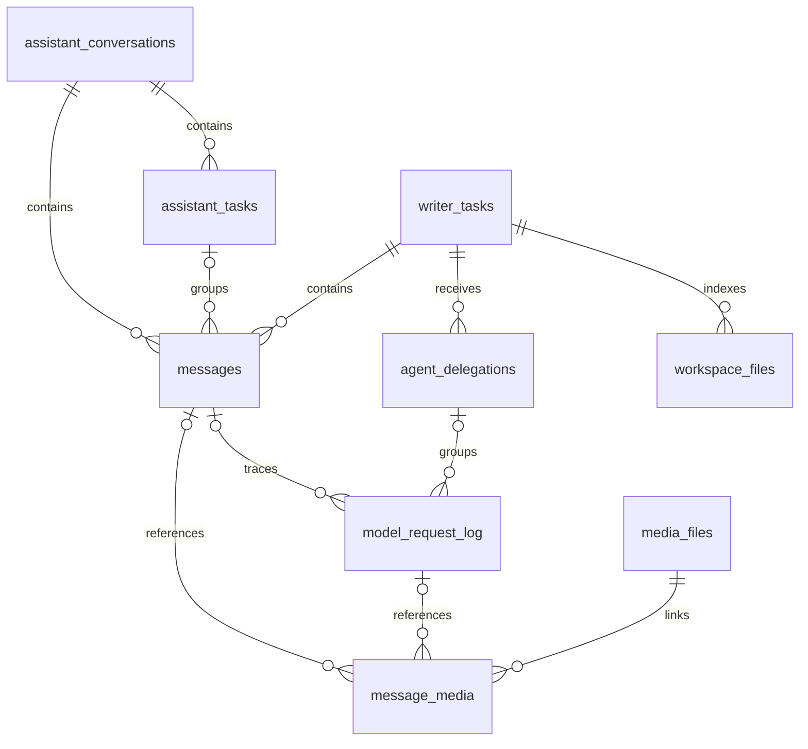

# Structured database storage

DatabaseStorage owns lifecycle and five repository ports: Chat, Tasks, Media, Devices and Workspaces.
DatabaseRepositories is an SQL-free value bundle. App selects SQLiteDatabaseFactory. StorageDatabase
uses StorageCore, domain contracts and StorageFiles; it owns Workspaces coordination but no Agent
execution policy. StorageSQLite alone owns GRDB. All ports share one lifecycle and storageScope.

## Domains and relations

| Table | Ownership and relation |
| --- | --- |
| assistant_conversations | Assistant topic/archival headers; owns rounds and foreground tasks |
| messages | One business round or foreground-task segment; Conversation XOR Writer Task owner |
| assistant_tasks | Foreground task identity, status, summary and source/summary revision fence |
| writer_tasks | Agent-local stable task, history header and current workspace metadata; no permanent completion |
| agent_delegations | Individual assignment, source, execution outcome and independent reporting/retirement receipts |
| model_request_log | Individual model attempt, full protocol/request/result evidence; round FK or auxiliary conversation FK |
| workspace_files | Current file path/size/fingerprint index; belongs to Writer Task, no content/version columns |
| media_files | Image/movie files, ownership, album inclusion and cleanup facts |
| message_media | Round XOR request references to media; protects retained media |
| devices | Native identity, readable key, selection and reconnect facts |

[Chat](Chat/README.md) owns round/request projections and summaries, [Tasks](Tasks/README.md) owns
foreground/delegation records, [Workspaces](Workspaces/README.md) coordinates Files/index,
[Media](Media/README.md) combines file publication with records, [Devices](Devices/README.md) owns
peripheral records. [SQLite](SQLite/README.md) implements each port in the shared pool.

Startup publishes ports only after schema preparation/recovery. Admission closes before shutdown joins
in-flight operations. Original and cleanup failures remain explicit. Passive snapshots expose phase,
never repository data. Files and SQL have no shared transaction; WorkspaceStore repairs interrupted
indexes from authoritative files rather than replaying business work.
