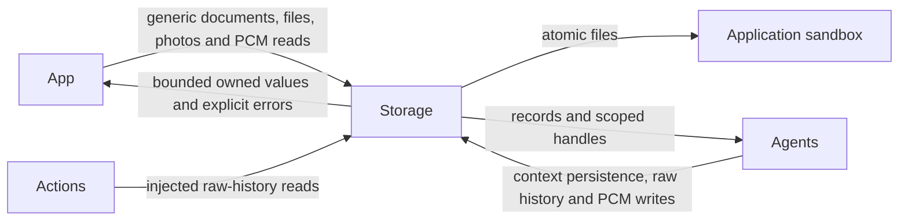
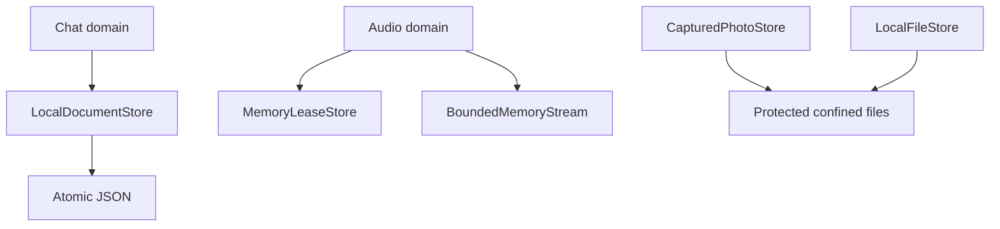

# Storage — Bounded Data and Persistence

## Summary

Independent atomic documents, confined files, scoped memory handles and raw domain schemas.

## Ownership and boundaries

Foundation module with no upper-layer dependencies. Agents choose context/retrieval; App owns schemas and adapters; Actions consumes injected capabilities. UI receives independently owned presentation values. Storage never routes Signals or chooses models.

## External relationships and data flow

Runtime arrows show data or capability calls; dashed arrows show injection.

## Internal structure

## Core contracts

| Mechanism | Current contract |
| --- | --- |
| `LocalDocumentStore` | One cached snapshot; default 64 KiB encoded envelope; versioned atomic write and revision-checked save |
| `LocalFileStore` | Confined root, traversal/symlink rejection, bounded read, reservation and non-overwriting directory publication |
| `MemoryLeaseStore` | Capacity chosen by caller; one checkout; exact namespace/source/session/input owner; optional queue/ready TTL |
| `BoundedMemoryStream` | Item/byte bounds, one suspended reader, explicit overflow, finish/drain and failure |
| `CapturedPhotoStore` | Caller Limits default to 32 JPEG files/128 MiB/16 KiB index; 4 MiB per photo, persisted owner index |

`save(expecting:)` rereads durable revision under a process-wide lock, atomically writes and publishes cache only after success. `replace` is explicit authoritative last-writer-wins. Corruption/version/capacity/conflict errors preserve previous valid state; there is no empty-data fallback. Cross-process transactions are unsupported.

Memory stream append rejects excess rather than suspending; finish drains admitted items, while failure clears them and wakes its reader. Lease removal joins caller cancellation and failure hooks. Terminal errors have separate bounded retention (128 records with caller TTL). Nil TTL delegates lifetime to the owning scope.

File store default reservation budget is 32 GiB; it checks free space and trusted-root confinement. Atomic publication does not overwrite an installed destination. File/directory protection and backup exclusion are technical storage policy, independent of model selection.

Photo reads require exact owner or authorized source/input for archived references. Missing historical files return nil; wrong owner/corrupt size fails. Caller evictOldest policy automatically retires oldest private cache files after a new index commit; default reject policy preserves its old semantics. Native capture/library writes are outside Storage.

✅ Atomic documents, confined files, bounded process memory, raw chat/PCM schemas and owned JPEG storage.

❌ Cross-process/device synchronization, semantic retrieval/forgetting, persistent video/audio libraries and general reclaimable disk caches.

## Related design

[Parent design](../README.md) · [Audio](Audio/README.md) · [Chat](Chat/README.md)

✅ Raw conversation system-message byte bounds match the existing 64 KiB Agent prompt bound. Storage continues to store evidence without interpreting Skills; encoded history capacity and other bounds remain enforced.

## Lifecycle-owned conversation and audio (2026-10-12)

✅ 已移除对话生成、ReACT、收件箱排队、结果屏障、ASR 收尾、TTS 合成及回复占用租约的计时终止。Signal 默认无过期时间，框架不再按通信契约附加 TTL。保留显式实时感知数据的新鲜度和网络传输自身超时；它们不作为对话/语音缓存生命周期。Action 自身超时通过原始执行者的 ActionResult 返回。请求/调用数及队列/PCM 容量仍有界，不以计时自动删除已接纳输入。语音句柄无读等待或错误记录 TTL，按播放完成、输入/会话正常结束、异常或显式取消清理；取消加入生成和播放工作。

✅ CapturedPhotoStore accepts caller-owned Limits (defaults remain 32 photos/128 MiB/16 KiB index; 4 MiB photo cap). App opts into FIFO cache limits. Validate bounds at first I/O, preserve old index/owner records, validate encoded index before file effects and retain transactional rollback. SDK reject policy remains explicit; App FIFO policy retires oldest cache entries instead of failing normal capture at capacity.

✅ Caller OverflowPolicy adds evictOldest for retained photo caches. Trim earliest index entries until count/bytes/encoded-index fit; atomically commit new JPEG/index before deleting retired JPEGs. Index failure removes only new uncommitted file; cleanup failure is explicit and retryable through unindexed-file reconciliation. Historical retired references return nil. SDK default remains reject; App chooses FIFO. Never evict the incoming photo or delete album data.

## Task history indexing and in-place compression

✅ Implemented: StorageChat history v3 deliberately breaks old history encoding; it retains original execution evidence plus separate conversation-owned compression records. No old-format decoder/import or business summary generation exists in Storage.

## 会话存储性能重构 v3

✅ 已实现：LocalDocumentStore 改为按文件隔离 compare-and-replace 锁。StorageChat 使用 current/独立归档/元数据索引和单个归档事务标记；current 缺失可以原子建立，损坏或读写失败明确传播。
