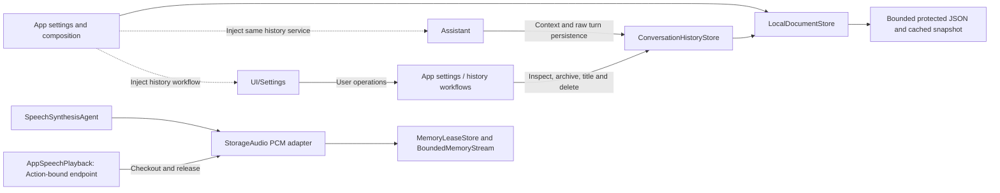
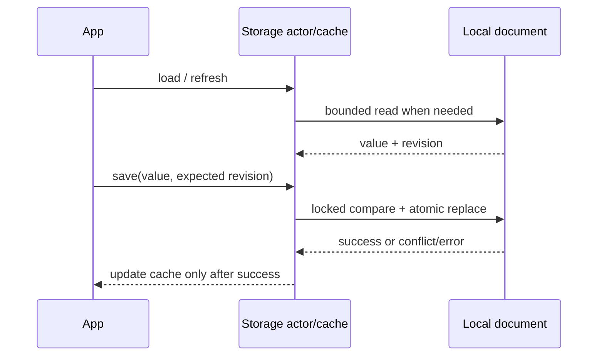
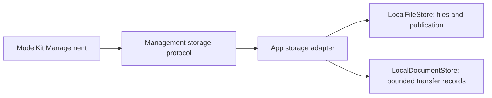

# Storage — Shared Local Storage

Purpose: provide one project-wide home for transient and durable data used by multiple domains. Storage concerns ownership, lifetime, capacity and retrieval. Agents decide what is worth remembering; ModelKit produces results using its own capability values; PlatformKit operates devices. Storage does not perform inference, choose Actions or control hardware.

## Design goals

- Offer a common identity and ownership model for audio, images, attachments, documents and memory records. Each item has an opaque ID, namespace, originating scope and an explicit lifetime policy.
- Distinguish **memory** (process-local and bounded), **cache** (reclaimable, optionally disk-backed) and **persistent** (retained until explicit deletion or a documented retention rule). A disk cache does not promise durable memory.
- Make byte/item limits, expiry, rejection, deletion, cancellation and shutdown explicit. Active readers need leases so expiry cannot remove data mid-consumption; no accepted device Action may disappear silently.
- Keep storage values independent of ModelKit media types and SwiftUI. Domain adapters convert audio frames, images or structured memories at the boundary. App assembles and injects one service where sharing is required.
- Persist large media as bounded files with metadata/indexes rather than forcing all bytes into a database row. A future database may support durable metadata and memory queries; no engine or third-party library is selected yet.

## Upstream and downstream

The base `Storage` target depends only on Foundation. Its direct production consumers are App/AppWorkflows (document assembly/settings), StorageChat (conversation persistence) and StorageAudio (bounded PCM primitives). Agents import StorageChat and StorageAudio. Scheduled Speech Actions consume audio through AppSpeechPlayback.SpeechPlayback; Actions does not depend on StorageAudio. UI imports StorageChat conversation record values only; its pages receive state/operation interfaces rather than a store. These arrows show runtime use, not reverse imports into Storage.



Generic LocalFileStore now supports explicit persistent directory publication; reclaimable disk caches remain planned; the current durable implementation stores settings and conversation records. ModelKit and PlatformKit do not depend on Storage; both own their SDK values without a Types dependency.

## Local cache and persistence synchronization

`LocalDocumentStore<Value>` is a Foundation-only actor providing one bounded JSON document and its read-through, write-through memory cache. The default encoded envelope limit is 64 KiB; oversized reads/writes fail explicitly. One cached snapshot is retained per instance, with no background write queue. App injects a trusted sandbox file URL; the consuming domain owns the payload schema.

- `load()` reuses the cache; `refresh()` reads disk and replaces the cache only on success; `invalidate()` releases the cached value.
- `save(_:expecting:)` rereads the durable revision, rejects stale writers, atomically replaces the file and then updates the cache. A nil expected revision requires an absent file. Failed writes leave the cache unchanged.
- A process-wide lock protects revision comparison and replacement across instances, including different payload types. This is local synchronization, not cross-process locking or cross-device replication. App assembles one owner per settings file. External edits are noticed by refresh or the next save; no filesystem watcher is installed.
- Envelope version 1 is independent of the consumer payload version. Invalid JSON, unsupported envelopes and nonregular files fail explicitly; corrupt data is never silently reset. iOS writes use complete file protection. App controls backup and credential policies.
- App settings and StorageChat are durable consumers. PCM remains transient with explicit reply/session-owned retention and bounded capacity; it does not expire merely while waiting for playback.



## Primitive ownership and lifetime

✅ BoundedMemoryStream and MemoryLeaseStore are actor-isolated process-local primitives with explicit overflow failure, scoped owners, single-reader/checkout behavior, cancellation and optional expiry. StorageAudio adapts these primitives to reply/session-owned PCM. App supplies the shared instance to synthesis and playback.

MemoryLeaseStore accepts nil queueTTL/readyTTL for owner-managed values without arming expiry tasks. BoundedMemoryStream accepts a nil read timeout, leaving completion to producer finish/failure or cancellation. StorageAudio uses both owner-managed policies; bounded error tombstones expire separately.

❌ Global cross-namespace byte budgets, reclaimable disk caches, persistent media, semantic memory and cross-device/cross-process synchronization are not implemented. Each instance supplies its own item/byte bound. Packaged model metadata belongs to Resources; downloaded model files use generic Storage through App injection, with Management owning their lifecycle.

## Directory and target ownership

```text
Storage/                         # Storage target: reusable storage mechanisms only
├── BoundedMemoryStream.swift     # Bounded transient data stream
├── MemoryLeaseStore.swift        # Generic in-memory handles/leases, not semantic memory
├── LocalDocumentStore.swift      # Persistent JSON, cached snapshot and revision synchronization
├── README.md
├── Audio/                       # StorageAudio: audio lifetime and PCM contracts
│   ├── SpeechPCM.swift          # Storage-owned format/frame values
│   ├── SpeechAudio.swift
│   ├── SpeechAudioStore.swift
│   └── README.md
└── Chat/                        # StorageChat: conversation records and journal
    ├── ConversationHistory.swift
    └── README.md
```

The outer layer owns reusable cache, persistence and local synchronization mechanisms. Domain directories own schemas, domain limits, retention and domain-specific APIs. Chat and Audio depend on core; core never imports a domain. StorageChat depends only on Storage.

| Domain | Status and responsibility |
| --- | --- |
| Audio/ | ✅ Process-local single-use PCM; persistent audio remains pending |
| Chat/ | ✅ Raw conversation records, current/archived history, context extraction and durable journal |
| Image/ | ❌ Planned only: image metadata, file/cache handles and retention |
| Video/ | ❌ Planned only: video files, finalization and retention |
| Memory/ | ❌ Planned only: semantic memory records, provenance, retrieval and forgetting; not the core MemoryLeaseStore |

Domain targets depend on core mechanisms, never the reverse. App owns settings payload/credential policy and uses the generic document store. StorageAudio owns PCM values and opaque source identity; both StorageAudio and StorageChat depend only on the internal Storage core. Neither imports Types or another capability/business module.

See [Chat](Chat/README.md) for the journal contract and [Audio](Audio/README.md) for PCM contracts.

## Cooperation with local model resources

✅ LocalFileStore provides generic confined staging, bounded reads/space reservations, non-overwriting directory publication and removal. Trusted root aliases are canonicalized; descendant symlinks/traversal reject. App bridges these primitives to Management and stores actual file/size receipts; bounded transfer/source documents use LocalDocumentStore. Storage remains Foundation-only and has no model JSON, network, provider selection or inference policy. Installed weights are user-managed persistent files.



❌ Generic orphan-directory collection and file-protection acceptance remain pending. Model-specific recovery/maintenance stays in [Management](../ModelKit/Management/README.md#local-model-resources--current-contract).

✅ iOS 本地目录通过原生文件属性 API 设置 completeUntilFirstUserAuthentication 保护，模型文件排除系统备份。❌ 设备锁定期间的真实下载生命周期仍需单独验证。

✅ LocalDocumentStore.replace is an explicit bounded, atomic last-writer-wins operation for single-owner authoritative snapshots; read/modify/write clients retain revision-checked save. File protection defaults to whileUnlocked; an explicit afterFirstUnlock policy permits non-sensitive task bookkeeping while locked after initial unlock. ❌ Device lock-state acceptance remains separate from macOS storage tests.

✅ LocalFileStore.relativePath normalizes both item/root URLs before confinement and relative-path derivation; native /var and /private/var spellings no longer produce shifted paths. ❌ Filesystem alias behavior on physical iOS remains part of device acceptance.

## Foundation dependency contract

✅ Storage core has no project/product dependencies and imports Foundation only. StorageChat and StorageAudio use only Foundation and the internal Storage target; their public records, errors, PCM formats/frames and ownership values are declared within Storage. There are no external typealiases or re-exports.

✅ Generic Codable/Sendable payloads, Error values and injected size/cancellation/removal callbacks use standard Swift contracts. Callers supply implementations through these contracts; Storage never names or locates their concrete Agent, model, platform or App functions. App and Agents own conversion between capability values and storage values.

❌ No concrete external service lookup or implicit model/device/business dependency is permitted.

## Consumer policy boundary

✅ Assistant owns completed-turn selection, its ten-round limit and system/user/assistant request assembly. StorageChat reads current records with an opaque process-local token and persists the caller's exact request only when that token remains current. Successful mutations and unsaved terminal recovery invalidate tokens; stale admission fails explicitly without retry.

✅ UI owns conversation title selection and localized fallback wording. Storage retains original user text, summaryTitle and archive metadata. SpeechSynthesis owns producer timeout and model-output validation; StorageAudio owns PCM validity and lease/cache errors and passes caller-supplied failures unchanged. App adapts known speech errors into user-facing messages after playback cleanup.

✅ Persisted schemas, atomic revisions, bounded writers and reply/session audio ownership remain unchanged. See [ADR0143](../../docs/adr/0143-storage-consumer-policy-boundaries.md).

❌ Broader workflow migration, unified UI intent and conversation-driven task continuation remain planned in [Agent-driven app](../Agent-Driven-App.md). No implicit business/service dependency is permitted in Storage.
