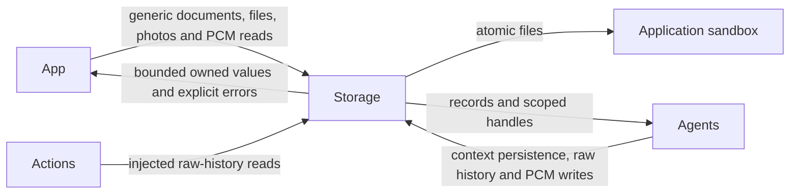
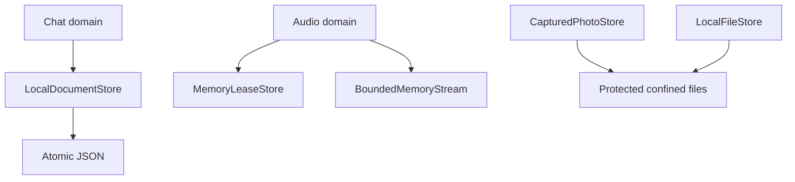

# Storage — Bounded Data and Persistence

## Summary

Independent atomic documents, confined files, scoped memory handles and raw domain schemas.

## Ownership and boundaries

Foundation module with no upper-layer dependencies. Agents choose context/retrieval; App owns schemas and adapters; Actions consumes injected capabilities. UI receives independently owned presentation values. Storage never routes Signals or chooses models.

## External relationships and data flow

Runtime arrows show data or capability calls; dashed arrows show injection.

## Internal structure

## Core contracts

| Mechanism | Current contract |
| --- | --- |
| `LocalDocumentStore` | One cached snapshot; default 64 KiB encoded envelope; versioned atomic write and revision-checked save |
| `LocalFileStore` | Confined root, traversal/symlink rejection, bounded read, reservation and non-overwriting directory publication |
| `MemoryLeaseStore` | Capacity chosen by caller; one checkout; exact namespace/source/session/input owner; optional queue/ready TTL |
| `BoundedMemoryStream` | Item/byte bounds, one suspended reader, explicit overflow, finish/drain and failure |
| `CapturedPhotoStore` | At most 32 JPEG files/128 MiB, 4 MiB per photo, persisted owner index |

`save(expecting:)` rereads durable revision under a process-wide lock, atomically writes and publishes cache only after success. `replace` is explicit authoritative last-writer-wins. Corruption/version/capacity/conflict errors preserve previous valid state; there is no empty-data fallback. Cross-process transactions are unsupported.

Memory stream append rejects excess rather than suspending; finish drains admitted items, while failure clears them and wakes its reader. Lease removal joins caller cancellation and failure hooks. Terminal errors have separate bounded retention (128 records with caller TTL). Nil TTL delegates lifetime to the owning scope.

File store default reservation budget is 32 GiB; it checks free space and trusted-root confinement. Atomic publication does not overwrite an installed destination. File/directory protection and backup exclusion are technical storage policy, independent of model selection.

Photo reads require exact owner or authorized source/input for archived references. Missing historical files return nil; wrong owner/corrupt size fails. No automatic photo eviction exists. Native capture/library writes are outside Storage.

✅ Atomic documents, confined files, bounded process memory, raw chat/PCM schemas and owned JPEG storage.

❌ Cross-process/device synchronization, semantic retrieval/forgetting, persistent video/audio libraries and general reclaimable disk caches.

## Related design

[Parent design](../README.md) · [Audio](Audio/README.md) · [Chat](Chat/README.md)
