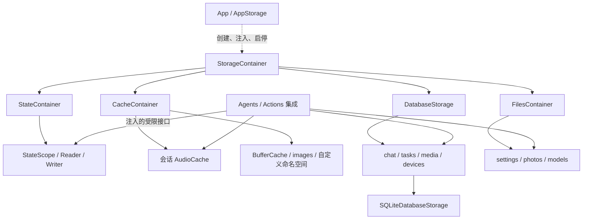

# Storage — State / Cache / Database / Files

## 职责与边界

Storage 提供进程内状态、临时字节、结构化持久化和文件能力。App 选择位置与数据库实现，通过独立 ApplicationContainer 注册根实例并调度生命周期；业务模块获得所需子接口，不访问全局容器。Storage 不依赖 Agents、Actions、Gateway、UI、PlatformKit 或 ModelKit，也不解释业务状态、配置类型和模型选择。

## 上下游与数据流

## 内部结构与编译

| 目录 | 编译目标 | 责任与依赖 |
| --- | --- | --- |
| 根 StorageContainer.swift | Storage | 四类容器组合、启动回滚与加入停止；依赖自身子目标，不依赖 GRDB |
| Support | StorageCore | 公共身份、错误、容量门、有界流和租约；无项目/第三方依赖 |
| State | StorageState | 类型化注册与进程内一致快照；只依赖 StorageCore |
| Cache（含 Audio） | StorageCache | 不可变字节、租约、音频作用域；只依赖 StorageCore |
| Files | StorageFiles | 文档、字节和受控目录；只依赖 StorageCore |
| Database 根 | StorageDatabase | 数据库生命周期协议与四个领域端口 |
| Database/Chat、Tasks、Media、Devices | 独立领域目标 | 记录契约；Chat 使用 Tasks，Media 组合 Files |
| Database/SQLite | StorageSQLite | 共享连接池、领域 SQL 适配、迁移、恢复与关闭；独占 GRDB |

每份源码只有一个编译拥有者。没有统一业务查询 DSL，没有自动内存回退或跨文件/SQL 事务。

## 生命周期与一致性

✅ 构造根容器不打开数据库或创建目录。start 准备 Files 并启动数据库；失败关闭内存/文件能力、清理数据库并保留原始与清理错误；清理成功的正常取消保持 CancellationError。重复启动共享准备任务，失败/停止作用域不复用。stop 同步关闭 State/Cache/Files 接纳，取消并加入启动，关闭 Cache/Files、加入数据库停止；重复停止共享结果。应用消费者先停止，再释放存储；重试只在原作用域清理成功后创建新根。

✅ DatabaseStorage 的 chat/tasks/media/devices 在准备前、关闭后抛错。SQLite 以 WAL、FULL、外键、四读者和一个写者运行；最多 64 个接纳操作，写入一个执行者加 16 等待者。旧仓库引用也受关闭屏障约束。恢复仅修复未完成事实，不重放设备动作。

✅ State 保存可编码的有限公开事实及只读投影；Cache 保存不可变缓冲区。数据库和文件写入成功才承诺对应持久化，不把内存成功解释为重启可恢复。Task/Skill 业务状态仍由 Agents 维护；照片发布仍由 CapturedPhotoStore 组合数据库元数据和文件。

数据库 schema、ID、配置 envelope version 1、文件路径、照片恢复和 FIFO 契约保持。Models 的文件目录能力是真实路径，不用内存实现伪造文件 URL。业务错误保留在生产者；Storage 不生成用户文案。

## 子目录与待完成

[State](State/README.md) · [Cache](Cache/README.md) · [Database](Database/README.md) · [Files](Files/README.md) · [公共机制](Support/README.md)

❌ Skill 动态状态需求与自动提示词上下文、持久化音视频、额外数据库后端、原生播放转换零拷贝不在本轮。自动化、构建、真实模型/UI/设备结果分别见 [验证记录](../../docs/validation/Validation-History.md)。

## 公开 State 边界

✅ State 是公开事实寄存器：原子发布类型化值与编码投影，公开读取绑定作用域；不托管完整 AgentContext 或业务状态机。Storage 不定义 Camera/Robot/Task 类型。

[公开 State 契约](State/README.md)
