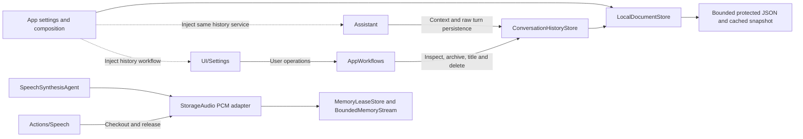
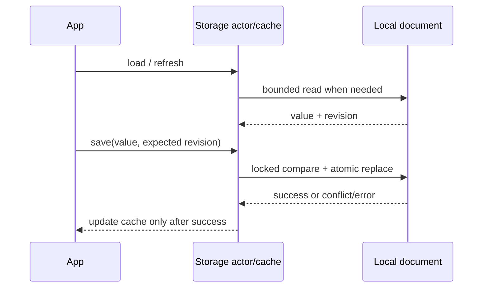

# Storage — Shared Local Storage

Purpose: provide one project-wide home for transient and durable data used by multiple domains. Storage concerns ownership, lifetime, capacity and retrieval. Agents decide what is worth remembering; ModelKit produces media/model values; PlatformKit operates devices. Storage does not perform inference, choose Actions or control hardware.

## Design goals

- Offer a common identity and ownership model for audio, images, attachments, documents and memory records. Each item has an opaque ID, namespace, originating scope and an explicit lifetime policy.
- Distinguish **memory** (process-local and bounded), **cache** (reclaimable, optionally disk-backed) and **persistent** (retained until explicit deletion or a documented retention rule). A disk cache does not promise durable memory.
- Make byte/item limits, expiry, rejection, deletion, cancellation and shutdown explicit. Active readers need leases so expiry cannot remove data mid-consumption; no accepted device Action may disappear silently.
- Keep storage values independent of ModelKit media types and SwiftUI. Domain adapters convert audio frames, images or structured memories at the boundary. App assembles and injects one service where sharing is required.
- Persist large media as bounded files with metadata/indexes rather than forcing all bytes into a database row. A future database may support durable metadata and memory queries; no engine or third-party library is selected yet.

## Upstream and downstream

The base `Storage` target depends only on Foundation. Its direct production consumers are App/AppWorkflows (document assembly/settings), StorageChat (conversation persistence) and StorageAudio (bounded PCM primitives). Agents import StorageChat and StorageAudio. Actions depends on StorageAudio. UI imports StorageChat conversation record values only; its pages receive state/operation interfaces rather than a store. These arrows show runtime use, not reverse imports into Storage.



Generic persistent media files and reclaimable disk caches remain planned; the current durable implementation stores settings and conversation records. ModelKit and PlatformKit do not depend on Storage.


## Local cache and persistence synchronization

✅ `LocalDocumentStore<Value>` is a Foundation-only actor providing one bounded JSON document and its read-through, write-through memory cache. The default encoded envelope limit is 64 KiB; oversized reads/writes fail explicitly. One cached snapshot is retained per instance, with no background write queue. App injects a trusted sandbox file URL; the consuming domain owns the payload schema.

- `load()` reuses the cache; `refresh()` reads disk and replaces the cache only on success; `invalidate()` releases the cached value.
- `save(_:expecting:)` rereads the durable revision, rejects stale writers, atomically replaces the file and then updates the cache. A nil expected revision requires an absent file. Failed writes leave the cache unchanged.
- A process-wide lock protects revision comparison and replacement across instances, including different payload types. This is local synchronization, not cross-process locking or cross-device replication. App assembles one owner per settings file. External edits are noticed by refresh or the next save; no filesystem watcher is installed.
- Envelope version 1 is independent of the consumer payload version. Invalid JSON, unsupported envelopes and nonregular files fail explicitly; corrupt data is never silently reset. iOS writes use complete file protection. App controls backup and credential policies.
- App settings are the first durable consumer. PCM remains transient and retains its existing expiry and capacity rules.



## Staged boundary

✅ The Foundation-only `Storage` target implements `BoundedMemoryStream` and `MemoryLeaseStore`. Both are actor-isolated, bounded process-local primitives with explicit overflow failure, single-reader/checkout behavior, scoped owners, cancellation and expiry. `StorageAudio` under [Audio](Audio/README.md) adapts the production PCM cache; App injects one instance into synthesis and playback. No third-party package is required.

❌ Reclaimable disk caches, persistent media and semantic memory records require concrete consumers, retention rules and separate verification. The general primitives do not yet coordinate global byte budgets across namespaces; each instance supplies an explicit item and byte bound.

✅ App settings define their layout, payload schema, legacy migration and device-local credential policy in [App](../App/README.md). ❌ Cross-device sync, cross-process writers, general persistent media/indexes and automatic disk-cache eviction are not implemented. Model weights remain in the resource system.

## Directory and target ownership

```text
Storage/                         # Storage target: reusable storage mechanisms only
├── BoundedMemoryStream.swift     # Bounded transient data stream
├── MemoryLeaseStore.swift        # Generic in-memory handles/leases, not semantic memory
├── LocalDocumentStore.swift      # Persistent JSON, cached snapshot and revision synchronization
├── README.md
├── Audio/                       # StorageAudio: audio lifetime and PCM contracts
│   ├── SpeechAudio.swift
│   ├── SpeechAudioStore.swift
│   └── README.md
└── Chat/                        # StorageChat: conversation records and journal
    ├── ConversationHistory.swift
    └── README.md
```

✅ The outer layer owns reusable cache, persistence and local synchronization mechanisms. Domain directories own schemas, domain limits, retention and domain-specific APIs. Chat and Audio depend on core; core never imports a domain. StorageChat depends only on Storage. Existing file formats, paths on disk and data limits are unchanged by the source move.

| Domain | Status and responsibility |
| --- | --- |
| Audio/ | ✅ Process-local single-use PCM; persistent audio remains pending |
| Chat/ | ✅ Raw conversation records, current/archived history, context extraction and durable journal |
| Image/ | ❌ Planned only: image metadata, file/cache handles and retention |
| Video/ | ❌ Planned only: video files, finalization and retention |
| Memory/ | ❌ Planned only: semantic memory records, provenance, retrieval and forgetting; not the core MemoryLeaseStore |

Do not create a domain directory or target until a concrete implementation exists. New domains follow the same dependency direction and must document bounds, deletion, ownership and verification. Core synchronization currently means process-local revision locking/cache coherence; cross-device synchronization and reclaimable disk cache remain unimplemented. App-owned settings schemas remain in App, using the generic document store.

See [Chat](Chat/README.md) for the moved journal contract and [Audio](Audio/README.md) for PCM contracts.
