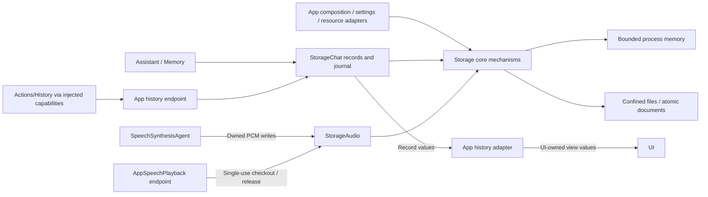
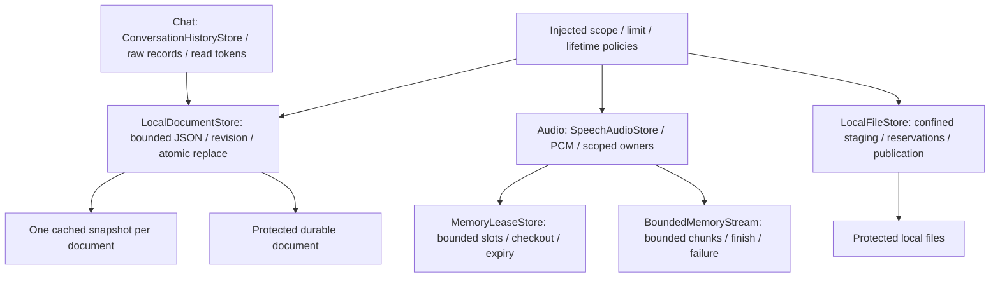
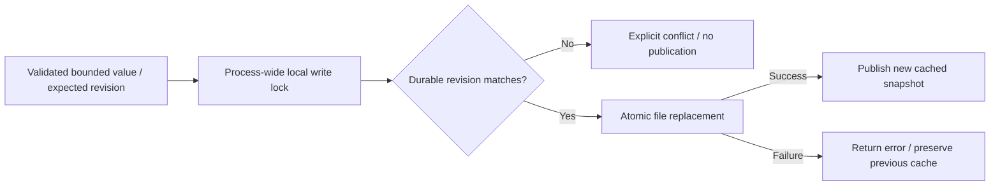

# Storage — Bounded Data and Persistence

Storage provides reusable storage mechanisms and domain data structures for transient and durable data. It owns consistency, capacity, ownership and retention; Agents own retrieval strategy and business decisions. Storage does not perform inference, choose actions or provide localized presentation.

Design goals: independent schemas, explicit byte/item bounds and lifetimes, atomic persistence, scoped readers and neutral errors. Memory, reclaimable cache and durable records have distinct contracts.

## Upstream and downstream

Arrows show capability calls/data movement; they are not Signal transport. App injects shared stores. ModelKit and PlatformKit do not import Storage.

Agents may read/write foundational stores directly for context and internal cache work. Complete exposed history operations use registered functions and Gateway feedback. UI imports no Storage target; App copies records into independently owned presentation values. Storage never delivers Agent messages.

## Internal structure

Arrows show domain targets using the independent Storage core and its persistence/cache mechanisms.

## Design principles and core mechanisms

**Store evidence, not decisions.** Raw conversation/model records and caller-supplied metadata are retained without choosing prompts, titles, retrieval priority or recovery actions. Opaque read tokens prevent a request assembled against obsolete history from being persisted after mutation; they are local consistency tokens, not Agent permissions.

| Data class | Ownership/lifetime | Current scope |
| --- | --- | --- |
| Memory | Process-local, item/byte bounded; scoped lease/read ownership and optional expiry | Implemented primitives and transient PCM |
| Cache | Reusable/reclaimable values; no durable-memory promise | Document read-through/write-through snapshot; general disk cache pending |
| Persistent | Explicit deletion or documented retention; atomic durable publication | Settings/journal documents and generic installed-file mechanisms |

**Publish only after persistence succeeds.** Revision checks and atomic file replacement precede cache updates. Read/modify/write clients use `save(..., expecting:)`; only authoritative single-owner snapshots use `replace`. A failed write leaves the cache unchanged and corrupt input is surfaced rather than reset.

**Cancellation does not undo durability.** Reader/writer ownership and cancellation protect live consumption; a committed archive/delete remains committed even when later Agent feedback fails. Model installation policy belongs to Management through injected storage interfaces; file confinement, reservations and protected publication belong here.

## Ownership and compilation

| Target / directory | Implemented contract |
| --- | --- |
| Storage core | Foundation-only actors/primitives and bounded owned JPEG files; no project/product dependencies |
| `Chat/` / StorageChat | Raw conversation records, current/archive journal, atomic mutations and opaque read-token admission; depends only on Storage |
| `Audio/` / StorageAudio | PCM values, reply/session-owned leases and single-use audio checkout; depends only on Storage |

Core never imports a domain or concrete business service. App owns settings/credential schemas and bridges generic storage to ModelKit management. StorageAudio values are independent of model/platform PCM; calling Agents/adapters perform conversion.

## Consistency and lifetime

- LocalDocumentStore retains one cached snapshot with no write backlog. Default envelope limit is 64 KiB; oversized/corrupt/unsupported documents fail explicitly without reset.
- Revision-checked save rereads durable state under a process-wide lock, atomically replaces the file and updates cache only after success. `replace` is explicit authoritative last-writer-wins. This is not cross-process/device synchronization; refresh detects external edits.
- LocalFileStore confines reads/writes/publication to trusted roots, rejects traversal/descendant symlinks, reserves bounded space and publishes without overwriting installed directories. App chooses protection/backup policies.
- Memory primitives have explicit item/byte capacities, reader ownership, cancellation and optional expiry. StorageAudio uses owner-managed lifetime while queued/ready; no device work is silently dropped. Error tombstones have separate bounded retention.
- Assistant chooses completed-turn context and its ten-round limit. StorageChat persists the exact request only while its opaque read token is current; mutations invalidate stale admission.
- UI selects title/fallback wording; SpeechSynthesis classifies producer failures. Storage preserves records and caller-supplied failures without business interpretation.

## Implementation status

✅ Bounded transient PCM, atomic documents/journal, confined files, explicit revisions/leases and neutral domain schemas. Consumer processing/presentation policy is outside Storage.

❌ Photo galleries/export, persistent video/audio domains, semantic memory/retrieval/forgetting, reclaimable disk caches, cross-namespace budgets and cross-device/process synchronization are not implemented. MemoryLeaseStore is a cache primitive, not a semantic memory Agent. File-protection and locked-device acceptance remain separate.

See [Chat](Chat/README.md), [Audio](Audio/README.md), [Model management](../ModelKit/Management/README.md) and [Agent-driven architecture](../README.md).

## Bounded registered-observation continuation

✅ Implemented: Assistant correlates generated Action/Tool calls with runtime-only feedback under the original turn, awaits complete results and requests the next model round. Limits: four total model rounds,16 native calls,64 KiB aggregate feedback/transcript and one30-second joined generation worker. A failed call becomes data for the model, never an automatic function retry. Cancellation clears owned feedback state and joins model cleanup; unknown/stale/duplicate feedback cannot resume a turn. Internal UI receipts and explicit /status retain their existing handling.

✅ Implemented: ModelKit ChatMessage gains provider-neutral assistant tool-call declarations and tool-result messages. OpenAI serializes request-local aliases consistently across declarations and prior calls; Gemma rejects native transcripts explicitly. Storage keeps optional exact text/native continuation JSON and metadata-only image descriptors as data, with bounded records and unchanged v1 compatibility. Camera native model calls use explicit observation registration so actual completion/error can continue reasoning. No change to camera or NexArm function implementation.

## Action/Tool generation rounds — ADR0183

✅ Implemented: text/XML resolves to ActionCall; Assistant maps natural text to Speech playback and Display caption Actions. Only Actions enter Channel/wait. Native ToolCalls execute directly, with at most four concurrent calls and sixteen total per Assistant input. Registration declares recordOnly/observation independently of return values. Separate ActionResult/ToolResult feedback is correlated by call and round, merged in emission order after all calls settle, and only observation enables another model request. Four requests,120 generated calls,64 KiB feedback/transcript and a30-second joined input deadline bound the loop.

✅ StorageChat persists optional bounded generationRounds and text/native continuation requests with metadata-only image descriptors; existing version-1 histories still decode. Execution evidence is distinct from raw model text.

❌ Live-model, native UI and physical-device acceptance remain pending; local native Tools and generic Agent request/reply are not implemented. See [ADR0183](../../docs/adr/0183-generation-round-observations.md).

## Assistant photo observation — ADR0184

✅ Implemented: CapturedPhotoStore in this existing directory writes bounded JPEG files atomically with owner metadata, scopes reads by source/session/input, limits32 files/128MiB, rejects overflow without deleting photos, and never owns capture or inference.

❌ Real camera/shutter/animation and configured-model vision acceptance remain pending; video recording and system Photos export are outside this iteration.

## History image thumbnails

✅ Implemented: CapturedPhotoStore adds readForInput(id,source,input), a bounded read for archived references across session restarts. Missing indexed/file data returns nil; wrong source/input and corrupt lengths reject explicitly. Existing exact-owner read remains unchanged. Both APIs share the same bounded file-read helper; no photo eviction or new persisted schema is introduced.

❌ Native image/layout and live-model acceptance remain separate from automated verification.
