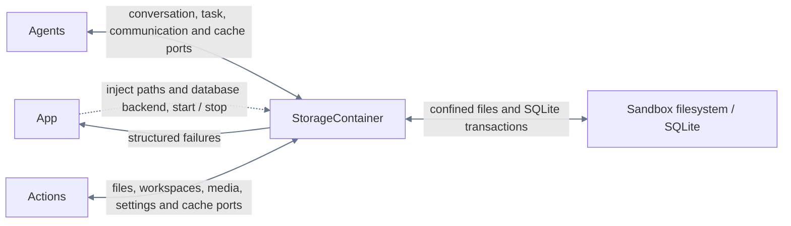
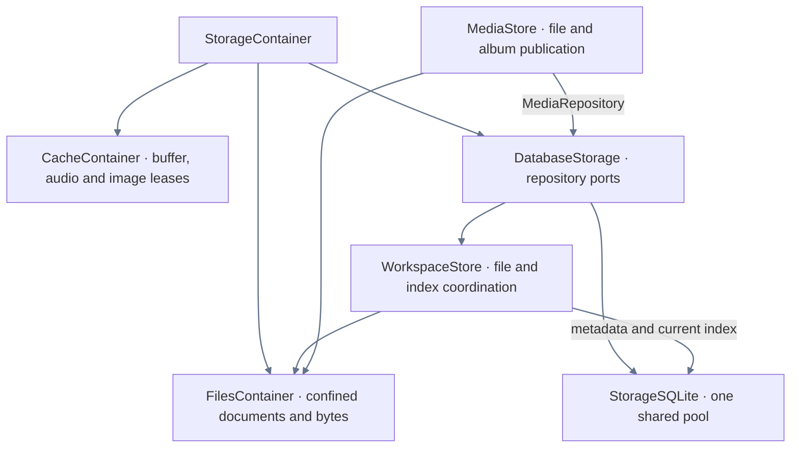

# Storage — Cache / Database / Files

## Responsibilities and boundaries

Storage provides temporary bytes, structured persistence and confined filesystem capabilities. App owns
construction, paths, dependency injection and lifecycle. Storage never imports Agents, Actions, Gateway,
UI, PlatformKit or ModelKit, and does not decide model work, scheduling, rendering or user messages.

## Upstream and downstream

## Internal ownership

| Owner | Interface and downstream relationship |
| --- | --- |
| StorageContainer | Composes CacheContainer, DatabaseStorage and FilesContainer; App starts/stops it |
| StorageCore | Root StorageFailure and Support contracts: IDs, classified snapshots, gates and errors; no project dependencies |
| StorageCache | CacheContainer entry, immutable byte leases, namespaced buffers and audio scopes; depends on Core |
| StorageFiles | Generic documents, controlled paths, bytes and directories; depends on Core |
| StorageDatabase | Database lifecycle/ports and Workspaces file/index coordination; consumes domain contracts and Files |
| StorageChat / StorageTasks | Conversation rounds, requests, summaries and delegation contracts; Chat consumes Tasks |
| StorageMedia / StorageDevices | Media publication and device records; Media consumes Files |
| StorageSQLite | Table-owned public contracts and GRDB operations selected by explicit sources, cross-table transactions and one shared pool; implements all database ports |

## Internal flow

## Lifecycle and data flow

Construction creates no directories or database. Start prepares Files and opens/recovers the database
before publishing ports. Failure retains original and cleanup errors. Stop closes admission, joins
startup and in-flight work, closes Cache/Files and shuts down the database; repeated stops join the
same result. Existing handles reject new work after closure. App stops consumers before storage.
SQLite uses WAL, FULL synchronization, foreign keys, four readers, one writer plus sixteen waiting
writes and at most sixty-four admitted operations. Overflow fails explicitly; failed persistence never
becomes memory-only success. Recovery records interrupted facts and never replays model/device work.

## Persistence contracts

[Database](Database/README.md) owns eleven domain tables. Assistant conversations, foreground tasks and complete messages are independent of Writer workspaces and delegation/message records; only communication and request logging are shared. Raw rounds survive task summary projection. Full HTTP request/response bytes (including SSE and images), parameters and generation metadata live in deletable logs. Clearing logs preserves business messages and results; lists/context do not load Base64. Database startup migrates supported older schemas before opening the repositories and rejects unknown newer versions. See [schema preparation](Database/README.md#编译与生命周期). Credentials and models are outside this database.

[Workspaces](Database/WriterWorkspaces/README.md) coordinates current filesystem source and SQL metadata. Writer-owned selection atomically binds a delegation to one workspace without moving existing messages; Storage validates persistence constraints without choosing the work from natural language.
No source body or historical file version is stored in SQLite. [Files](Files/README.md) owns generic
atomic replacement and sandbox checks. Media files remain independent of conversation deletion.
[Cache](Cache/README.md) owns temporary buffers; [Support](Support/README.md) owns reusable contracts.

## Observation and failure reporting

StorageCore snapshots expose classified lifecycle, admission and resource facts without opening files,
creating directories or accessing repositories. Unknown backend state remains unknown. No public
snapshot pretends several backends were atomically sampled. StorageFailureReporter is an injected
Sendable callback; App connects it to diagnostics. It never interprets business errors or changes the
throwing result. StorageFailure preserves underlying errors, cancellation and cleanup errors separately.

Camera photos use the dedicated [Image cache](Cache/README.md#session-image-cache), with a separate session budget and FIFO lifecycle. Explicit save publishes original bytes and independent album media_N metadata through MediaStore while the session copy remains until eviction/window close. Memory-only preview numbers belong to Camera. Storage neither chooses model attachments nor persists preview counters. History reads images only from captured request logs; clearing logs removes those images without a live-cache or album fallback. Camera album rows contain no preview/session association and are read by media_N.

Database owns schema assembly and recovery. Assistant and Writer have independent history ports and projections. Their actual model requests retain the full business input and original input, including applicable coordination evidence. Writer delegations have independent execution records. Request preparation and discarded input create no message row.
