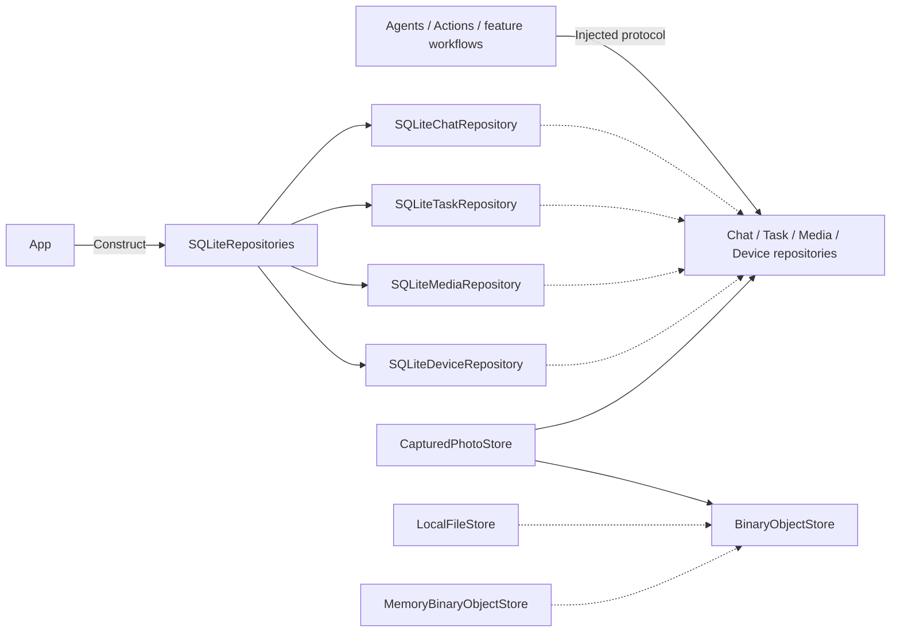

# Storage — Contracts, Domain Repositories and Backends

## Ownership and boundaries

Storage owns record persistence and bounded process memory, without Agent decisions, model selection, device execution or UI orchestration. ModelKit, PlatformKit and UI remain independent. App chooses backends, paths and lifecycle, then injects domain protocols; consumers do not discover stores globally.

Directory ownership differs from compilation ownership: each business directory contains its contracts/policy and its SQLite adapter, but backend files compile only in StorageSQLite. The common Storage target compiles Support excluding SQLite and has no project or third-party target dependency. StorageSQLite alone links GRDB.swift7.11.1; its SQL/GRDB values are internal. There is no Storage.swift umbrella or Storage.shared locator.

## Direct relationships and internal components

| Directory / target | Owns | Direct relationships |
| --- | --- | --- |
| Support / Storage | Document/binary contracts, ownership/errors/identity/fingerprints; File/Memory mechanisms | Foundation, Synchronization, CryptoKit; used by all domains and injected App document consumers |
| Chat / StorageChat | Dialog/message values, ChatRepository, ConversationRecordStore, memory history/checkpoints/windows | Storage and StorageTasks; Agents/Actions/App consume it |
| Tasks / StorageTasks | TaskRepository and explicit ephemeral MemoryTaskRepository | Storage; Agents/Chat consume it |
| Audio / StorageAudio | Single-use PCM handles and producer/player ownership | Storage; synthesis/playback owners consume it |
| Media / StorageMedia | MediaRepository and JPEG delivery/recovery/FIFO policy | Storage; ActionBindings camera / AgentBindings history readers consume it |
| Devices / StorageDevices | DeviceRepository mapping/selection/reconnect contract | Storage; ActionBindings Bluetooth service consumes it |
| SQLite files / StorageSQLite | Domain schemas/queries, shared connection pool, explicit construction owner | Storage plus Chat/Tasks/Media/Devices contracts and GRDB; only App construction and backend tests use it |

Individual products expose common/domain libraries without requiring the aggregate application product. New backends implement the same domain/capability interfaces; there are no empty MongoDB/document-database adapters or additional ORM dependency.

## Contracts and consistency

DocumentRepository<Value> supplies load/refresh/invalidate, UUID-revision compare-and-replace and explicit replacement. LocalDocumentStore and MemoryDocumentStore share that contract; durability is persistent or memory, respectively. BinaryObjectStore supplies bounded reads/info, non-overwriting publication, deletion and bounded object listing; LocalFileStore and MemoryBinaryObjectStore implement it. Success in memory never promises survival after restart. Native model-artifact directory materialization remains a File capability chosen in ActionBindings' adapter, rather than a fabricated memory filesystem URL.

Domain protocols are async and return owned values, never SQL predicates, table handles or GRDB rows. ChatRepository checkpoint commits messages and Task compression/source facts atomically. Its paired TaskRepository must have the same opaque runtime storageScope; mismatched namespaces reject construction even if their task_N strings coincide. App uses one SQLiteRepositories family. There is no file/database combined transaction or transaction across model/device awaits.

StorageOperationGate provides FIFO admission across async backend calls: one active operation and at most16 waiters; overflow busy. Ordinary cancelled queued callers release admission without executing their body; captured checkpoints run a joined store-owned operation so cancellation terminal data still persists. Chat checkpoint/rotation cache updates and Media publication/recovery reuse it. Caller lifecycle remains responsible for joining accepted work; no page owns database lifetime.

## SQLite records and performance

One App-owned records.sqlite uses WAL, foreign keys, synchronous FULL, four readers and one writer plus16 waiters. Generic SQLiteDatabase executes caller-supplied migrations/transactions; business schemas and queries stay in owning domain files. The records-v1 tables are retained; record-lifecycle-v2 adds an unfinished-message index. Named migrations come from domain assembly; no legacy JSON import exists.

Business tables allocate independently committed AUTOINCREMENT keys and format dialog_/message_/task_/media_/device_ references. Deleted committed keys do not repeat and gaps are allowed. BusinessRecordID validates/formats references only. Technical scopes/calls/requests/audio/revisions/temp files use UUID or original protocol strings; there is no application-wide ID generator/counter file. Standalone memory conversation/Task consumers allocate ephemeral business records locally and open no SQLite connection.

Message identities commit before references escape. Complete user/Assistant/ReACT observation content commits separately; delta stays in memory. A completed user message stays completed even if its Assistant response is cancelled. Dirty-input hashes and window-bounded fingerprints skip unchanged messages. List/pair/title reads use stored240-character previews and omit large body/evidence/recovery data. Details restore exact text; UTF-8 chunks deduplicate shared request/catalog content. Position plus primary-key tie-breaking preserves history order; UI/Task pages have20 items and context retains ten projected blocks. Full Task source indexes survive memory offloading. Startup recovery repairs unfinished facts without replaying actions.

## Media lifecycle

App injects MediaRepository and BinaryObjectStore independently. CapturedPhotoStore currently produces JPEG: at most4MiB each, application1024 files/2GiB and FIFO eviction; default32 files/128MiB. Pending metadata reserves a committed key/path, binary bytes publish outside SQL, then ready commits before media_N is returned. Formal names are UTC yyyyMMdd_HHmmss_primaryKey.jpg; File backend temp names use UUID. Failure preserves prior destinations and records truthful failed/unavailable states. Startup checks pending regular-file size; bounded128-object cleanup resumes by cursor and ignores unrelated old/user filenames. Historical references remain after FIFO removal; deleting a dialog does not delete other media files.

## Completion and outstanding work

Agent 热状态使用进程内存；配置/偏好文档使用 File 后端，业务记录使用领域仓库注入的 SQLite 后端。仓库、提交、并发与损坏错误显式传播，不自动切换后端。

[Chat](Chat/README.md) · [Tasks](Tasks/README.md) · [Media](Media/README.md) · [Devices](Devices/README.md) · [Audio](Audio/README.md) · [Support](Support/README.md)

[Repository refactor decision](../../docs/completed/Storage-Repository-Plan.md)

File 文档 envelope version 为 1，以 UUID revision 和 value 保存配置。媒体原件位于 CapturedPhotos；SQLite 索引业务媒体记录，不自动导入或删除未被索引的用户文件。

Lifecycle and ORM: StateRepository<Value: Sendable> and single-snapshot MemoryStateStore own hot runtime state without Codable or per-update encoding. ChatRepository.beginMessage reserves an idempotent empty Assistant/observation identity row; message completion/checkpoint saves content by that identity. Accepted user messages insert completed content directly. SQL row mappings use GRDB FetchableRecord/MutablePersistableRecord; specialized indexed reads remain SQL. No GRDB object or shared mutable reference crosses modules. Task start rows/terminal updates and atomic dialog rotation remain.

User acceptance inserts the complete completed message in one transaction, with no empty user placeholder. Checkpoints return backend-neutral committed message identities; Chat memory publishes the returned ID before inference. Assistant identities are reserved before inference.

Current-dialog synchronization: one current per Agent remains constrained by the existing partial unique index. Failed post-rotation memory publication fences subsequent operations until authoritative current reload succeeds. New message rows and identity reservations require a current dialog in the same write transaction; existing archived-message evidence may still update.

## 待实现

- Additional chat/document-database backends, semantic memory extraction/query, durable PCM and video/audio/document producers remain separate work. Current controlled tests/builds do not establish physical camera/Bluetooth/UI or live-model acceptance. See [validation history](../../docs/validation/Validation-History.md).
