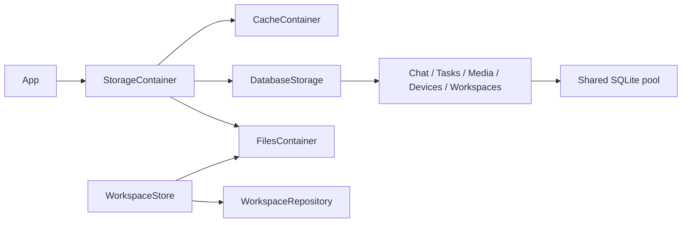

# Storage — Cache / Database / Files

## Responsibilities and boundaries

Storage provides temporary bytes, structured persistence and confined filesystem capabilities. App owns
construction, paths, dependency injection and lifecycle. Storage never imports Agents, Actions, Gateway,
UI, PlatformKit or ModelKit, and does not decide model work, scheduling, rendering or user messages.

## Direct relationships and internal design

| Owner | Interface and downstream relationship |
| --- | --- |
| StorageContainer | Composes CacheContainer, DatabaseStorage and FilesContainer; App starts/stops it |
| StorageCore | Root StorageFailure and Support contracts: IDs, classified snapshots, gates and errors; no project dependencies |
| StorageCache | CacheContainer entry, immutable byte leases, namespaced buffers and audio scopes; depends on Core |
| StorageFiles | Generic documents, controlled paths, bytes and directories; depends on Core |
| StorageDatabase | Database lifecycle/ports and Workspaces file/index coordination; consumes domain contracts and Files |
| StorageChat / StorageTasks | Conversation rounds, requests, summaries and delegation contracts; Chat consumes Tasks |
| StorageMedia / StorageDevices | Media publication and device records; Media consumes Files |
| StorageSQLite | SQL implementations and one GRDB pool; implements all database ports |

## Lifecycle and data flow

Construction creates no directories or database. Start prepares Files and opens/recovers the database
before publishing ports. Failure retains original and cleanup errors. Stop closes admission, joins
startup and in-flight work, closes Cache/Files and shuts down the database; repeated stops join the
same result. Existing handles reject new work after closure. App stops consumers before storage.
SQLite uses WAL, FULL synchronization, foreign keys, four readers, one writer plus sixteen waiting
writes and at most sixty-four admitted operations. Overflow fails explicitly; failed persistence never
becomes memory-only success. Recovery records interrupted facts and never replays model/device work.

## Persistence contracts

[Database](Database/README.md) owns ten domain tables and shared request logs. Writer task identity is
agent/task_N; Assistant conversations and foreground tasks remain separate. Raw rounds survive task
summary projection. Full model protocol logs are JSON TEXT without chunk/evidence storage. Development
schema mismatch rebuilds SQLite without importing older formats; credentials and models are outside it.

[Workspaces](Database/Workspaces/README.md) coordinates current filesystem source and SQL metadata.
No source body or historical file version is stored in SQLite. [Files](Files/README.md) owns generic
atomic replacement and sandbox checks. Media files remain independent of conversation deletion.
[Cache](Cache/README.md) owns temporary buffers; [Support](Support/README.md) owns reusable contracts.

## Observation and failure reporting

StorageCore snapshots expose classified lifecycle, admission and resource facts without opening files,
creating directories or accessing repositories. Unknown backend state remains unknown. No public
snapshot pretends several backends were atomically sampled. StorageFailureReporter is an injected
Sendable callback; App connects it to diagnostics. It never interprets business errors or changes the
throwing result. StorageFailure preserves underlying errors, cancellation and cleanup errors separately.
