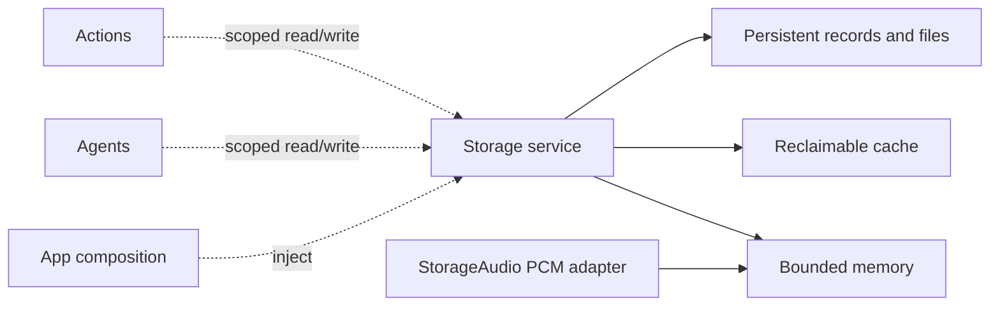
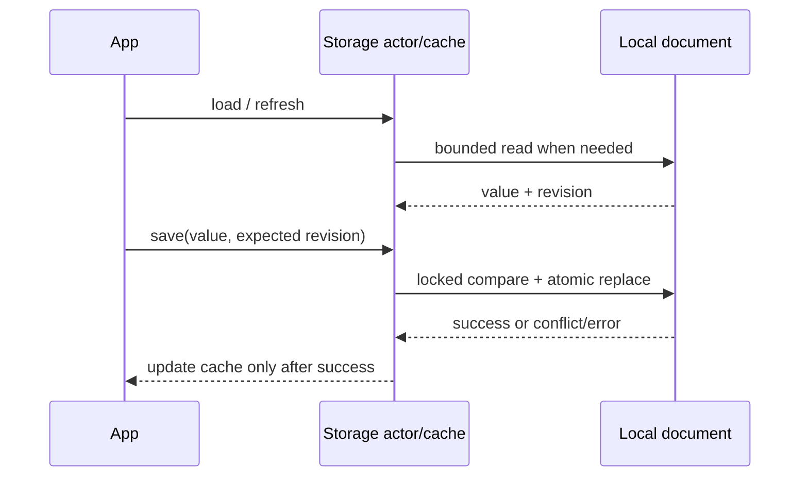
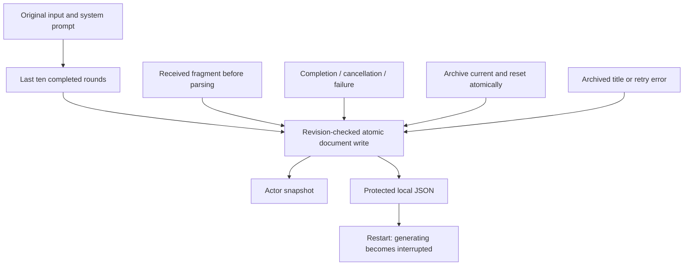

# Storage — Shared Local Storage

Purpose: provide one project-wide home for transient and durable data used by multiple domains. Storage concerns ownership, lifetime, capacity and retrieval. Agents decide what is worth remembering; ModelKit produces media/model values; PlatformKit operates devices. Storage does not perform inference, choose Actions or control hardware.

## Design goals

- Offer a common identity and ownership model for audio, images, attachments, documents and memory records. Each item has an opaque ID, namespace, originating scope and an explicit lifetime policy.
- Distinguish **memory** (process-local and bounded), **cache** (reclaimable, optionally disk-backed) and **persistent** (retained until explicit deletion or a documented retention rule). A disk cache does not promise durable memory.
- Make byte/item limits, expiry, rejection, deletion, cancellation and shutdown explicit. Active readers need leases so expiry cannot remove data mid-consumption; no accepted device Action may disappear silently.
- Keep storage values independent of ModelKit media types and SwiftUI. Domain adapters convert audio frames, images or structured memories at the boundary. App assembles and injects one service where sharing is required.
- Persist large media as bounded files with metadata/indexes rather than forcing all bytes into a database row. A future database may support durable metadata and memory queries; no engine or third-party library is selected yet.

## Local cache and persistence synchronization

✅ `LocalDocumentStore<Value>` is a Foundation-only actor providing one bounded JSON document and its read-through, write-through memory cache. The default encoded envelope limit is 64 KiB; oversized reads/writes fail explicitly. One cached snapshot is retained per instance, with no background write queue. App injects a trusted sandbox file URL; the consuming domain owns the payload schema.

- `load()` reuses the cache; `refresh()` reads disk and replaces the cache only on success; `invalidate()` releases the cached value.
- `save(_:expecting:)` rereads the durable revision, rejects stale writers, atomically replaces the file and then updates the cache. A nil expected revision requires an absent file. Failed writes leave the cache unchanged.
- A process-wide lock protects revision comparison and replacement across instances, including different payload types. This is local synchronization, not cross-process locking or cross-device replication. App assembles one owner per settings file. External edits are noticed by refresh or the next save; no filesystem watcher is installed.
- Envelope version 1 is independent of the consumer payload version. Invalid JSON, unsupported envelopes and nonregular files fail explicitly; corrupt data is never silently reset. iOS writes use complete file protection. App controls backup and credential policies.
- App settings are the first durable consumer. PCM remains transient and retains its existing expiry and capacity rules.

## Staged boundary

✅ The Foundation-only `Storage` target implements `BoundedMemoryStream` and `MemoryLeaseStore`. Both are actor-isolated, bounded process-local primitives with explicit overflow failure, single-reader/checkout behavior, scoped owners, cancellation and expiry. `StorageAudio` under [Audio](Audio/README.md) adapts the production PCM cache; App injects one instance into synthesis and playback. No third-party package is required.

❌ Reclaimable disk caches, persistent media and semantic memory records require concrete consumers, retention rules and separate verification. The general primitives do not yet coordinate global byte budgets across namespaces; each instance supplies an explicit item and byte bound.

✅ App settings define their layout, payload schema, legacy migration and device-local credential policy in [App](../App/README.md). ❌ Cross-device sync, cross-process writers, general persistent media/indexes and automatic disk-cache eviction are not implemented. Model weights remain in the resource system.

## Conversation journal

✅ ConversationHistoryStore is the Foundation-only domain store for current and archived conversations. App provides one LocalDocumentStore<ConversationArchive> and injects that owner into Assistant and the history UI. A nil document explicitly selects volatile storage for tests, never production fallback. The versioned payload stores original user text, exact request messages, model label/options, received text fragments, generation status/finish reason/error and optional execution error. Credentials and media are not recorded. Current title is computed from the latest original user input; only archived conversations have a generated summary title.

| Bound | Policy |
| --- | --- |
| Journal document | 32 MiB encoded envelope; reject excess, no automatic eviction |
| Conversations | One current plus at most 64 archives; explicit deletion of archives |
| Turns | At most 256 per conversation; start a new conversation when full |
| Input / system / model label | 4096 / 32768 / 512 UTF-8 bytes per record |
| Received raw response | 256 KiB / 8192 fragments; reject excess preserving prior data |
| Context | Latest ten completed rounds of current conversation, oldest to newest; no archived or failed rounds |
| Title / error | 80 characters / 4096 characters |
| Mutations | One actor-owned write admission; concurrent mutation fails busy, no queue |

Each accepted fragment is atomically persisted before current Action parsing. Admission/append reserve encoded headroom for terminal error state. Disk failures preserve the previous durable revision and surface explicitly. If a terminal write fails after the producer has stopped, the in-memory record is marked interrupted with an unsaved-status error so it cannot permanently fence the next input; a later successful write persists that recovery state. Interrupted generating records loaded after restart are marked interrupted in the snapshot and excluded from context. A subsequent successful write persists that recovery state. New conversation is one atomic archive-and-reset write; pending title failure never loses the archived conversation. An active producer blocks archival until stopped/joined.

❌ Cross-process writers, cross-device sync, semantic retrieval, compressed archives and automatic retention are not implemented. Whole-document fragment writes favor diagnostic durability; no background unbounded flush queue exists. Provider token budgets are independent of journal storage limits.

✅ Chat output-token budgets are optional and default to nil. Assistant/cloud requests omit max_tokens so the provider chooses its default; local Qwen uses remaining room in its existing 4096-token context. History shows 模型默认 for omitted values and preserves older explicit budgets. The separate 2000-byte whole-reply cap is removed; parser, queue, timeout and per-segment bounds remain. Explicit title/warmup budgets are unchanged. ❌ Live-provider/device acceptance remains separate.
