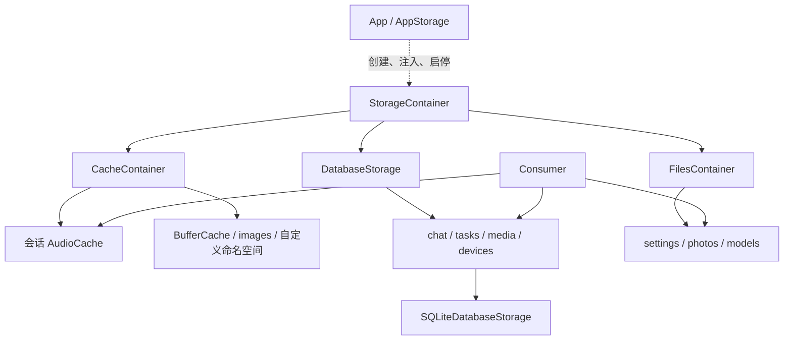

# Storage — Cache / Database / Files

✅ StorageFailure.swift 迁至模块根，与 StorageContainer.swift 并列；异常仍编译于无项目依赖的 StorageCore，容器仍编译于 Storage，公开类型和行为保持。

## 职责与边界

Storage 提供临时字节、结构化持久化和文件能力。App 选择位置与数据库实现，通过独立 ApplicationContainer 注册根实例并调度生命周期；业务模块获得所需子接口，不访问全局容器。Storage 不依赖 Agents、Actions、Gateway、UI、PlatformKit 或 ModelKit，也不解释业务状态、配置类型和模型选择。

## 上下游与数据流

## 内部结构与编译

| 目录                                 | 编译目标        | 责任与依赖                                                    |
| ------------------------------------ | --------------- | ------------------------------------------------------------- |
| 根 StorageContainer.swift            | Storage         | 三类容器组合、启动回滚与加入停止；依赖自身子目标，不依赖 GRDB |
| 根 StorageFailure.swift、Support      | StorageCore     | 公共身份、错误、State 数据契约、容量门、有界流和租约；无项目/第三方依赖       |
| Cache（含 Audio）                    | StorageCache    | 不可变字节、租约、音频作用域；只依赖 StorageCore              |
| Files                                | StorageFiles    | 文档、字节和受控目录；只依赖 StorageCore                      |
| Database 根                          | StorageDatabase | 数据库生命周期协议与四个领域端口                              |
| Database/Chat、Tasks、Media、Devices | 独立领域目标    | 记录契约；Chat 使用 Tasks，Media 组合 Files                   |
| Database/SQLite                      | StorageSQLite   | 共享连接池、领域 SQL 适配、迁移、恢复与关闭；独占 GRDB        |

每份源码只有一个编译拥有者。没有统一业务查询 DSL，没有自动内存回退或跨文件/SQL 事务。

## 生命周期与一致性

✅ 构造根容器不打开数据库或创建目录。start 准备 Files 并启动数据库；失败关闭内存/文件能力、清理数据库并保留原始与清理错误；清理成功的正常取消以 StorageFailure 保留原始 CancellationError。重复启动共享准备任务，失败/停止作用域不复用。stop 同步关闭 Cache/Files 接纳，取消并加入启动，关闭 Cache/Files、加入数据库停止；重复停止共享结果。应用消费者先停止，再释放存储；重试只在原作用域清理成功后创建新根。

✅ DatabaseStorage 的 chat/tasks/media/devices 在准备前、关闭后抛错。SQLite 以 WAL、FULL、外键、四读者和一个写者运行；最多 64 个接纳操作，写入一个执行者加 16 等待者。旧仓库引用也受关闭屏障约束。恢复仅修复未完成事实，不重放设备动作。

✅ Container自行维护运行事实；Cache保存不可变缓冲区。数据库和文件写入成功才承诺对应持久化，不把内存成功解释为重启可恢复。Task/Skill 业务状态仍由 Agents 维护；照片发布仍由 CapturedPhotoStore 组合数据库元数据和文件。

数据库 schema、ID、配置 envelope version 1、文件路径、照片恢复与仅回收未收录媒体的 FIFO 契约适用。Models 的文件目录能力是真实路径，不用内存实现伪造文件 URL。业务错误保留在生产者；Storage 不生成用户文案。

## 子目录与待完成

[Cache](Cache/README.md) · [Database](Database/README.md) · [Files](Files/README.md) · [公共机制](Support/README.md)

❌ 持久化音视频、额外数据库后端、原生播放转换零拷贝不在本轮。自动化、构建、真实模型/UI/设备结果分别见 [验证记录](../../docs/validation/Validation-History.md)。

✅ 对话用量增加可选缓存读/写输入计数，兼容旧证据无字段；不更改数据库表或迁移版本。

## 统一容器异常通道

✅ StorageCore 的原生 StorageFailureReporter 使用注入的 Sendable 回调，不认识 Signal。Storage 根及 Cache/Files/SQLite 的操作、后台失败与清理保留原错误并同步报告，由 App 连接 Gateway；报告不改变底层领域接口的返回值或完成边界；根生命周期使用明确的 StorageFailure 类型化抛错。

报告器由 App 同时传给 Files、SQLite 后端和 Storage 根；根把它传给自身创建的 Cache。外部自建后端由构造者明确注入，不通过全局通知或隐式查找补绑定。

## 契约与重复报告整理

✅ StorageError/DocumentStorageError/RecordStorageError 集中在共享契约文件，值错误统一 Error/Equatable/Sendable。AudioCache 私有接纳检查只翻译／抛错，公开操作报告该接纳错误一次；原始失败、释放／取消及数据库 schema 保持，Storage 不生成 Signal。

✅ 已实现：StorageFailureReporter 保留取消在内的原始错误回调，底层领域调用方仍接收原始 throw，根异常的 underlying 保留原始对象；宿主保留诊断，正常取消不广播业务故障。

✅ StorageFailure由StorageCore拥有，根start／stop使用throws(StorageFailure)，报告器统一交付同形结构；底层Cache／Files／数据库协议仍可抛领域错误。清理错误与underlying主错误分离，原始取消通过isCancellation判断；结构定义见根目录 [StorageFailure.swift](StorageFailure.swift)，公共机制见[公共契约](Support/Contracts/README.md)。

## 基础相册实施契约

✅ Media扩展独立相册收录元数据与照片资源操作，SQLite迁移默认不收录旧媒体；已收录照片不FIFO淘汰。

## Container 上下文

✅ Storage仅拥有Cache／Database／Files及其生命周期；运行状态和模型上下文来源属于外部容器。照片、聊天、任务等领域记录仍由所属数据库契约持久化，不建立公共运行状态镜像。

## Reflexive state reads

`StorageStateSnapshot` is owned by [StorageCore contracts](Support/Contracts/StorageStateSnapshot.swift). StorageContainer, CacheContainer, FilesContainer and DatabaseStorage return this same classified Codable/Sendable structure directly. The root returns its own data and three child indices; stateReaders() provides independent read capabilities without sampling the children. All reads use stateSnapshot() async throws, and descriptors come from the returned value. Cache reports entry/retained-byte budgets and audio-scope counts; files reports existing handle counts and closure; database reports its lifecycle phase. Reads never create directories, acquire repository handles, open SQLite or read content. DatabaseStorage's default observation is unknown for backends without an implementation. SQLite owns its ready/stopping/stopped/failed evidence. Snapshot collection does not assert cross-backend atomicity.

Cache budgets/retained bytes, audio scopes, file handles and database/root lifecycle belong to Runtime. A root lifecycle failure is engineering evidence under health/issues; it does not synthesize a Business problem summary. Domain repository/operation outcomes keep their typed owning interfaces. Consumers select from the same complete State read.

## File-backed video album resources

Actions supplies native-validated movie metadata and a local source; StorageMedia serializes ready-file publication and explicit album inclusion using StorageFiles and MediaRepository. Video playback/export obtains a bounded local URL after ownership or album-membership checks. The existing photos namespace and retention policy hold both photos and movies; image/model reads remain image-only. Storage does not inspect AV assets or manage microphones. See [Media](Database/Media/README.md) and [Files](Files/README.md).
