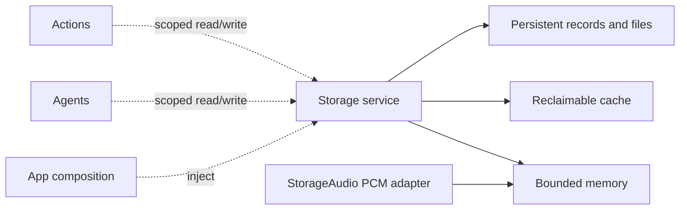

# Storage — Shared Local Storage

Purpose: provide one project-wide home for transient and durable data used by multiple domains. Storage concerns ownership, lifetime, capacity and retrieval. Agents decide what is worth remembering; ModelKit produces media/model values; PlatformKit operates devices. Storage does not perform inference, choose Actions or control hardware.

## Design goals

- Offer a common identity and ownership model for audio, images, attachments, documents and memory records. Each item has an opaque ID, namespace, originating scope and an explicit lifetime policy.
- Distinguish **memory** (process-local and bounded), **cache** (reclaimable, optionally disk-backed) and **persistent** (retained until explicit deletion or a documented retention rule). A disk cache does not promise durable memory.
- Make byte/item limits, expiry, rejection, deletion, cancellation and shutdown explicit. Active readers need leases so expiry cannot remove data mid-consumption; no accepted device Action may disappear silently.
- Keep storage values independent of ModelKit media types and SwiftUI. Domain adapters convert audio frames, images or structured memories at the boundary. App assembles and injects one service where sharing is required.
- Persist large media as bounded files with metadata/indexes rather than forcing all bytes into a database row. A future database may support durable metadata and memory queries; no engine or third-party library is selected yet.

## Staged boundary

✅ The Foundation-only `Storage` target implements `BoundedMemoryStream` and `MemoryLeaseStore`. Both are actor-isolated, bounded process-local primitives with explicit overflow failure, single-reader/checkout behavior, scoped owners, cancellation and expiry. `StorageAudio` under [Audio](Audio/README.md) adapts the production PCM cache; App injects one instance into synthesis and playback. No third-party package is required.

❌ Reclaimable disk cache, persistent media and memory records require concrete consumers, retention rules and separate verification. The general primitives do not yet coordinate global byte budgets across namespaces; each instance supplies an explicit item and byte bound.

❌ Decide on-disk layout, schema migration, retention and backup rules with their first concrete use cases. Keep secrets in the existing credential store and model weights in the existing resource system; this module is not a replacement for either.
