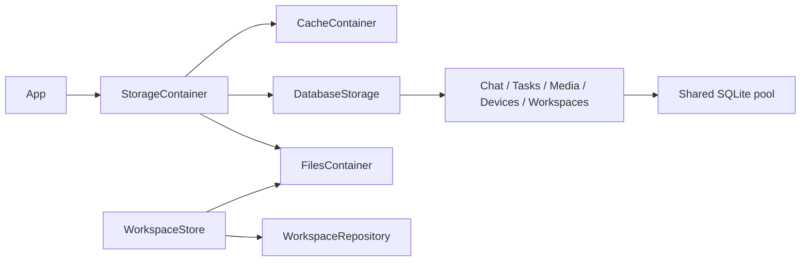

# Storage — Cache / Database / Files

## Responsibilities and boundaries

Storage provides temporary bytes, structured persistence and confined filesystem capabilities. App owns
construction, paths, dependency injection and lifecycle. Storage never imports Agents, Actions, Gateway,
UI, PlatformKit or ModelKit, and does not decide model work, scheduling, rendering or user messages.

## Direct relationships and internal design

| Owner | Interface and downstream relationship |
| --- | --- |
| StorageContainer | Composes CacheContainer, DatabaseStorage and FilesContainer; App starts/stops it |
| StorageCore | Root StorageFailure and Support contracts: IDs, classified snapshots, gates and errors; no project dependencies |
| StorageCache | CacheContainer entry, immutable byte leases, namespaced buffers and audio scopes; depends on Core |
| StorageFiles | Generic documents, controlled paths, bytes and directories; depends on Core |
| StorageDatabase | Database lifecycle/ports and Workspaces file/index coordination; consumes domain contracts and Files |
| StorageChat / StorageTasks | Conversation rounds, requests, summaries and delegation contracts; Chat consumes Tasks |
| StorageMedia / StorageDevices | Media publication and device records; Media consumes Files |
| StorageSQLite | Table-owned public contracts and GRDB operations selected by explicit sources, cross-table transactions and one shared pool; implements all database ports |

## Lifecycle and data flow

Construction creates no directories or database. Start prepares Files and opens/recovers the database
before publishing ports. Failure retains original and cleanup errors. Stop closes admission, joins
startup and in-flight work, closes Cache/Files and shuts down the database; repeated stops join the
same result. Existing handles reject new work after closure. App stops consumers before storage.
SQLite uses WAL, FULL synchronization, foreign keys, four readers, one writer plus sixteen waiting
writes and at most sixty-four admitted operations. Overflow fails explicitly; failed persistence never
becomes memory-only success. Recovery records interrupted facts and never replays model/device work.

## Persistence contracts

[Database](Database/README.md) owns eleven domain tables. Assistant conversations, foreground tasks and complete messages are independent of Writer workspaces and delegation/message records; only communication and request logging are shared. Raw rounds survive task summary projection. Full HTTP request/response bytes (including SSE and images), parameters and generation metadata live in deletable logs. Clearing logs preserves business messages and results; lists/context do not load Base64. Schema 20261110/20261111 migrates transactionally to the request-only message schema with independent Writer execution records; the previously approved clean reset applies only to older formats. Current versions reopen normally and future versions are rejected. Credentials and models are outside this database.

[Workspaces](Database/WriterWorkspaces/README.md) coordinates current filesystem source and SQL metadata. Writer-owned selection atomically binds a delegation to one workspace without moving existing messages; Storage validates persistence constraints without choosing the work from natural language.
No source body or historical file version is stored in SQLite. [Files](Files/README.md) owns generic
atomic replacement and sandbox checks. Media files remain independent of conversation deletion.
[Cache](Cache/README.md) owns temporary buffers; [Support](Support/README.md) owns reusable contracts.

## Observation and failure reporting

StorageCore snapshots expose classified lifecycle, admission and resource facts without opening files,
creating directories or accessing repositories. Unknown backend state remains unknown. No public
snapshot pretends several backends were atomically sampled. StorageFailureReporter is an injected
Sendable callback; App connects it to diagnostics. It never interprets business errors or changes the
throwing result. StorageFailure preserves underlying errors, cancellation and cleanup errors separately.

Camera photos use the dedicated [Image cache](Cache/Image/README.md), with a separate session budget and FIFO lifecycle. Explicit save publishes original bytes and independent album media_N metadata through MediaStore while the session copy remains until eviction/window close. Memory-only preview numbers belong to Camera. Storage neither chooses model attachments nor persists preview counters. History reads images only from captured request logs; clearing logs removes those images without a live-cache or album fallback. Camera album rows contain no preview/session association and are read by media_N.

Database root owns core connection/lifecycle/schema assembly. Shared owns neutral encoding, identity and paging mechanisms. Each Agent has independent history ports and projections, with logs and communication injected separately. Each table directory owns its contracts, records, SQL and recovery; Package.swift preserves SQL-free contract targets and the GRDB implementation target.

## Agent 数据区域

[Database](Database/README.md) 的十表分为 Assistant 私有对话/前台任务/完整消息、Writer 委托入口与子消息/workspace/文件索引，以及通用通信、HTTP logs、相册和设备。Database 根目录拥有核心机制与装配，Shared 拥有共用业务；各业务表目录拥有自身 schema、record、repo、恢复和业务操作。旧格式清空初始化，无兼容表或迁移；当前版本正常重开保留数据。

WriterMessages 同时拥有委托入口与子消息，WriterWorkspaces 仅拥有文件与 workspace 元数据。开发格式重置在数据库发布前清理 App 显式传入的 Writer 文件根，失败阻止启动；当前版本重开不清理。

Assistant input coordination is additive message evidence; input source, classification and batch membership are persisted separately from the single generated response. Current schema upgrade preserves existing data. See [Assistant messages](Database/AssistantMessages/README.md).

AssistantMessages 将每次请求的完整业务输入与原始输入分开保存在同一消息行；完整回复与请求文本不依赖可清理的模型日志。字段与兼容读取见 [AssistantMessages](Database/AssistantMessages/README.md)。

Assistant/Writer message 表只持有实际发起的模型请求；准备阶段不建行，Writer 委托由独立 writer_executions 表拥有。来源和已采用的协调决策随请求保存，discard 不持久化。
