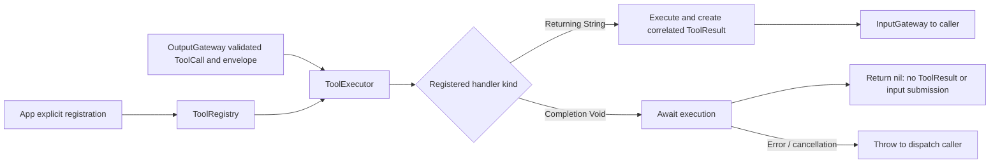

# ToolRuntime — Direct Tool Execution

Purpose: register and execute resolved ToolCalls without Channel scheduling. Design goals: trusted handler selection, awaited completion, cancellation and explicit feedback semantics. Dependencies remain AgentCore only.

✅ register registers data-returning handlers; registerCompletion registers Void handlers with the trusted OutputEnvelope for session/source checks. Names share one registry and duplicates fail across both kinds. Call arguments cannot select no-feedback behavior. Agent JSON still declares the tool path/parameters; its doc states completion semantics. App chooses the explicit implementation.

✅ ToolExecutor.execute(call,envelope:) returns optional ToolResult. A returned empty String is still a normal result; nil means completion-only success. Ordinary data-tool errors retain callID in ToolResult. Unknown paths return an error result. Completion-tool errors propagate; cancellation propagates for both kinds. No error is silently converted to successful completion.

✅ ToolDispatcher submits only non-nil results through InputGateway. No feedback is constructed for successful completion tools. No Channel queue, detached work, separate waiting queue or automatic replay is introduced. The caller awaits actual handler completion; a sequential output consumer serializes its Tool calls.
❌ Dedicated timeouts, resource budgets, latest-pending replacement and native model tool-argument streaming remain outstanding.
