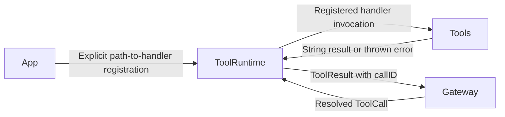

# ToolRuntime — Tool Registration and Execution

ToolRuntime executes resolved Tool Calls directly, following architecture section 31. It does not parse model output, resolve Agent-local aliases, or schedule GhostShell Channels.

## Direct relationships

Gateway's ToolDispatcher submits the result through InputGateway to the originating Agent and session. ToolRuntime uses injected handlers and has no compile-time dependency on concrete Tools.

## Implementation status

- ✅ `ToolRegistry.swift`: actor-isolated handler registration and lookup; duplicate registration fails.
- ✅ `ToolExecutor.swift`: executes a handler and wraps success, unknown-tool failure, or thrown error as ToolResult while preserving callID.
- ✅ Gateway feedback through InputGateway using the existing AgentInput contract.
- ❌ Dedicated execution timeouts, resource budgets, and unified result Signals.
- ❌ End-to-end model-native tool argument streaming and full JSON Schema support; these also require changes in ModelKit and AgentCore.

`ToolResult` is declared in AgentCore/Output because Agent inputs use it too. Moving its declaration here would introduce a dependency cycle. This runtime reuses that contract instead of defining a duplicate type.

## Maintenance

Keep this README synchronized with changes to responsibilities, files, interfaces, and implementation status. ✅ means implemented; ❌ means planned or incomplete. Do not create unused placeholder modules. The [technical architecture](../README.md) defines the target; the [layout audit](../../docs/Repository-Structure.md) records implementation exceptions.
