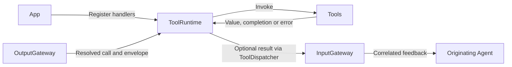
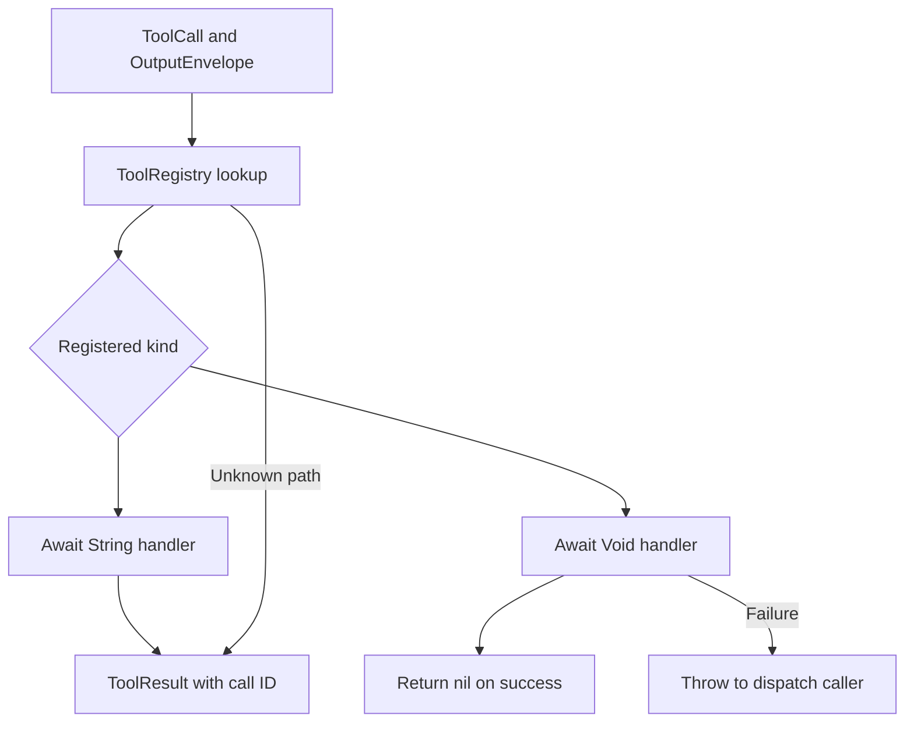

# ToolRuntime — Direct Tool Execution

Registers and executes resolved ToolCalls. The goal is explicit completion and feedback without Channel scheduling. This target depends only on AgentCore.

## Directory structure

```text
ToolRuntime/
├── ToolRegistry.swift  # Actor-owned handlers; rejects duplicate paths
├── ToolExecutor.swift  # Execute and select result or completion semantics
└── README.md           # Module contract and status
```

## Upstream and downstream

Arrows show runtime calls through handlers injected by App; ToolRuntime does not import Tools.



## Internal flow



App selects the handler kind; call arguments cannot select feedback behavior. A returned empty String still creates a result. Returning-handler errors become error results; completion-handler errors throw. Cancellation throws for both kinds. ToolDispatcher sends only non-nil results through InputGateway.

There is no execution queue, replay or automatic serialization of independent callers. The App output consumer awaits calls in order. Actor isolation protects registry access, not handler execution. The registry has no numeric entry cap; production uses a fixed App registration list.

## Feature status

- ✅ Shared path namespace, duplicate rejection, returning and completion-only handlers.
- ✅ Correlated feedback, awaited completion and cancellation propagation.
- ❌ Runtime timeouts, resource budgets, generic pending-call replacement and registry entry limits.

## Issue record

| Status | Issue / next step |
| --- | --- |
| Open | A non-cooperative handler can delay its caller; no timeout is enforced. |
