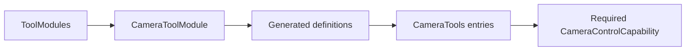

# Camera Tool Support

Purpose: bind explicit entries to the host camera capability. Design goals: required typed injection, no discovery and no owned device/session state.

✅ CameraToolModule defines three completion-only handlers. CameraControlCapability exposes setEnabled and flip with opaque ToolInvocation correlation. CameraControlError reports foreground, busy, disabled, permission and availability failures. No queue or platform dependency.

❌ No fallback camera, permission bypass, native Tool transport or device readiness claim.
