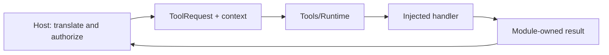

# Tools Contracts

Purpose: define the public inputs, metadata, capabilities and results owned by Tools. Design goals: independent execution, explicit host context and bounded values.

✅ `ToolRequest`, `ToolExecutionContext` and `ToolResource` belong to this module. Context contains opaque source/session/input/correlation identifiers and sequence; it carries no Agent input, output envelope, permissions or resource lease. The host validates identity and acquires resources before execution.

✅ Definitions and attached macros describe explicitly registered handlers. Arguments are decoded locally. ToolResponse preserves call identity; completion-only handlers return no response. ToolPoseOverlay validates the presentation payload without Agent types.

✅ No dependency on AgentCore, Gateway, App, UI or the other behavior module. These contracts compile inside `Tools`; no shared-contract package is introduced. Platform/model capabilities may be consumed by implementations when needed.

❌ Cross-process serialization and durable execution replay are not provided.
