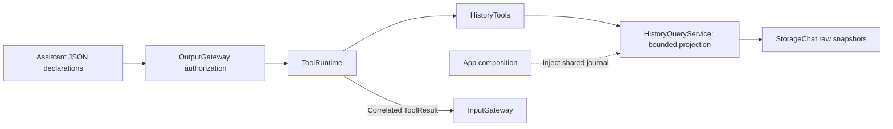

# History Tools

Purpose: expose conversation discovery, record previews and explicit archive-only deletion through the existing output boundary. Design goals: shared deterministic queries, bounded results, explicit truncation and no effect replay.

| Entry | Arguments (strings) | Result |
| --- | --- | --- |
| History.list | offset 0–64, limit 1–5 | Current conversation first, then newest archives; IDs, ISO-8601 timestamps, archive flag, summary/latest-input previews and turn counts |
| History.delete | Archived conversation UUID | Deleted UUID acknowledgment; current/missing IDs fail; fixed internal memory permission only |
| History.read | conversation UUID, offset 0–256, limit 1–2 | Oldest-first turn previews with IDs and generation state |

Both return JSON pages with items, total and optional nextOffset (absent at end). Preview fields contain value and truncated. List title/input previews use 40 UTF-8 bytes; read user/response previews use 80/160 bytes, preserving whole characters. These are bounded previews, not full export or semantic retrieval. Each call reads a fresh snapshot; pagination is not a stable cross-call transaction.

✅ Arguments are required, unknown keys reject, and cancellation is checked before/after query. Encoded results above 1800 bytes fail resultTooLarge; callers can request a smaller page. Missing IDs fail notFound. Credentials, request prompts, Tool arguments/results and model settings are excluded. Raw response text is data, never parsed or replayed.

✅ Tools depends on StorageChat for the concrete query implementation. Runtime and BehaviorAssembly retain their independent contracts; no new store, queue or Agent is added. See [Support](Support/README.md).

✅ Refresh and confirmed deletion use the memory Agent intent route. ❌ Full-text export/search, archival, title inference and model result-driven continuation remain pending. Cloud native calls can invoke these Tools; local chat remains text-only. Current Assistant presents escaped Tool results without continued model reasoning.

✅ History.delete uses an injected HistoryMutationCapability. HistoryMutationService validates the archive against the shared journal and invokes its atomic transaction; Tools owns no UI or model effect. It returns a small JSON acknowledgment only after persistence succeeds. Cancellation before the transaction prevents the call; later cancellation cannot undo a committed write. No automatic retry or missing-ID success fallback.

❌ Assistant JSON exposes only read-only list/read; deletion is not model-callable in this stage.
