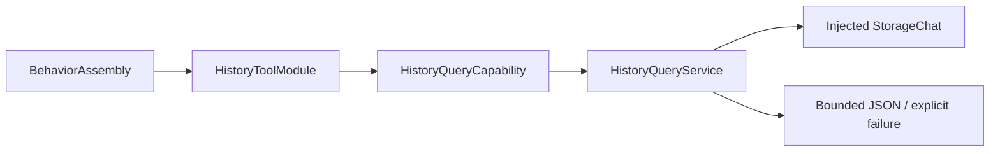

# History Tool Support

Purpose: own capability injection, registration, query projection and domain failures. Design goals: explicit host binding, read-only storage use and bounded transport values.

✅ HistoryToolModule binds two returning handlers. HistoryQueryCapability permits isolated implementations; production uses HistoryQueryService with the same ConversationHistoryStore as Assistant/history UI. The service validates pagination independently, projects only requested entries and bounds encoded results. Storage owns persistence; Tools owns query/presentation-independent preview policy.

✅ No new asynchronous queue, cache, device action, inference or UI dependency. Read operations retain the existing StorageChat 16-waiter bound and overflow policy.

❌ No implicit store construction, unbounded/full record result, automatic result-size retry or stable pagination snapshot.
