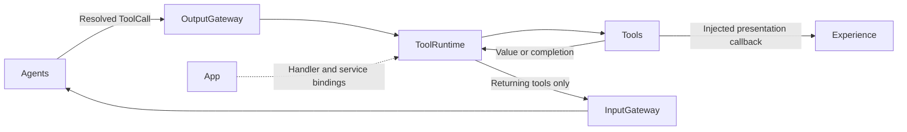
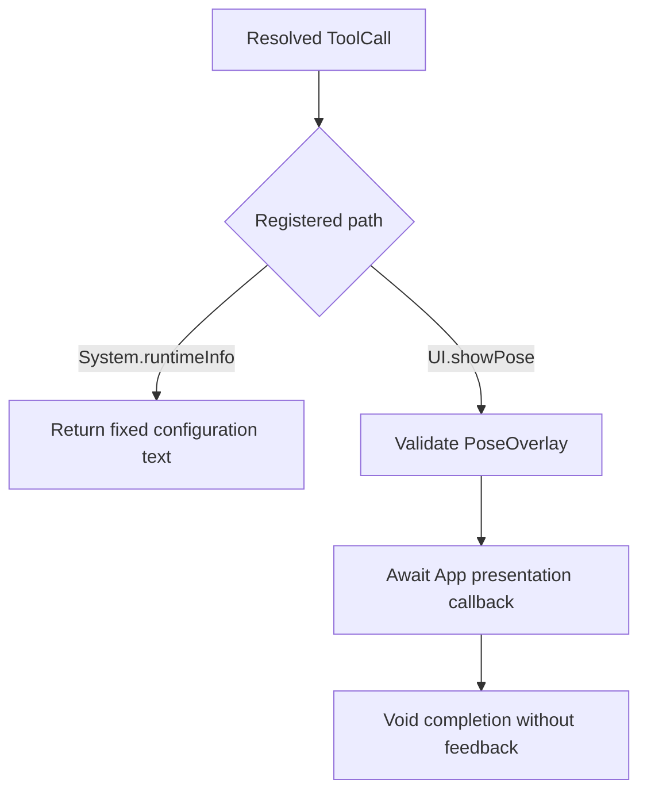

# Tools — Callable Functions

Implements functions reached through ToolCalls. The goal is reusable behavior with explicit results or completion. Tools depends only on AgentCore; App injects any presentation or device service.

## Directory structure

```text
Tools/
├── System/RuntimeInfo.swift  # Fixed configuration description
├── UI/ShowPose.swift         # Validate and replace the skeleton overlay
└── README.md                # Module boundary and status
```

## Upstream and downstream

Arrows show runtime flow through App-supplied handlers.



## Internal flow



`System.runtimeInfo` is a configuration description, not a live health probe. `UI.showPose` accepts at most 3000 UTF-8 bytes and six COCO-17 skeletons; an empty people list clears the display. App validates session and frame order. Completion means display state was accepted, not that a screen frame was rendered.

Tools owns no queue and bypasses Channel scheduling. VisionPerception retains the latest pending skeleton before dispatch. Tool failures remain observable; no Tool sends results directly to an Agent.

## Feature status

- ✅ [System](System/README.md): fixed runtime information.
- ✅ [UI](UI/README.md): bounded skeleton display as a completion-only Tool.
- ❌ Search, storage, network, memory and other model/device tools.
- ❌ Live model/device health reporting.

## Issue record

| Status | Issue / next step |
| --- | --- |
| Open | Measure skeleton presentation latency on a physical device. |
| Resolved — 2026-09-27 audit | Included UI alongside System and documented both feedback modes. |
